# Alta magia

[← Wiki KodeX](README.md)

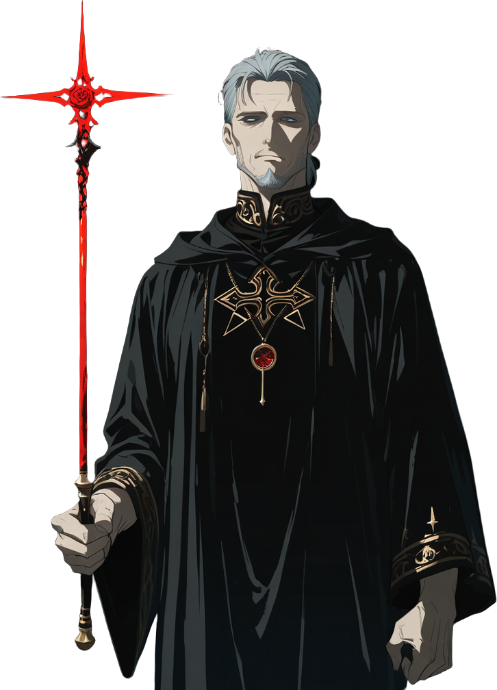

**Campeão no torneio:** Silas Ashcombe — *O Magus do Triângulo*

## Identidade do deck

**Controle e invocação.** O mago cerimonial não luta: traça o círculo, abre o grimório, chama o espírito pelo nome e o obriga a servir. O deck joga assim — poucas Entidades baratas e quase nenhuma sem efeito; os Selos são **banimentos e sigilos** (`counter` em Ritos e em uma Entidade inimiga — três contadores no total, o teto —, Solve et Coagula recolhendo o que morre, o Sigilo de Spare esquecido na mesa até arrancar uma carta da mão inimiga); os Ritos são **grimórios e palavras de poder** (`search`, `gain_fe` com compra, `bounce` em massa, um único golpe direto com Abrahadabra) e **conjurações** (Elementais ×2); as Relíquias são **instrumentos históricos** (Anel de Salomão, Sigillum Dei Aemeth, Pedra de Visão de Dee) que dão corpo ao mago e aos espíritos. O plano é sobreviver aos primeiros turnos negando e devolvendo, acumular Fé (Azoth: +1 máxima, +1 agora, compra 1) e fodder (Homúnculos, Elementais), e então **selar o pacto**: Astaroth e Dantalion entram com **Sacrifício 1** e viram o jogo — Dantalion rouba a melhor Entidade inimiga (`swap_control`), Astaroth revela; Paimon, o Rei, chega sem pacto e traz a hoste que paga os pactos seguintes. As duas Lendárias fecham a partida de lados opostos da Árvore: o **Anjo Guardião Sagrado** (Guarda, Renascer, cura) é a muralha que o deck de controle quer no turno 7; **Babalon** (Sacrifício 1, 5/6) cresce a cada morte em qualquer campo, bebendo o sangue dos santos.

O deck é fraco em dano de área (só Abrahadabra e Andras removem algo, e ambos têm limites) e em pressão inicial — contra agressão rápida depende de Orobas, dos Selos e do bounce. Sinergias internas: Vassago busca Selos; Kelley busca Relíquias; Homúnculo e Elementais são Sacrifício que ainda paga (Último Sopro, Solve et Coagula); Marbas e Anel de Salomão silenciam para que Dantalion roube corpos sem efeitos perigosos. Diálogo com o Abismo: Babalon e o Anjo são as duas faces da travessia (quem cruza Daath ou se dissolve em Choronzon ou verte-se na Taça); o deck não inclui o Conjunto do Abismo, mas quem trocar 4 cartas por ele achará aqui Fé e Selos para proteger as peças.

**24 cartas distintas · 32 no deck**

## Entidades

<a href="cartas/alt_homunculo.md">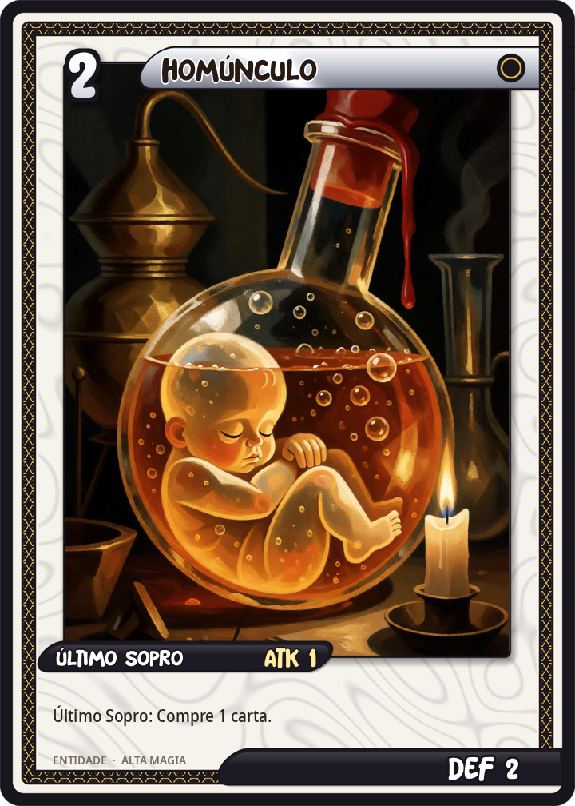</a> <a href="cartas/alt_edward_kelley.md">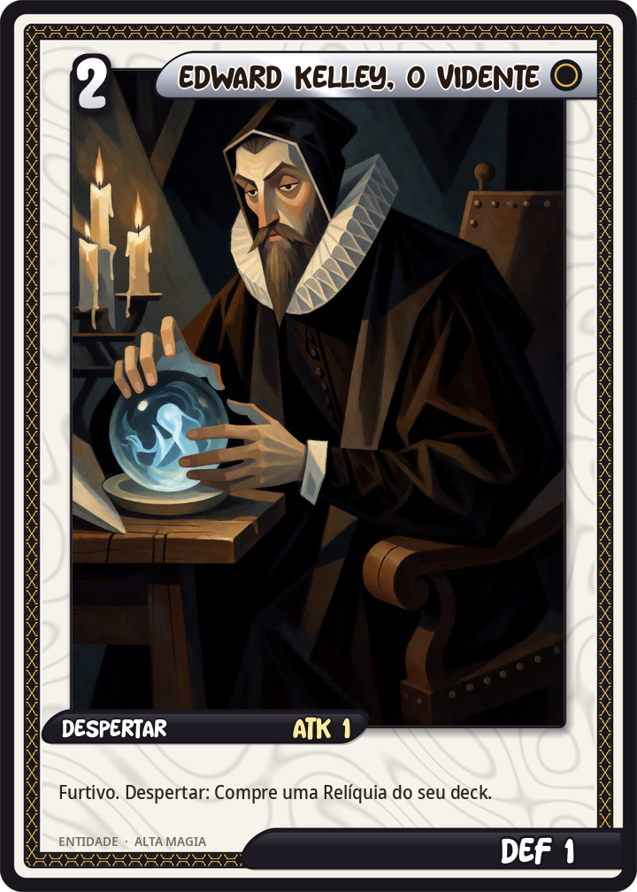</a>  

  <a href="cartas/alt_marbas.md">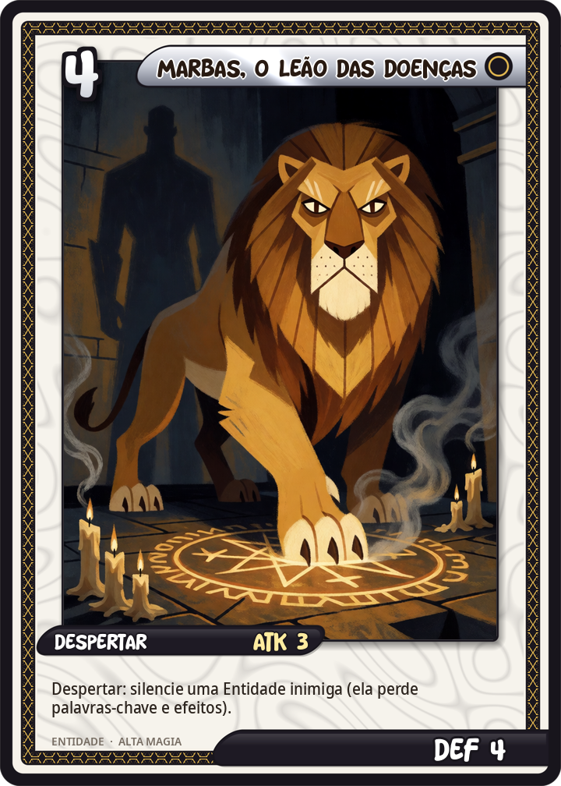</a> 

<a href="cartas/alt_dantalion.md">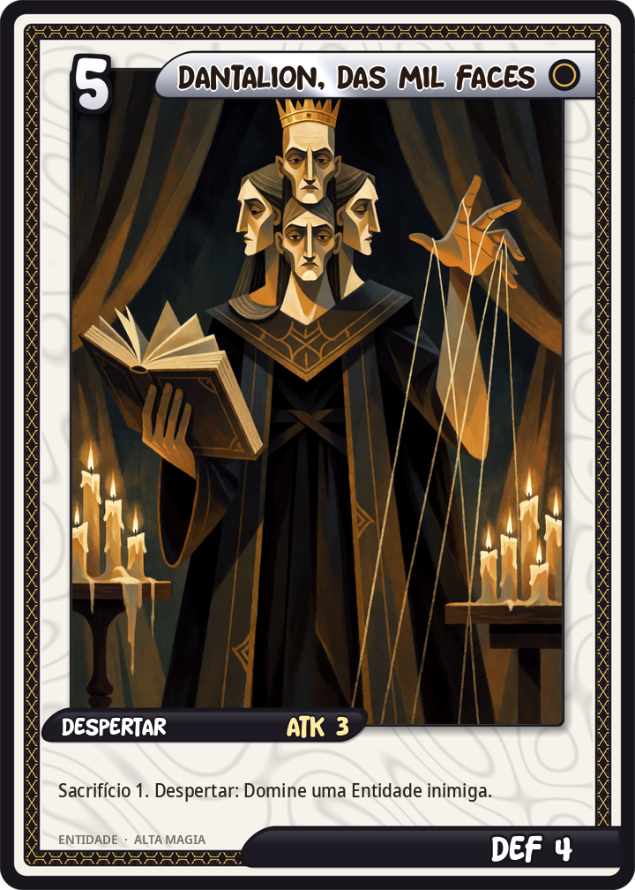</a>   <a href="cartas/alt_anjo_guardiao.md">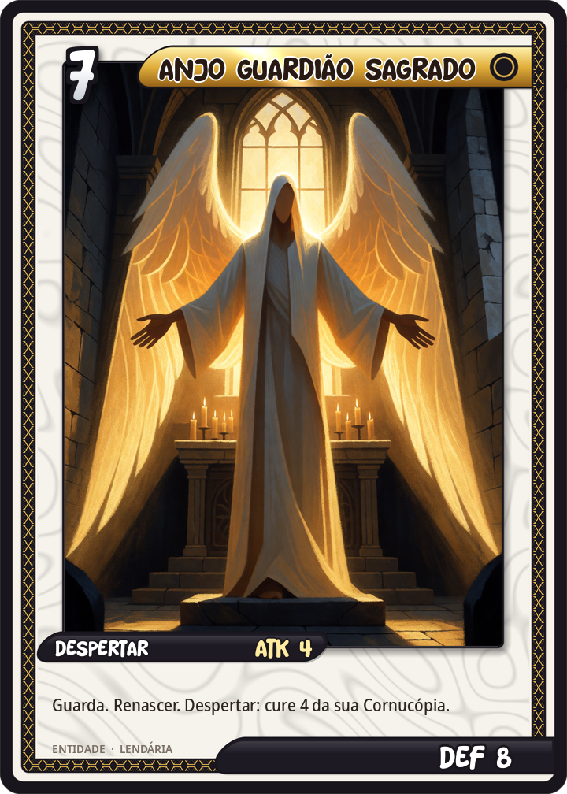</a>

| Carta | Atributos | Texto |
|---|---|---|
| [Homúnculo](cartas/alt_homunculo.md) ×2 | Entidade · custo 2 · ATK 1 / DEF 2 | Último Sopro: compre 1 carta. |
| [Edward Kelley, o Vidente](cartas/alt_edward_kelley.md) | Entidade · custo 2 · ATK 1 / DEF 1 | Furtivo. Despertar: busque uma Relíquia do seu deck. |
| [Silfo](cartas/alt_silfo.md) | Entidade · custo 2 · ATK 1 / DEF 2 | Ímpeto. Furtivo. |
| [Vassago, o Príncipe que Acha](cartas/alt_vassago.md) ×2 | Entidade · custo 3 · ATK 2 / DEF 3 | Despertar: busque um Selo do seu deck. |
| [Orobas, o Príncipe Fiel](cartas/alt_orobas.md) | Entidade · custo 3 · ATK 1 / DEF 4 | Guarda. No início do seu turno, Orobas cura 2 de Vida de si mesmo. |
| [Andras, o Semeador de Discórdia](cartas/alt_andras.md) | Entidade · custo 4 · ATK 3 / DEF 2 | Despertar: destrua uma Entidade inimiga de custo 3 ou menos. |
| [Marbas, o Leão das Doenças](cartas/alt_marbas.md) | Entidade · custo 4 · ATK 3 / DEF 4 | Despertar: silencie uma Entidade inimiga (ela perde palavras-chave e efeitos). |
| [Astaroth, o Duque Revelador](cartas/alt_astaroth.md) | Entidade · custo 4 · ATK 3 / DEF 5 | Sacrifício 1. Despertar: compre 2 cartas. |
| [Dantalion, das Mil Faces](cartas/alt_dantalion.md) | Entidade · custo 5 · ATK 3 / DEF 4 | Sacrifício 1. Despertar: tome o controle permanente de uma Entidade inimiga. |
| [Paimon, Rei do Oeste](cartas/alt_paimon.md) | Entidade · custo 6 · ATK 4 / DEF 5 | Despertar: invoque dois Espíritos de Paimon 1/1. |
| [Babalon, a Mulher Escarlate](cartas/alt_babalon.md) | Entidade · custo 6 · ATK 5 / DEF 6 · **Lendária** | Sacrifício 1. Sempre que qualquer Entidade morrer, Babalon ganha +1/+1 permanente. |
| [Anjo Guardião Sagrado](cartas/alt_anjo_guardiao.md) | Entidade · custo 7 · ATK 4 / DEF 8 · **Lendária** | Guarda. Renascer. Despertar: cure 4 da sua Cornucópia. |

## Selos

<a href="cartas/alt_pentagrama_flamejante.md">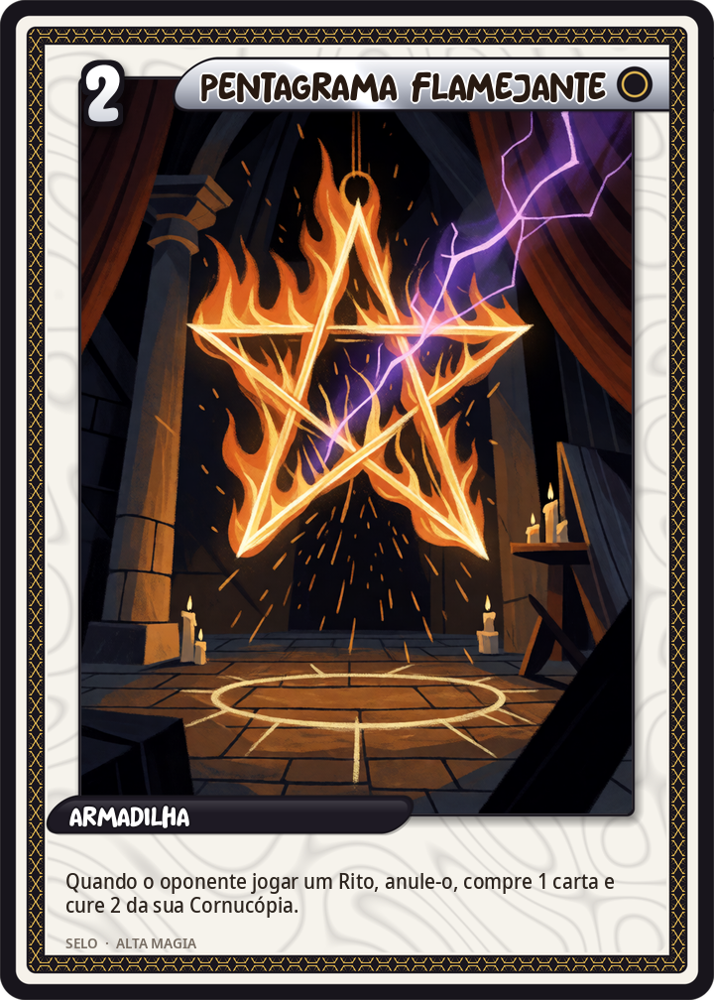</a>  <a href="cartas/alt_solve_et_coagula.md">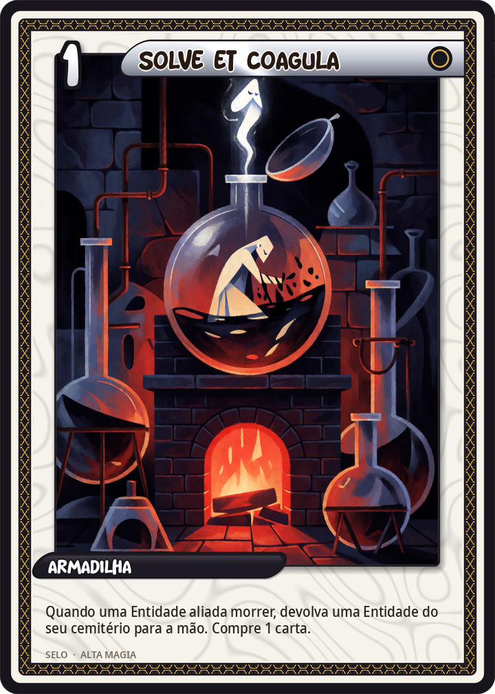</a> <a href="cartas/alt_sigilo_de_spare.md">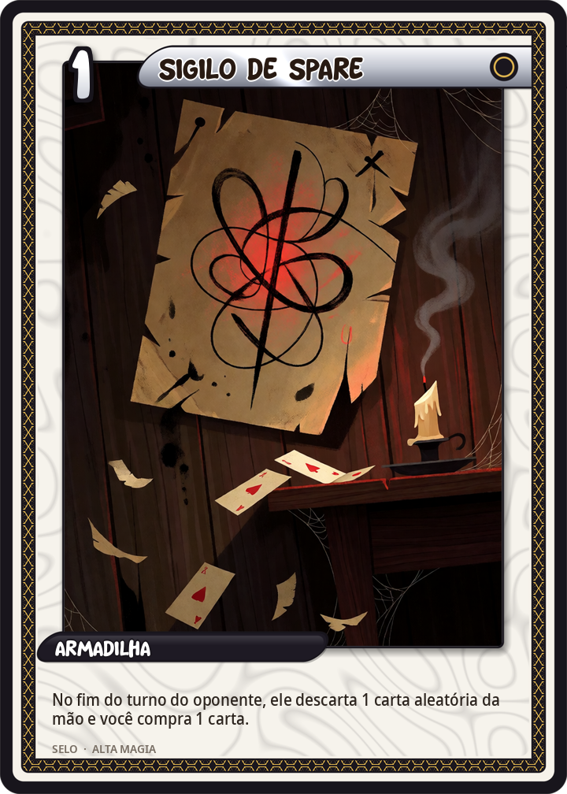</a>

| Carta | Atributos | Texto |
|---|---|---|
| [Pentagrama Flamejante](cartas/alt_pentagrama_flamejante.md) ×2 | Selo · custo 2 | Quando o oponente jogar um Rito, anule-o, compre 1 carta e cure 2 da sua Cornucópia. |
| [Selo de Salomão](cartas/alt_selo_de_salomao.md) | Selo · custo 3 | Quando o oponente invocar uma Entidade, anule-a (ela vai ao cemitério) e compre 1 carta. |
| [Solve et Coagula](cartas/alt_solve_et_coagula.md) ×2 | Selo · custo 1 | Quando uma Entidade aliada morrer no turno do oponente, devolva uma Entidade do seu cemitério à mão e compre 1 carta. |
| [Sigilo de Spare](cartas/alt_sigilo_de_spare.md) | Selo · custo 1 | No fim do turno do oponente, ele descarta 1 carta aleatória da mão e você compra 1 carta. |

## Ritos

<a href="cartas/alt_lemegeton.md">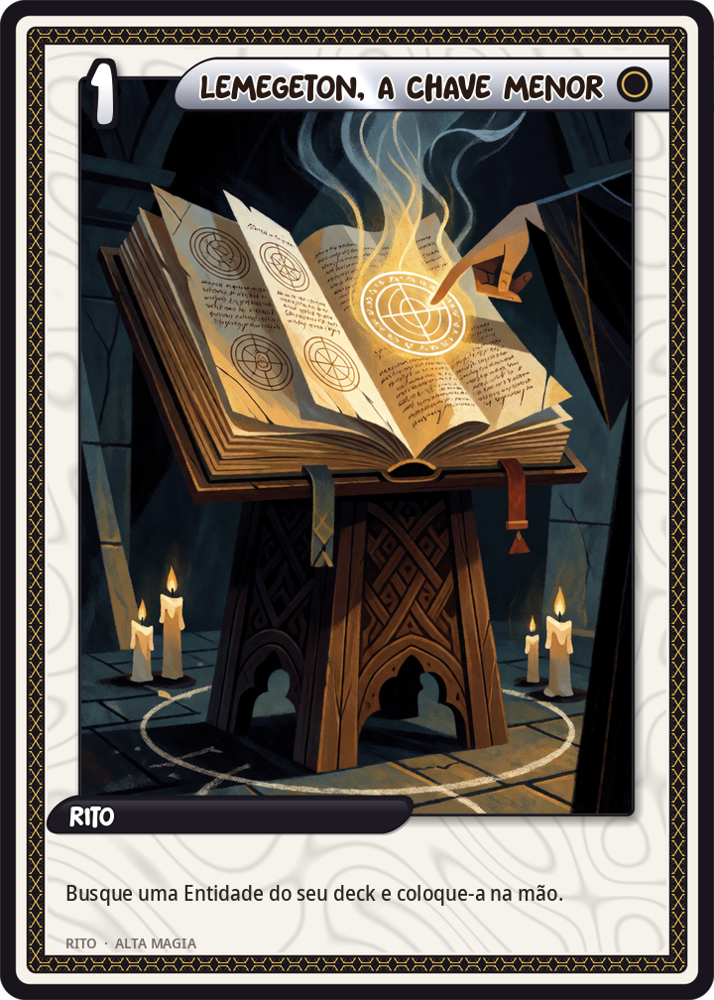</a>  <a href="cartas/alt_conjuracao_elementais.md">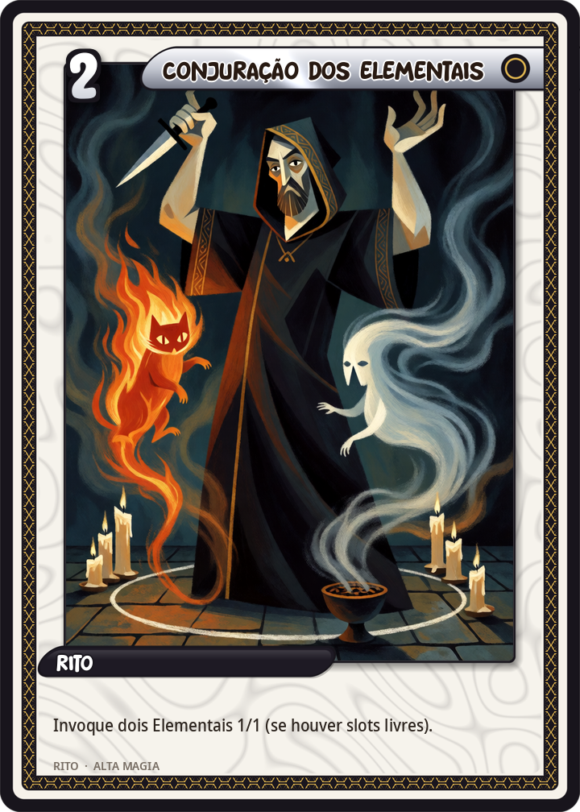</a> 

| Carta | Atributos | Texto |
|---|---|---|
| [Lemegeton, a Chave Menor](cartas/alt_lemegeton.md) ×2 | Rito · custo 1 | Busque uma Entidade do seu deck e coloque-a na mão. |
| [Azoth](cartas/alt_azoth.md) ×2 | Rito · custo 3 | Sua Fé máxima aumenta em 1 (até 8). Ganhe 1 de Fé neste turno. Compre 1 carta. |
| [Conjuração dos Elementais](cartas/alt_conjuracao_elementais.md) ×2 | Rito · custo 2 | Invoque dois Elementais 1/1 (se houver slots livres). |
| [Ritual Menor do Pentagrama](cartas/alt_ritual_menor_pentagrama.md) | Rito · custo 4 | Devolva todas as Entidades inimigas à mão do dono. |
| [Abrahadabra](cartas/alt_abrahadabra.md) | Rito · custo 3 | Cause 3 de dano à Cornucópia inimiga. |

## Relíquias

 <a href="cartas/alt_sigillum_dei_aemeth.md">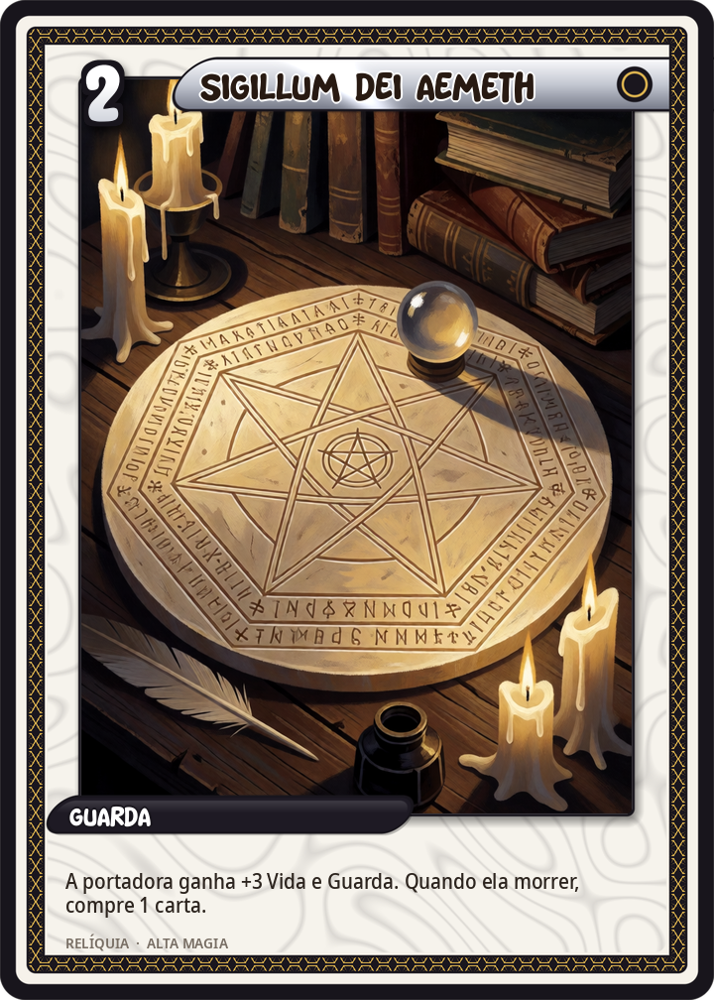</a> <a href="cartas/alt_pedra_de_visao.md">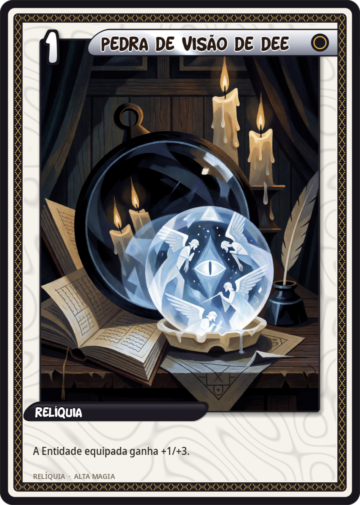</a>

| Carta | Atributos | Texto |
|---|---|---|
| [Anel de Salomão](cartas/alt_anel_de_salomao.md) | Relíquia · custo 2 | A Entidade equipada ganha +1/+2 e Ímpeto. Sempre que ela atacar, silencie uma Entidade inimiga. |
| [Sigillum Dei Aemeth](cartas/alt_sigillum_dei_aemeth.md) | Relíquia · custo 2 | A Entidade equipada ganha +0/+3 e Guarda. Quando ela morrer, compre 1 carta. |
| [Pedra de Visão de Dee](cartas/alt_pedra_de_visao.md) ×2 | Relíquia · custo 1 | A Entidade equipada ganha +1/+3. |
