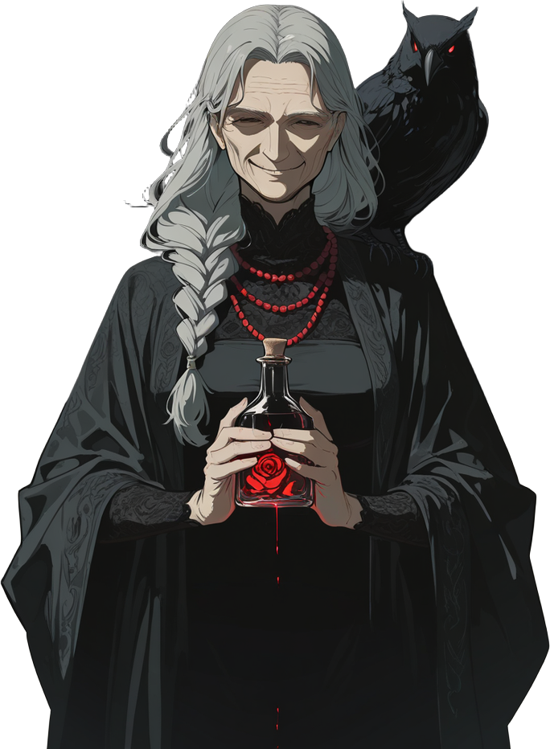
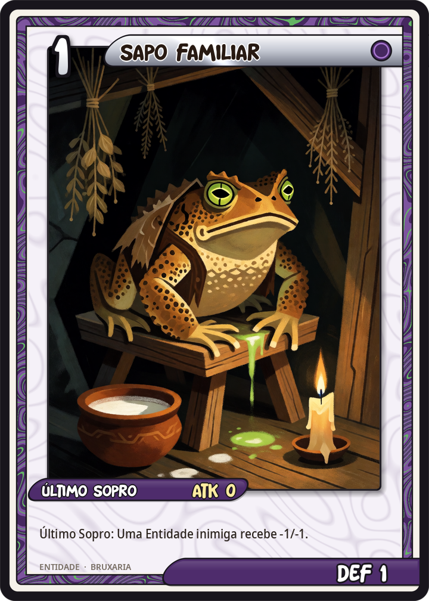
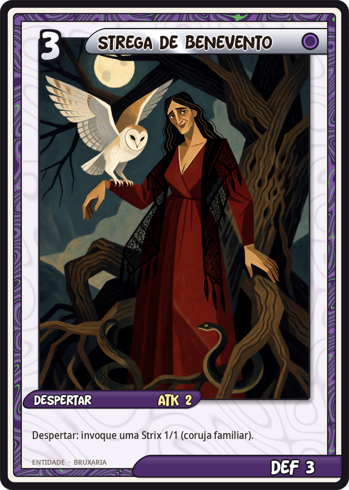
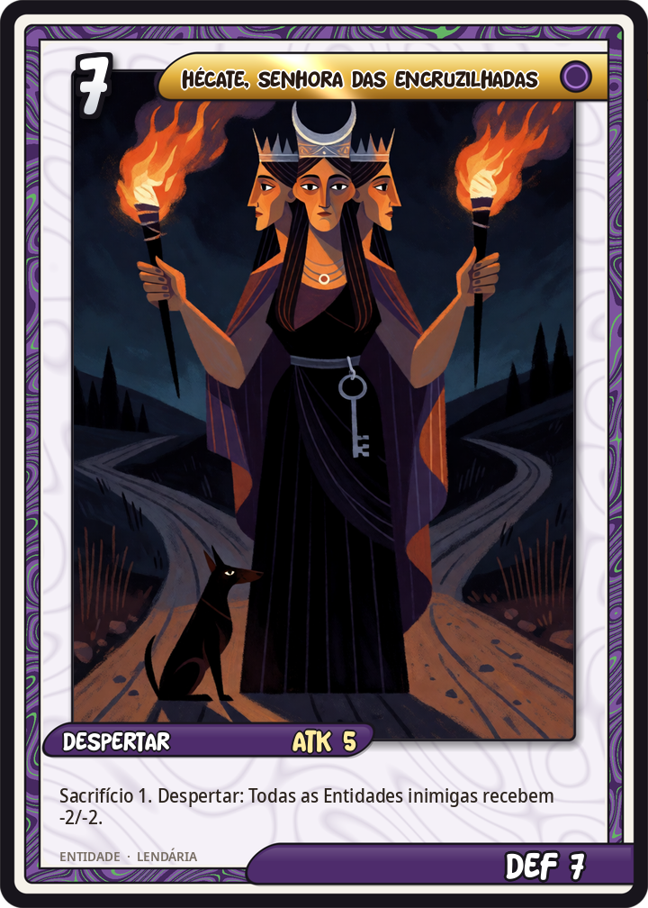
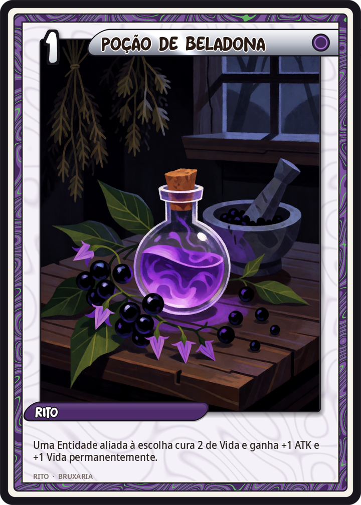

# Bruxaria

[← Wiki KodeX](README.md)

**Campeão no torneio:** Ilka Wrona — *A Bruxa da Encruzilhada*

## Identidade do deck

**Maldições e familiares.** O deck de bruxaria não vence pela força bruta das Entidades: vence encolhendo o oponente. Quase tudo o que ele faz ao inimigo é *reduzir* — `buff` negativo permanente (Malefício, Medeia, Sapo, Hécate), `freeze` (Benandante, Mau-Olhado), `silence` (Malefício), `set_stats` (Circe transforma em porco), `discard` na mão (o olho-gordo do Corvo, Pó de Ossos, Garrafa de Bruxa). Os Selos são **malefícios armados**: a Entidade que o oponente invoca já entra congelada e diminuída; o dano feito a uma aliada volta pelo Boneco de Cera; o Rito inimigo é anulado pela Garrafa. Por outro lado, o próprio campo da bruxa é povoado de **familiares** pequenos e numerosos (Gato Preto com sete vidas, Sapo, Corvo, as Strix da Strega, as Lebres do Sabá, os Corvos da Morrigan): são pontos de ATK baratos, protegem a Cornucópia de ataque direto e — sobretudo — são **moeda de pacto**: Baba Yaga e Hécate exigem Sacrifício 1, e a morte de um familiar ainda dispara efeitos (Último Sopro do Sapo, Corvo da Morrigan — mas **não** Renascer: Sacrifício conta como morte sem acionar Renascer, então o Gato Preto sacrificado não volta).

As **poções** são Ritos baratos de buff/cura (Poção de Beladona), o **Sabá** é o único buff coletivo (`all_ally_entities`), e o **Pacto na Encruzilhada** acelera a Fé para chegar às Entidades grandes. O deck quase não cura a Cornucópia (nenhum efeito de `heal` nela) e não tem **Guarda**: a defesa é fazer o inimigo bater fraco, não absorver. Fraquezas deliberadas: pouco dano direto (sem `damage` à Cornucópia), Entidades médias de corpo modesto, dependência de ter familiares em campo para pagar o Sacrifício. Contra decks de uma Entidade grande, Circe/Baba Yaga/Malefício resolvem; contra enxames de tokens o deck sofre (só Pó de Ossos e Hécate limpam área).

**25 cartas distintas · 32 no deck**

## Entidades

   

   

   

| Carta | Atributos | Texto |
|---|---|---|
| [Sapo Familiar](cartas/bru_sapo_familiar.md) | Entidade · custo 1 · ATK 0 / DEF 1 | Último Sopro: uma Entidade inimiga à escolha perde 1 ATK e 1 Vida permanentemente. |
| [Gato Preto](cartas/bru_gato_preto.md) ×2 | Entidade · custo 2 · ATK 1 / DEF 1 | Furtivo. Renascer. *(Sete vidas: quando morre, volta à sua mão uma vez.)* |
| [Corvo Agourento](cartas/bru_corvo_agourento.md) | Entidade · custo 2 · ATK 1 / DEF 2 | Despertar: o oponente descarta 1 carta aleatória da mão. |
| [Strega de Benevento](cartas/bru_strega_de_benevento.md) | Entidade · custo 3 · ATK 2 / DEF 3 | Despertar: invoque uma Strix 1/1 (coruja familiar). |
| [Benandante](cartas/bru_benandante.md) ×2 | Entidade · custo 3 · ATK 2 / DEF 3 | Despertar: congele uma Entidade inimiga à escolha (ela não ataca no próximo turno). |
| [Circe](cartas/bru_circe.md) | Entidade · custo 4 · ATK 3 / DEF 3 | Despertar: uma Entidade inimiga à escolha vira porco — seu ATK e sua Vida passam a ser 1/1. |
| [Medeia, a Envenenadora](cartas/bru_medeia.md) | Entidade · custo 4 · ATK 3 / DEF 4 | Despertar: uma Entidade inimiga à escolha perde 2 ATK permanentemente. |
| [A Bruxa de Endor](cartas/bru_bruxa_de_endor.md) | Entidade · custo 4 · ATK 2 / DEF 4 | Furtivo. Despertar: devolva uma Entidade do seu cemitério à sua mão. |
| [Baba Yaga](cartas/bru_baba_yaga.md) | Entidade · custo 5 · ATK 3 / DEF 5 | Sacrifício 1. Despertar: devore uma Entidade inimiga à escolha (destrua-a). |
| [Cerridwen, Senhora do Caldeirão](cartas/bru_cerridwen.md) | Entidade · custo 5 · ATK 4 / DEF 4 | Despertar: compre 2 cartas. |
| [A Morrigan](cartas/bru_a_morrigan.md) | Entidade · custo 6 · ATK 5 / DEF 5 · **Lendária** | Ímpeto. Sempre que uma Entidade — aliada ou inimiga — morrer, invoque um Corvo 1/1. |
| [Hécate, Senhora das Encruzilhadas](cartas/bru_hecate.md) | Entidade · custo 7 · ATK 5 / DEF 7 · **Lendária** | Sacrifício 1. Despertar: todas as Entidades inimigas perdem 2 ATK e 2 Vida permanentemente. |

## Selos

   

| Carta | Atributos | Texto |
|---|---|---|
| [Mau-Olhado](cartas/bru_mau_olhado.md) ×2 | Selo · custo 1 | Quando o oponente invocar uma Entidade, ela fica congelada e perde 1 ATK e 1 Vida permanentemente. |
| [Círculo de Sal](cartas/bru_circulo_de_sal.md) ×2 | Selo · custo 2 | Quando uma Entidade inimiga atacar, devolva-a à mão do dono; o oponente descarta 1 carta aleatória e você compra 1. |
| [Garrafa de Bruxa](cartas/bru_garrafa_de_bruxa.md) | Selo · custo 2 | Quando o oponente jogar um Rito, anule-o; o oponente descarta 1 carta aleatória. |
| [Boneco de Cera](cartas/bru_boneco_de_cera.md) | Selo · custo 3 | Quando uma Entidade aliada sofrer dano de um ataque, o atacante sofre 4 de dano e perde 2 ATK e 2 Vida permanentemente. |

## Ritos

   

 

| Carta | Atributos | Texto |
|---|---|---|
| [Poção de Beladona](cartas/bru_pocao_de_beladona.md) ×2 | Rito · custo 1 | Uma Entidade aliada à escolha cura 2 de Vida e ganha +1 ATK e +1 Vida permanentemente. |
| [Pacto na Encruzilhada](cartas/bru_pacto_na_encruzilhada.md) | Rito · custo 1 | Ganhe 2 de Fé temporária (só neste turno). |
| [Seiðr](cartas/bru_seidr.md) | Rito · custo 1 | Busque uma Entidade do seu deck e ponha-a na mão. Embaralhe. |
| [Pó de Ossos](cartas/bru_po_de_ossos.md) | Rito · custo 2 | Todas as Entidades inimigas sofrem 2 de dano; o oponente descarta 1 carta aleatória. |
| [Malefício](cartas/bru_maleficio.md) ×2 | Rito · custo 3 | Uma Entidade inimiga à escolha perde 3 ATK e 2 Vida permanentemente e é silenciada (perde palavras-chave e habilidades). |
| [Sabá de Walpurgis](cartas/bru_saba_de_walpurgis.md) | Rito · custo 4 | Todas as Entidades aliadas ganham +1 ATK e +1 Vida permanentemente. Invoque uma Lebre 1/2. |

## Relíquias

  

| Carta | Atributos | Texto |
|---|---|---|
| [Vassoura](cartas/bru_vassoura.md) ×2 | Relíquia · custo 1 | A portadora ganha +1 ATK e +2 Vida e Ímpeto. |
| [Livro das Sombras](cartas/bru_livro_das_sombras.md) | Relíquia · custo 2 · Usos 4 | Usos 4. A portadora ganha +1 ATK e +1 Vida enquanto o porta. Sempre que ela atacar, compre 1 carta e gaste 1 Uso. |
| [Caldeirão de Renascimento](cartas/bru_caldeirao_de_renascimento.md) | Relíquia · custo 3 | A portadora ganha +1 ATK e +2 Vida. Quando ela morrer, reviva uma Entidade do seu cemitério para o campo. |
