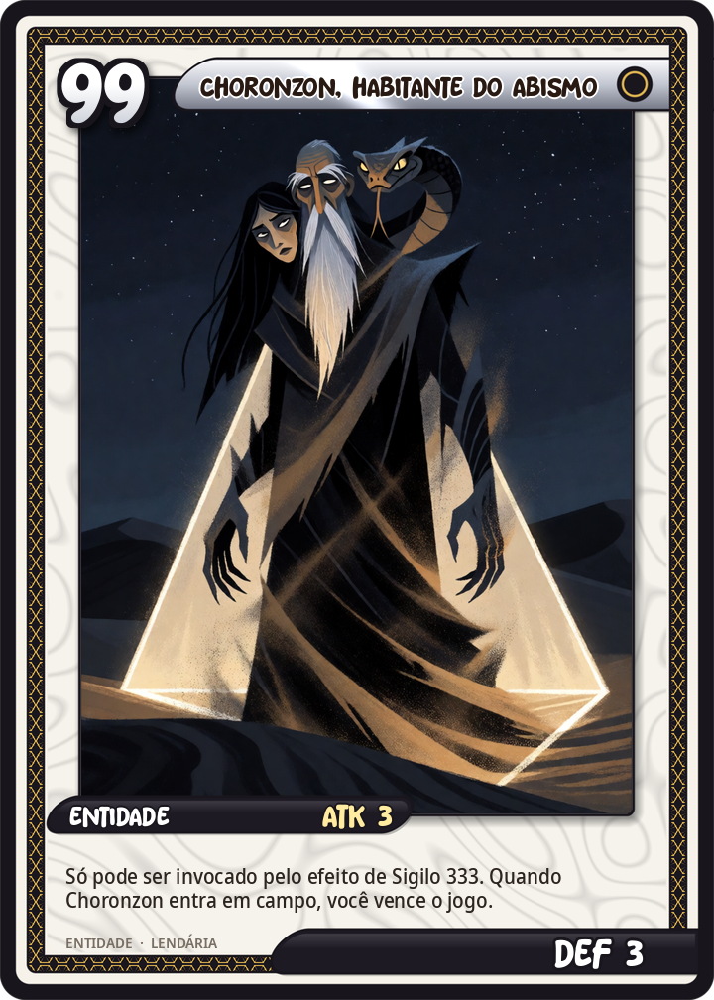
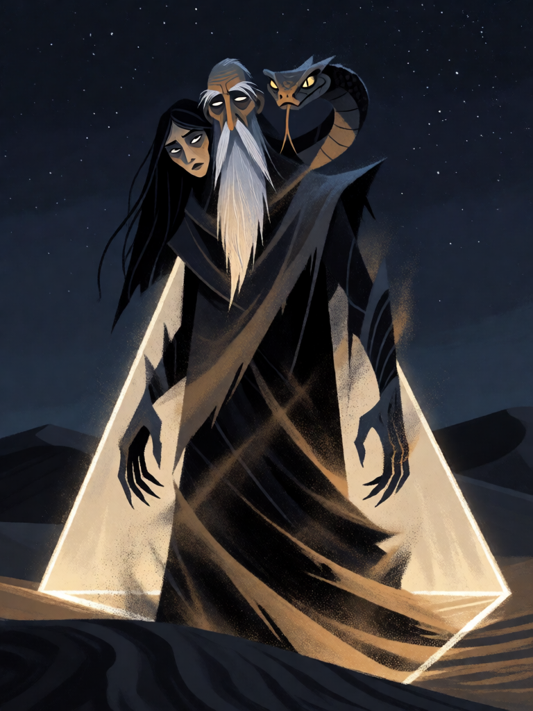

# Choronzon, Habitante do Abismo

[← Conjunto do Abismo](../abismo.md) · [Wiki KodeX](../README.md) · [Triângulo da Arte ▶](aby_triangulo.md)

| Carta | Arte |
|---|---|
|  |  |

| | |
|---|---|
| **Tradição** | Conjunto do Abismo |
| **Tipo** | Entidade |
| **Custo de Fé** | — (só por ritual) |
| **ATK / DEF** | 3 / 3 |
| **Palavras-chave** | — |
| **Lendária** | sim |
| **Cópias no deck** | 1 |
| **Id** | `aby_choronzon` |

## Texto da carta

> Só pode ser invocado pelo efeito de Sigilo 333. Quando Choronzon entra em campo, você vence o jogo.

**EN — Choronzon, Dweller in the Abyss:** *Can only be summoned by Sigil 333. When Choronzon enters the field, you win the game.*

## Contexto mitológico

Choronzon aparece primeiro nos diários enochianos de John Dee e Edward Kelley (1580s) como *Coronzon*, nome que os anjos dão ao "grande inimigo" — o diabo expulso do Éden. Fica adormecido por três séculos até Aleister Crowley, que o transforma na figura central da travessia do Abismo: o vazio entre os sefirot inferiores e os três supernos da Árvore da Vida, onde a personalidade se dissolve.

Em dezembro de 1909, no deserto perto de Bou Saâda (Argélia), Crowley e Victor Neuburg invocam o 10º Aethyr, ZAX. Neuburg permanece dentro de um círculo traçado na areia; Crowley entra no triângulo da arte. Segundo *The Vision and the Voice*, Choronzon se manifesta trocando de forma — uma mulher que Neuburg amara, uma serpente, o próprio Crowley, um velho — tenta persuadir o escriba a sair do círculo, apaga parte da linha com areia e o ataca. É repelido com a adaga ritual e o nome de Deus.

Seu número é **333**: dispersão, a mente que se despedaça, "o único verdadeiro inimigo". Não é um demônio que se derrota — é o que acontece a quem o invoca sem estar pronto. Por isso a carta não ataca nem defende: se chegou à mesa, o jogo acabou.

## Papel no jogo

Condição de vitória alternativa (o "Exódia" do Gods Kodex). Fora do balanceamento por decisão de design: o custo está em juntar as 4 cartas do Conjunto do Abismo e pagar 7 Fé em turnos separados enquanto o oponente vê as peças no campo.

## Atributos visuais

demônio mutante de corpo de areia em redemoinho, em pé dentro de um triângulo brilhante · exatamente três rostos fundindo-se na cabeça: mulher, velho e serpente · manto esfarrapado de areia · deserto noturno estrelado

Balanço (conta de custo)

Fora do orçamento por definição. Contra-jogo: destruir a portadora do Triângulo da Arte (a Relíquia vai ao cemitério) ou forçar o disparo do Círculo de Proteção antes do Sigilo.

Ficha completa: `cartas/abismo/01_choronzon.md` · cartas base da versão Alpha
