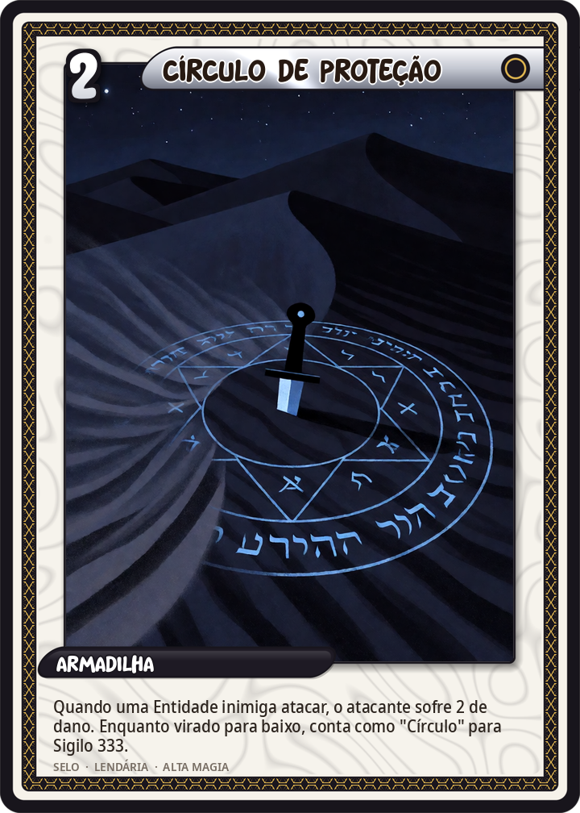
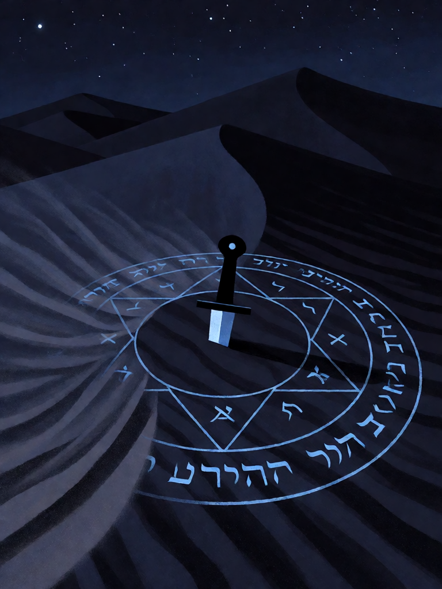

# Círculo de Proteção

[← Conjunto do Abismo](../abismo.md) · [Wiki KodeX](../README.md) · [◀ Triângulo da Arte](aby_triangulo.md) · [Sigilo 333 ▶](aby_sigilo.md)

| Carta | Arte |
|---|---|
|  |  |

| | |
|---|---|
| **Tradição** | Conjunto do Abismo |
| **Tipo** | Selo |
| **Custo de Fé** | 2 |
| **Palavras-chave** | — |
| **Lendária** | sim |
| **Cópias no deck** | 1 |
| **Id** | `aby_circulo` |

## Texto da carta

> Quando uma Entidade inimiga atacar, o atacante sofre 2 de dano. Enquanto virado para baixo, conta como "Círculo" para Sigilo 333.

**EN — Circle of Protection:** *When an enemy Entity attacks, the attacker takes 2 damage. While face down, counts as "Circle" for Sigil 333.*

## Contexto mitológico

O círculo mágico é a fronteira entre o operador e o que ele evoca. Na *Goetia* tem nove pés de diâmetro, com os nomes divinos e os nomes dos sefirot escritos na banda externa; na tradição da Golden Dawn é traçado com a adaga ou a varinha, sempre no sentido do sol. Sair do círculo durante a evocação é a falha clássica — e exatamente o que Choronzon tenta provocar.

Em Bou Saâda, Neuburg ficou dentro do círculo de areia com a adaga mágica. Choronzon, com conversa, apagou parte da linha com areia e se atirou sobre ele; Neuburg o repeliu e refez o círculo. A carta é um Selo porque o círculo é passivo até ser testado: só revela sua força quando algo tenta atravessá-lo.

## Papel no jogo

Peça 2 do ritual. Como qualquer Selo, o oponente sabe que há algo virado para baixo — e pode atacar de propósito com uma Entidade descartável para gastá-lo antes do Sigilo.

## Atributos visuais

círculo mágico brilhante na areia, anéis concêntricos · letras hebraicas e sigilos · adaga ritual cravada no centro · parte da linha sendo apagada pela areia ao vento · vista de cima

Balanço (conta de custo)

P = 5 (+1 Selo) = 6. Gasto: 2 de dano ao atacante = 2. Deliberadamente fraco.

Ficha completa: `cartas/abismo/03_circulo_de_protecao.md` · cartas base da versão Alpha
