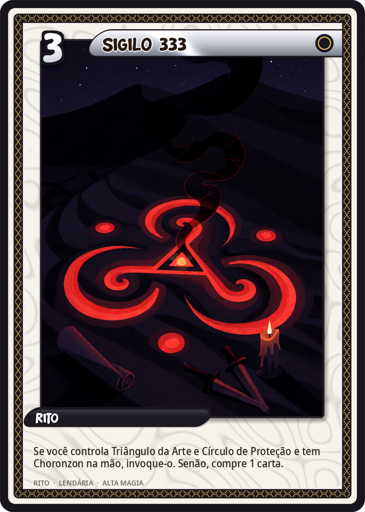
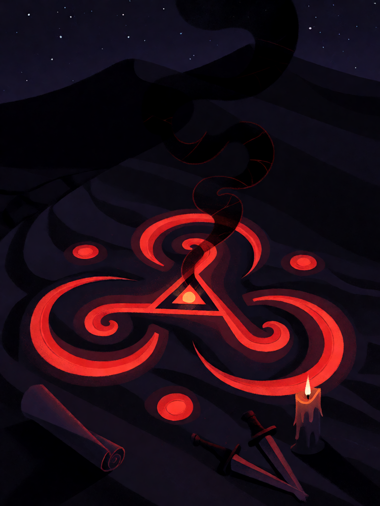

# Sigilo 333

[← Conjunto do Abismo](../abismo.md) · [Wiki KodeX](../README.md) · [◀ Círculo de Proteção](aby_circulo.md)

| Carta | Arte |
|---|---|
|  |  |

| | |
|---|---|
| **Tradição** | Conjunto do Abismo |
| **Tipo** | Rito |
| **Custo de Fé** | 3 |
| **Palavras-chave** | — |
| **Lendária** | sim |
| **Cópias no deck** | 1 |
| **Id** | `aby_sigilo` |

## Texto da carta

> Se você controla Triângulo da Arte e Círculo de Proteção e tem Choronzon na mão, invoque-o. Senão, compre 1 carta.

**EN — Sigil 333:** *If you control Triangle of Art and Circle of Protection and have Choronzon in hand, summon it. Otherwise, draw 1 card.*

## Contexto mitológico

333 é o número de Choronzon na gematria de Crowley (*Liber 777*; *The Vision and the Voice*, 10º Aethyr). É a metade de 666 — a Besta inteira contra a dispersão pela metade — e o número da "mente falsa", o tagarelar que impede o silêncio. No ZAX, Choronzon fala sem parar; cada frase é uma tentativa de dispersar a atenção de quem o ouve.

Um sigilo, na magia cerimonial, é a assinatura gráfica de um espírito: traçá-lo e vibrar o nome é chamá-lo. Este Rito é o ato de pronunciar o nome com as peças no lugar. Sem as peças, é só um rabisco na areia — e o mago volta ao livro (compra 1 carta).

## Papel no jogo

Peça 3 e gatilho do ritual. Jogar sem as condições não é desperdício total (compra 1), o que permite "fingir" um Conjunto para forçar o oponente a gastar remoção.

## Atributos visuais

sigilo oculto gravado em vermelho na areia escura, simetria tríplice · três glifos idênticos de linhas em brasa entrelaçados · fumaça negra em espiral subindo · ferramentas rituais espalhadas · vista de cima

Balanço (conta de custo)

P = 7. Sem as condições: comprar 1 = 1,5 (deliberadamente fraco). Com as condições: vitória — fora do orçamento por definição.

Ficha completa: `cartas/abismo/04_sigilo_333.md` · cartas base da versão Alpha
