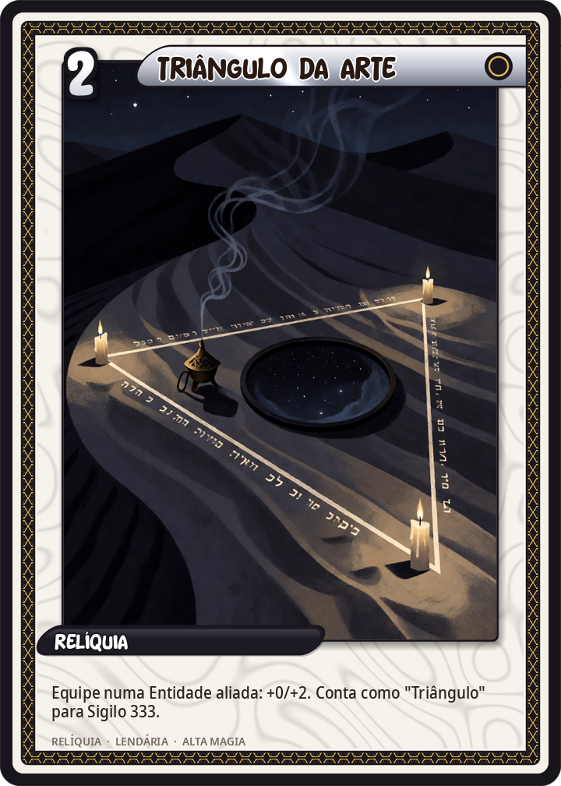
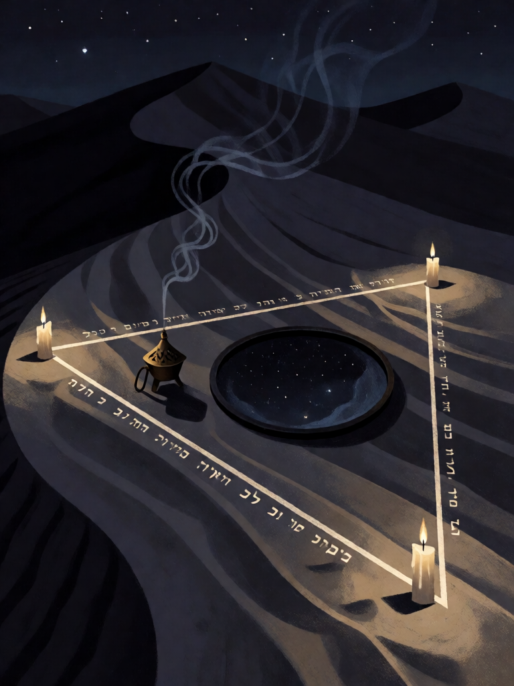

# Triângulo da Arte

[← Conjunto do Abismo](../abismo.md) · [Wiki KodeX](../README.md) · [◀ Choronzon, Habitante do Abismo](aby_choronzon.md) · [Círculo de Proteção ▶](aby_circulo.md)

| Carta | Arte |
|---|---|
|  |  |

| | |
|---|---|
| **Tradição** | Conjunto do Abismo |
| **Tipo** | Relíquia |
| **Custo de Fé** | 2 |
| **Palavras-chave** | — |
| **Lendária** | sim |
| **Cópias no deck** | 1 |
| **Id** | `aby_triangulo` |

## Texto da carta

> Equipe numa Entidade aliada: +0/+2. Conta como "Triângulo" para Sigilo 333.

**EN — Triangle of Art:** *Equip to an allied Entity: +0/+2. Counts as "Triangle" for Sigil 333.*

## Contexto mitológico

O Triângulo da Arte (ou Triângulo de Salomão) é o espaço, fora do círculo do mago, onde o espírito evocado é obrigado a se manifestar. Na *Goetia* (Lemegeton, séc. XVII) ele é desenhado a dois pés do círculo, com os nomes Tetragrammaton, Primeumaton e Anaphaxeton nos lados e "Michael" dividido nos vértices; dentro dele fica o espelho negro ou o incensório.

Na operação de Bou Saâda, Crowley fez o inverso do protocolo: entrou ele mesmo no triângulo, oferecendo o próprio corpo como receptáculo para Choronzon, enquanto Neuburg guardava o círculo. Daí a carta ser uma Relíquia **equipada** numa Entidade: alguém tem que ficar dentro do triângulo.

## Papel no jogo

Peça 1 do ritual. A Entidade que a carrega vira alvo prioritário do oponente — proteger a portadora é parte do jogo do Conjunto.

## Atributos visuais

triângulo brilhante desenhado na areia do deserto · letras hebraicas ao longo dos lados · espelho negro de vidência no centro · incensário fumegante · vista de cima

Balanço (conta de custo)

P = 5 (+1 Relíquia) = 6. Gasto: +2 Vida = 2. Deliberadamente fraca: o valor é ser peça do ritual.

Ficha completa: `cartas/abismo/02_triangulo_da_arte.md` · cartas base da versão Alpha
