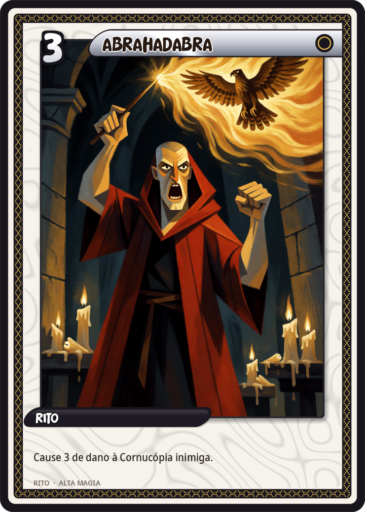
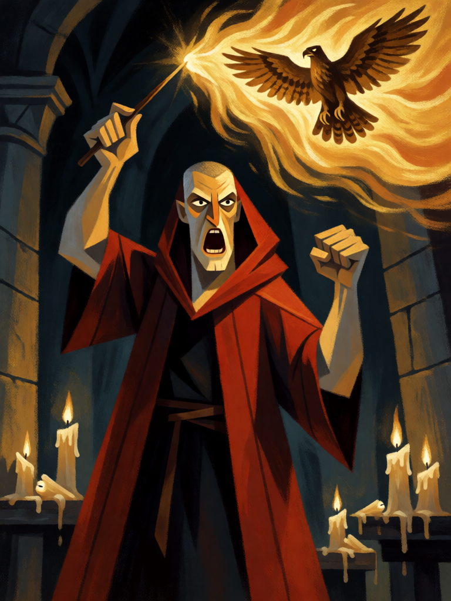

# Abrahadabra

[← Alta magia](../alta_magia.md) · [Wiki KodeX](../README.md) · [◀ Ritual Menor do Pentagrama](alt_ritual_menor_pentagrama.md) · [Anel de Salomão ▶](alt_anel_de_salomao.md)

| Carta | Arte |
|---|---|
|  |  |

| | |
|---|---|
| **Tradição** | Alta magia |
| **Tipo** | Rito |
| **Custo de Fé** | 3 |
| **Palavras-chave** | — |
| **Lendária** | não |
| **Cópias no deck** | 1 |
| **Id** | `alt_abrahadabra` |

## Texto da carta

> Cause 3 de dano à Cornucópia inimiga.

**EN — Abrahadabra:** *Deal 3 damage to the enemy Cornucopia.*

## Contexto mitológico

*Abrahadabra* é a Palavra do Aeon na Thelema. Abre o terceiro capítulo do *Liber AL vel Legis* (Cairo, abril de 1904): "Abrahadabra! a recompensa de Ra Hoor Khut" (AL III.1). Crowley a formou a partir do antigo *Abracadabra* dos amuletos (atestado em Sereno Samônico, séc. III) trocando o C pelo H — a letra de Hórus, o deus-criança do novo Aeon. A palavra tem **onze letras**, número da magia e da união do microcosmo (5) com o macrocosmo (6), e soma **418** na gematria hebraica — valor também de *Cheth* escrito por extenso (חית), da Casa de Boleskine na contagem de Crowley, e o título de *The Vision and the Voice* (Liber 418). Crowley o chama "o número da Grande Obra realizada".

Crowley a chama "a Palavra da Grande Obra realizada", a fórmula de Ra-Hoor-Khuit, o Hórus guerreiro da Estela da Revelação: "Eu sou o deus da Guerra e da Vingança" (AL III.3). Diferente das fórmulas de proteção e invocação do resto do grimório, é uma palavra de **culminação e golpe**: pronuncia-se quando a Obra está feita.

A carta é a palavra dita contra o inimigo: dano direto à Cornucópia, ignorando o campo — e a recompensa de Ra-Hoor-Khuit em forma de carta.

## Papel no jogo

Único dano direto do deck e seu finalizador: quando Babalon ou o Anjo seguraram o jogo e a Cornucópia inimiga está em 3 ou menos, Abrahadabra fecha sem precisar passar pelos bloqueadores. Antes disso é um Rito de 3 de dano que não mexe no tabuleiro — segure-o. Por 3 Fé cabe no mesmo turno de um Vassago ou de um Selo. Uma cópia, conforme a regra de que dano direto é raro e caro.

## Atributos visuais

mago adulto de manto vermelho e preto com capuz · varinha erguida na mão direita · boca aberta gritando a palavra de poder · jato de fogo dourado com silhueta de falcão (Hórus)

Balanço (conta de custo)

Orçamento P = 2·3+1 = 7 pts. Gasto: 3 de dano direto à Cornucópia (2 × 3 = 6) = 6. Dentro (P−1). Respeita o máximo de 3 de dano direto por carta.
Rodada 1 de balanceamento: era custo 4 com "compre 1" (7,5/9). O deck sofria fadiga em 34–54 % das partidas e tinha um único fecho: o fecho chega um turno antes e compra uma carta a menos.

Ficha completa: `cartas/alta_magia/28_abrahadabra.md` · cartas base da versão Alpha
