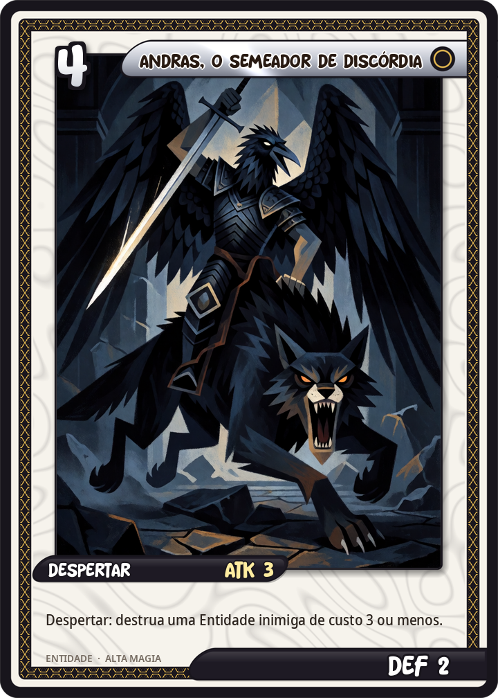
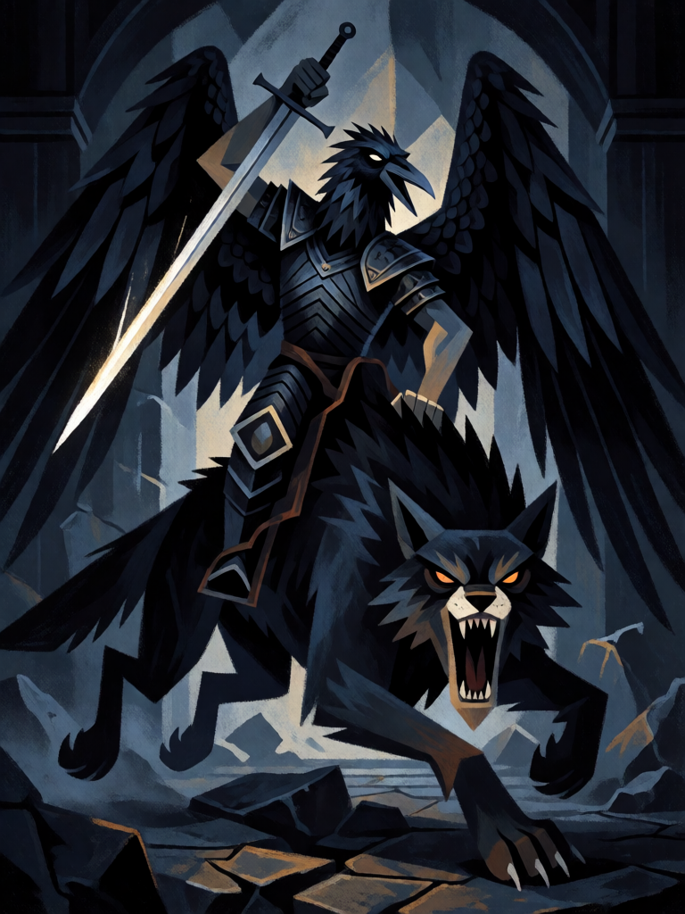

# Andras, o Semeador de Discórdia

[← Alta magia](../alta_magia.md) · [Wiki KodeX](../README.md) · [◀ Orobas, o Príncipe Fiel](alt_orobas.md) · [Marbas, o Leão das Doenças ▶](alt_marbas.md)

| Carta | Arte |
|---|---|
|  |  |

| | |
|---|---|
| **Tradição** | Alta magia |
| **Tipo** | Entidade |
| **Custo de Fé** | 4 |
| **ATK / DEF** | 3 / 2 |
| **Palavras-chave** | — |
| **Lendária** | não |
| **Cópias no deck** | 1 |
| **Id** | `alt_andras` |

## Texto da carta

> Despertar: destrua uma Entidade inimiga de custo 3 ou menos.

**EN — Andras, Sower of Discord:** *Awaken: Destroy an enemy Entity that costs 3 or less.*

## Contexto mitológico

Andras é o 63º espírito da *Ars Goetia*: um Grande Marquês que aparece com corpo de anjo e cabeça de corvo noturno (ou coruja), montado num forte lobo negro e brandindo uma espada afiada e brilhante. Seu ofício é **semear discórdias** — e a Goetia acrescenta a advertência mais dura da lista: "se o exorcista não tomar cuidado, ele o matará, e aos seus companheiros". Governa 30 legiões. Weyer (1577) repete a descrição e o aviso.

É o espírito assassino do catálogo, aquele que os grimórios recomendam evocar só com o círculo perfeitamente traçado, porque busca qualquer brecha. Collin de Plancy o desenhou exatamente assim: asas abertas, cabeça de coruja, lobo a galope, espada erguida.

A carta é a remoção pontual do deck: Andras chega e mata — mas só o pequeno (custo ≤ 2), porque a discórdia funciona nas fileiras, não contra reis. A limitação é também a mecânica do aviso: ele não serve contra o que é grande demais.

## Papel no jogo

Resposta a decks de agressão barata e média (tokens, Entidades de custo 1–3: Caipora, Vassago, Benandante, Lázaro, Lü Dongbin, Ganesha) e limpador de bloqueadores antes de um ataque. Corpo 3/2 no turno 4 — bate, mas morre fácil. Fica morto na mão contra tabuleiros só de custo alto — nesses jogos é um 3/2 vanilla; prefira Marbas.

## Atributos visuais

corpo de anjo com cabeça de corvo negro (bico longo) · asas de penas negras abertas · montado num grande lobo negro · espada brilhante erguida para golpear · armadura escura

Balanço (conta de custo)

Orçamento P = 2·4+1 = 9 pts. Gasto: ATK 3 + Vida 2 + destruir Entidade escolhida com `target_cost_max` ≤ 3 (3,5) = 8,5. Dentro (P−0,5).
Rodada 1 de balanceamento: era 3/3 com custo ≤ 2 (9,5 com a tabela §10 nova). Trocou 1 de Vida por alcance: custo ≤ 3 cobre a maioria dos corpos que travam o deck.

Ficha completa: `cartas/alta_magia/08_andras.md` · cartas base da versão Alpha
