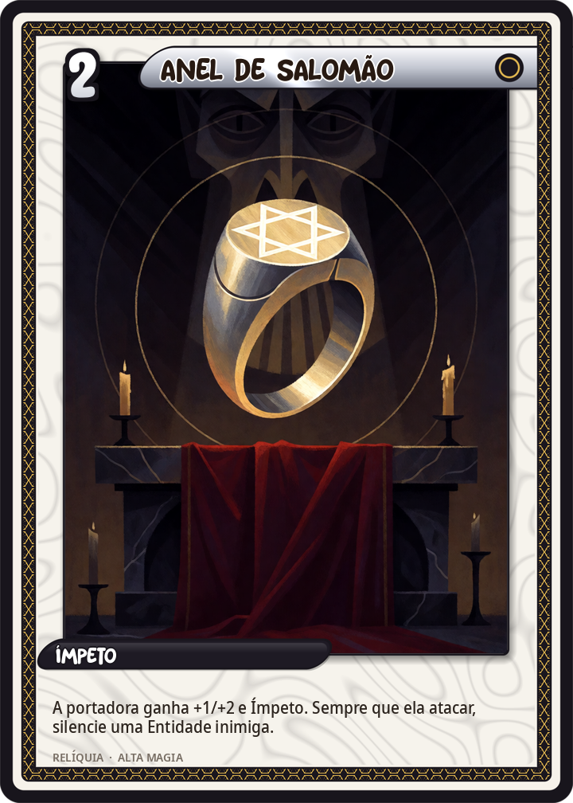
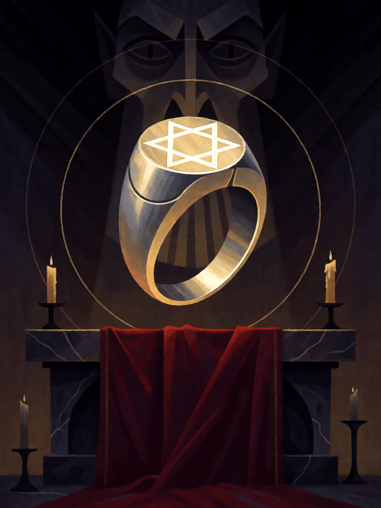

# Anel de Salomão

[← Alta magia](../alta_magia.md) · [Wiki KodeX](../README.md) · [◀ Abrahadabra](alt_abrahadabra.md) · [Sigillum Dei Aemeth ▶](alt_sigillum_dei_aemeth.md)

| Carta | Arte |
|---|---|
|  |  |

| | |
|---|---|
| **Tradição** | Alta magia |
| **Tipo** | Relíquia |
| **Custo de Fé** | 2 |
| **Palavras-chave** | — |
| **Lendária** | não |
| **Cópias no deck** | 1 |
| **Id** | `alt_anel_de_salomao` |

## Texto da carta

> A Entidade equipada ganha +1/+2 e Ímpeto. Sempre que ela atacar, silencie uma Entidade inimiga.

**EN — Ring of Solomon:** *The equipped Entity gains +1/+2 and Rush. Whenever it attacks, silence an enemy Entity.*

## Contexto mitológico

O Anel de Salomão é a relíquia fundadora da magia cerimonial. No *Testamento de Salomão* (texto grego dos séc. I–III d.C.), o rei reza pelo seu operário atormentado por um demônio, e o arcanjo Miguel desce com um anel gravado com um selo: com ele Salomão convoca Ornias, Belzebu, Asmodeu e dezenas de outros, **interroga cada um sobre seu nome, seu ofício e o anjo que o frustra**, e os põe a carregar pedra para o Templo. É a origem de toda a literatura dos catálogos de espíritos — inclusive da Goetia.

No Lemegeton, o Anel é de prata e serve para proteger o mago do hálito de Astaroth e de Beleth: "segure-o diante do rosto". Agrippa (*De occulta philosophia* I.47) discute anéis mágicos como receptáculos de virtudes planetárias; a tradição árabe faz do anel o instrumento com que Salomão comandava os djinn e o vento. Perdê-lo — como numa lenda em que um demônio o lança ao mar — é perder o reino.

A carta é o anel no dedo: quem o usa ganha a autoridade do rei (+1/+1 e Ímpeto) e, ao avançar, cala um espírito — tira-lhe o nome, o ofício, as palavras-chave.

## Papel no jogo

Silêncio repetível: cada ataque da portadora remove as habilidades de uma Entidade inimiga — Guarda, Furtivo, Último Sopro, auras — preparando o alvo para Dantalion roubar ou para Andras matar. Ímpeto deixa a portadora atacar no turno em que entra; em Vassago ou Marbas, dá um corpo que ataca e controla ao mesmo tempo. Morre com a portadora; equipe em quem o oponente não vai alcançar fácil.

## Atributos visuais

um único anel-sinete de prata flutuando sobre altar de pedra · hexagrama gravado brilhando no engaste · anéis de luz girando ao redor · rosto espectral de demônio ao fundo, de boca selada

Balanço (conta de custo)

Orçamento P = 2·2+1 = 5 pts + 1 (Relíquia) = 6. Gasto: +1 ATK / +2 Vida permanentes (3) + Ímpeto (1) + silenciar Entidade inimiga ao atacar (2, repetível mas exige ataque) = 6. Dentro.
Rodada 2 de balanceamento (pacote CA3 do Analista): +1/+1 → +1/+2 (+1,3 pp medido); a portadora precisa sobreviver ao primeiro ataque para silenciar de novo.

Ficha completa: `cartas/alta_magia/29_anel_de_salomao.md` · cartas base da versão Alpha
