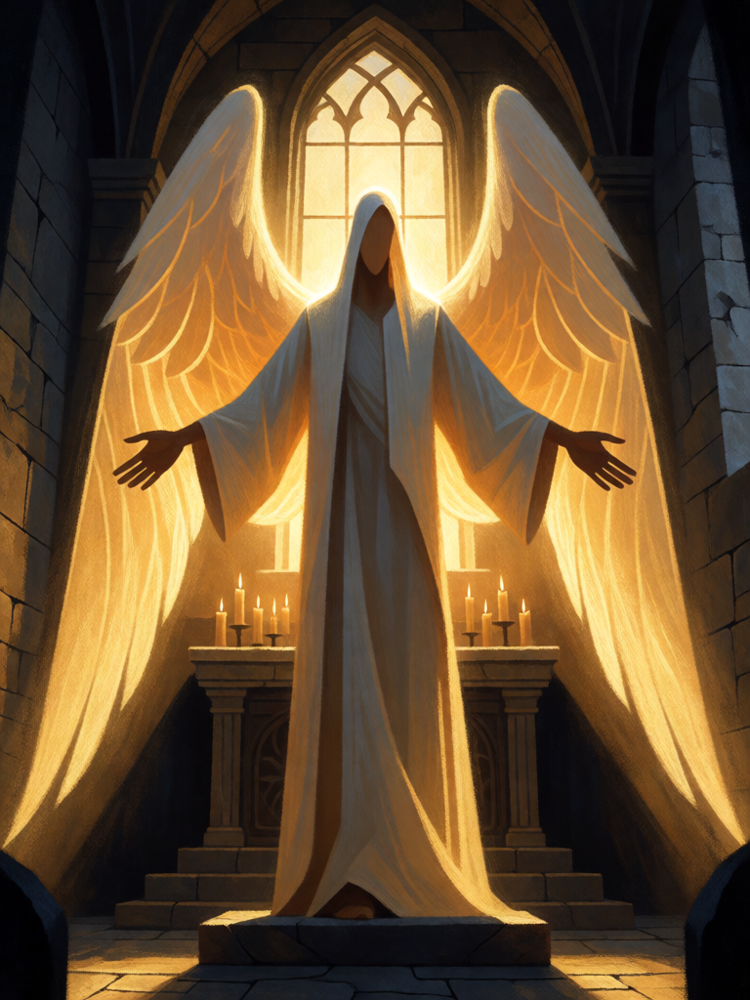

# Anjo Guardião Sagrado

[← Alta magia](../alta_magia.md) · [Wiki KodeX](../README.md) · [◀ Babalon, a Mulher Escarlate](alt_babalon.md) · [Pentagrama Flamejante ▶](alt_pentagrama_flamejante.md)

| Carta | Arte |
|---|---|
|  |  |

| | |
|---|---|
| **Tradição** | Alta magia |
| **Tipo** | Entidade |
| **Custo de Fé** | 7 |
| **ATK / DEF** | 4 / 8 |
| **Palavras-chave** | Guarda, Renascer |
| **Lendária** | sim |
| **Cópias no deck** | 1 |
| **Id** | `alt_anjo_guardiao` |

## Texto da carta

> Guarda. Renascer. Despertar: cure 4 da sua Cornucópia.

**EN — Holy Guardian Angel:** *Guard. Rebirth. Awaken: Heal your Cornucopia for 4.*

## Contexto mitológico

O Anjo Guardião Sagrado é o objetivo de toda a alta magia a partir de Abramelin. *O Livro da Magia Sagrada de Abramelin o Mago*, atribuído a Abraão de Worms (c. 1458; mss. alemães dos séc. XVII–XVIII, versão francesa traduzida por Mathers em 1898), prescreve uma operação de seis meses (dezoito, nos mss. alemães) de oração, jejum e reclusão num oratório com janela para o oriente. Ao fim, o Anjo aparece ao mago, e só então — com a autoridade do Anjo — ele convoca os quatro príncipes infernais e seus servos e os obriga a jurar obediência; a partir daí os quadrados mágicos do livro funcionam.

Crowley fez do "Conhecimento e Conversação do Anjo Guardião Sagrado" o centro da sua magia: "o único ritual supremo", escreve em *Magick in Theory and Practice*; o *Liber Samekh* (adaptado do Rito do Sem-Cabeça dos papiros gregos) é sua versão do método. Para ele, Aiwass — a inteligência que ditou o *Liber AL* — era seu Anjo. Na Árvore da Vida, o encontro com o Anjo é o grau de Adeptus Minor em Tiphareth, a etapa antes do Abismo: é o que protege o mago para que, mais tarde, possa atravessar Daath sem ser dissolvido por Choronzon.

A carta é a proteção absoluta: Guarda (nada passa por ele), Renascer (o Anjo sempre volta à mão do mago), e ao chegar cura a Cornucópia — o primeiro efeito do Conhecimento é a paz.

## Papel no jogo

Lendária defensiva e condição de estabilização: no turno 7 entra, cura 4, e qualquer ataque inimigo tem de passar por 8 de Vida. Se morre, volta à mão e pode ser invocado de novo (curando 4 de novo). Com Sigillum Dei Aemeth vira 4/11. É a resposta do deck a decks agressivos que sobreviveram aos Selos; a Babalon fecha o jogo enquanto o Anjo o segura. Caro: exige que o deck tenha controlado o tabuleiro até o turno 7.

## Atributos visuais

anjo alto feito de luz dourada, rosto oculto pelo brilho · túnica branca longa · grandes asas de luz abertas · braços abertos de frente, protegendo o altar (Guarda) · luz do amanhecer pela janela do leste

Balanço (conta de custo)

Orçamento P = 2·7+1 = 15 pts; Lendária até +2 → 17. Gasto: ATK 4 + Vida 8 + Guarda (1) + Renascer (2) + curar 4 de Cornucópia (2) = 17. Lendária, no limite do +2.

Ficha completa: `cartas/alta_magia/14_anjo_guardiao.md` · cartas base da versão Alpha
