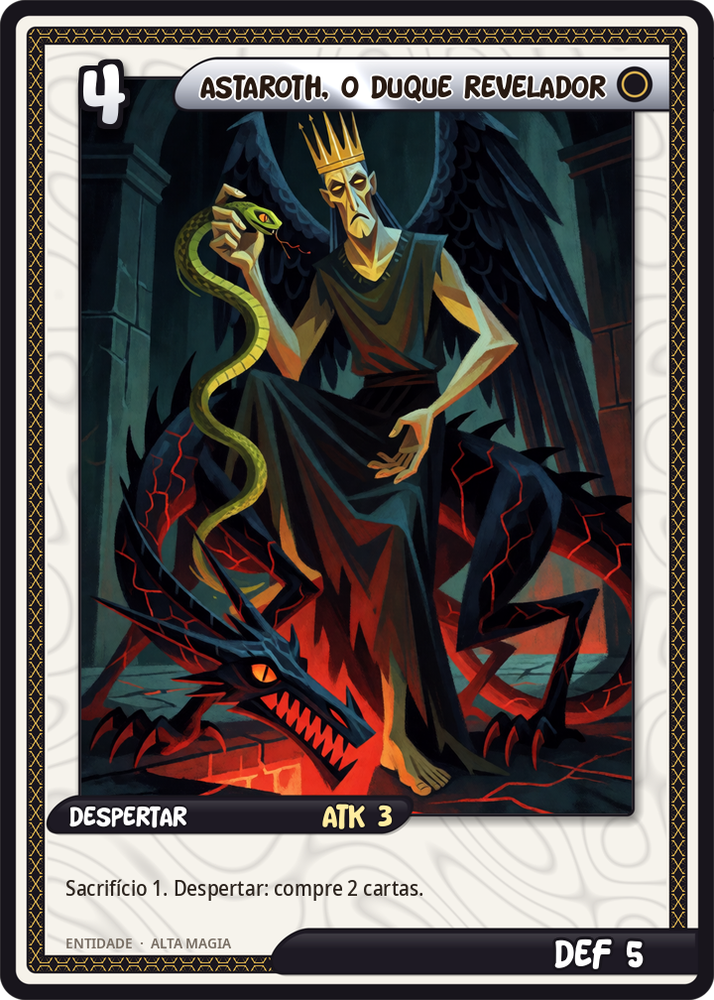
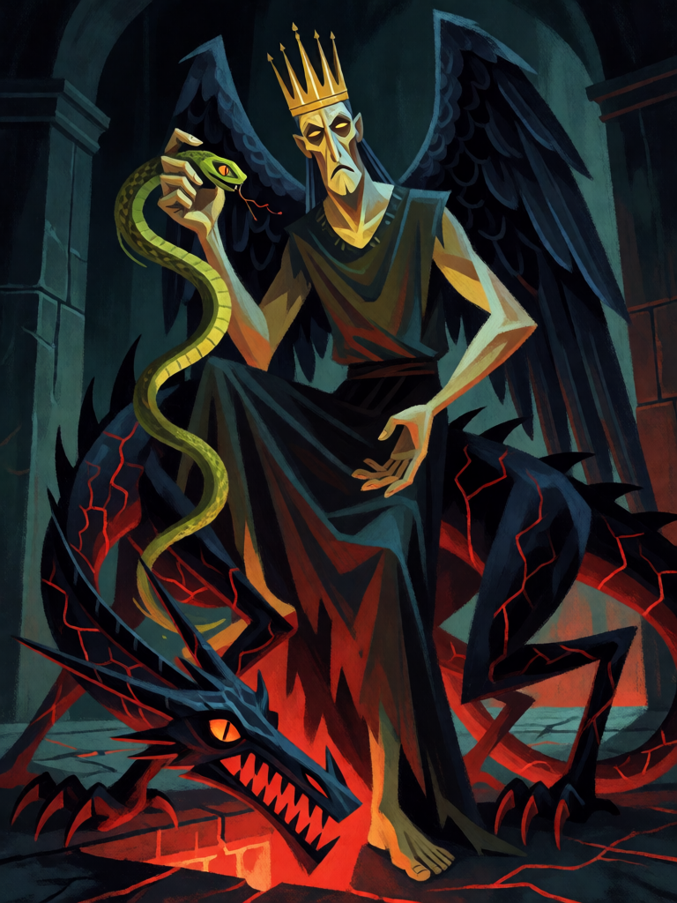

# Astaroth, o Duque Revelador

[← Alta magia](../alta_magia.md) · [Wiki KodeX](../README.md) · [◀ Marbas, o Leão das Doenças](alt_marbas.md) · [Dantalion, das Mil Faces ▶](alt_dantalion.md)

| Carta | Arte |
|---|---|
|  |  |

| | |
|---|---|
| **Tradição** | Alta magia |
| **Tipo** | Entidade |
| **Custo de Fé** | 4 |
| **ATK / DEF** | 3 / 5 |
| **Sacrifício** | 1 |
| **Palavras-chave** | — |
| **Lendária** | não |
| **Cópias no deck** | 1 |
| **Id** | `alt_astaroth` |

## Texto da carta

> Sacrifício 1. Despertar: compre 2 cartas.

**EN — Astaroth, the Revealing Duke:** *Sacrifice 1. Awaken: Draw 2 cards.*

## Contexto mitológico

Astaroth é o 29º espírito da *Ars Goetia*, um Grande Duque que aparece como um anjo "danoso" montado num dragão infernal, com uma víbora na mão direita. O mago não deve deixá-lo aproximar-se, por causa do hálito pestilento — deve segurar o Anel mágico diante do rosto. Ele responde com verdade sobre passado, presente e futuro, **revela todos os segredos**, conta de bom grado como os anjos caíram (e como ele próprio caiu) e ensina as ciências liberais. Governa 40 legiões.

O nome é a forma masculinizada de Astarte, a deusa fenícia (Ashtoreth na Bíblia), via os demonólogos medievais; o *Grimorium Verum* e o *Grimório do Papa Honório* o colocam na tríade suprema ao lado de Lúcifer e Belzebu. Collin de Plancy o desenhou nu sobre um dragão magro, com a serpente na mão e uma coroa.

A carta é o pacto do conhecimento: você entrega uma criatura (Sacrifício 1) e Astaroth revela — compra 2 cartas. O corpo grande e o hálito venenoso ficam nos 3/5.

## Papel no jogo

Primeira grande jogada de "pacto" do deck, já no turno 4 (ou 3 com Azoth): sacrifica um Homúnculo (que ainda compra 1) e Astaroth compra mais 2 — três cartas por um corpo 3/5. É a vantagem de cartas que o deck de controle precisa para ter sempre a resposta. Exige Entidade em campo; se o oponente limpou a mesa, fica preso na mão.

## Atributos visuais

anjo caído de rosto magro e feio, coroa de ouro · asas escuras de penas · túnica escura que cobre o corpo · víbora verde na mão direita · montado num dragão negro magro com veias vermelhas · hálito verde pestilento

Balanço (conta de custo)

Orçamento P = 2·4+1 = 9 pts; Sacrifício 1 = −2 de custo → orçamento efetivo 11. Gasto: ATK 3 + Vida 5 + comprar 2 (3) = 11. Dentro.

Ficha completa: `cartas/alta_magia/10_astaroth.md` · cartas base da versão Alpha
