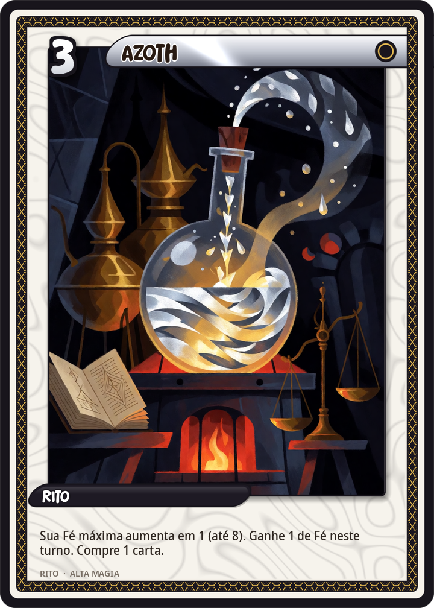
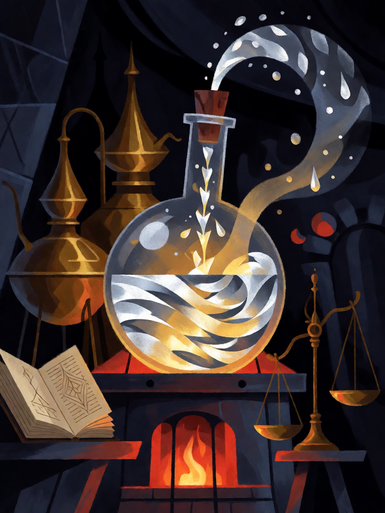

# Azoth

[← Alta magia](../alta_magia.md) · [Wiki KodeX](../README.md) · [◀ Lemegeton, a Chave Menor](alt_lemegeton.md) · [Conjuração dos Elementais ▶](alt_conjuracao_elementais.md)

| Carta | Arte |
|---|---|
|  |  |

| | |
|---|---|
| **Tradição** | Alta magia |
| **Tipo** | Rito |
| **Custo de Fé** | 3 |
| **Palavras-chave** | — |
| **Lendária** | não |
| **Cópias no deck** | 2 |
| **Id** | `alt_azoth` |

## Texto da carta

> Sua Fé máxima aumenta em 1 (até 8). Ganhe 1 de Fé neste turno. Compre 1 carta.

**EN — Azoth:** *Your maximum Faith increases by 1 (up to 8). Gain 1 Faith this turn. Draw 1 card.*

## Contexto mitológico

Azoth é o nome alquímico do **mercúrio universal** — o solvente e a semente de todas as coisas, o princípio que dissolve os metais e os refaz. A palavra é construída com a primeira letra dos alfabetos (A) e a última de cada um: Z do latino, Ω (ômega) do grego, ת (tav) do hebraico — o princípio e o fim, "Alfa e Ômega" em três línguas sagradas. Paracelso o usa como nome do remédio universal, e a lenda diz que o levava dentro do pomo da espada que nunca largava.

O corpus atribuído a Basílio Valentim deu o nome ao tratado *Azoth* (Frankfurt, 1613; versão francesa em Paris, 1624), cujas gravuras — o mago com a estrela de sete pontas, o "Visita Interiora Terrae" — a Golden Dawn e Crowley reproduziram. Lévi o identifica com a Luz Astral; nos tarôs de inspiração ocultista é o fluido que corre entre os polos. Para o alquimista, ter Azoth é ter a fonte de onde tudo pode ser feito.

A carta é a fonte: a Fé do mago (seu recurso de criação) aumenta para sempre. É a substância que acelera a Obra.

## Papel no jogo

Ramp: jogado no turno 3, o mago chega ao turno 4 com 5 Fé (Dantalion um turno antes) e ao turno 5 com 6 (Paimon ou Babalon). A Fé do próprio turno volta na hora: Azoth custa 3 e devolve 1, então ainda sobra para um Homúnculo ou uma Pedra de Visão no mesmo turno. Duas cópias porque o deck inteiro é feito de cartas caras e pactos. Compra 1 para não perder carta. Perde valor tarde no jogo (Fé máxima já em 8). Revisão: era custo 2 sem compra; dois Azoth no turno 2–3 davam Astaroth/Dantalion cedo demais para um deck que também nega tudo.

## Atributos visuais

frasco de vidro redondo com mercúrio prateado girando com luz dourada · fonte de prata jorrando do frasco · gotas prateadas subindo · atanor em brasa embaixo

Balanço (conta de custo)

Orçamento P = 2·3+1 = 7 pts. Gasto: +1 Fé máxima permanente (não tabelado; 4 — equivale a +1 Fé temporária (1,5) por ~3 turnos úteis, com desconto por chegar atrasada) + 1 Fé temporária (1,5) + comprar 1 (1,5) = 7. Dentro (exato).
Rodada 2 de balanceamento (pacote CA3 do Analista): o motor passou a dar só a Fé máxima (rodada 1), o que tirou da carta o "+1 agora" que ela tinha de fato; a carta ganha o efeito no texto (+2,0 pp medido) e fecha em P.

Ficha completa: `cartas/alta_magia/23_azoth.md` · cartas base da versão Alpha
