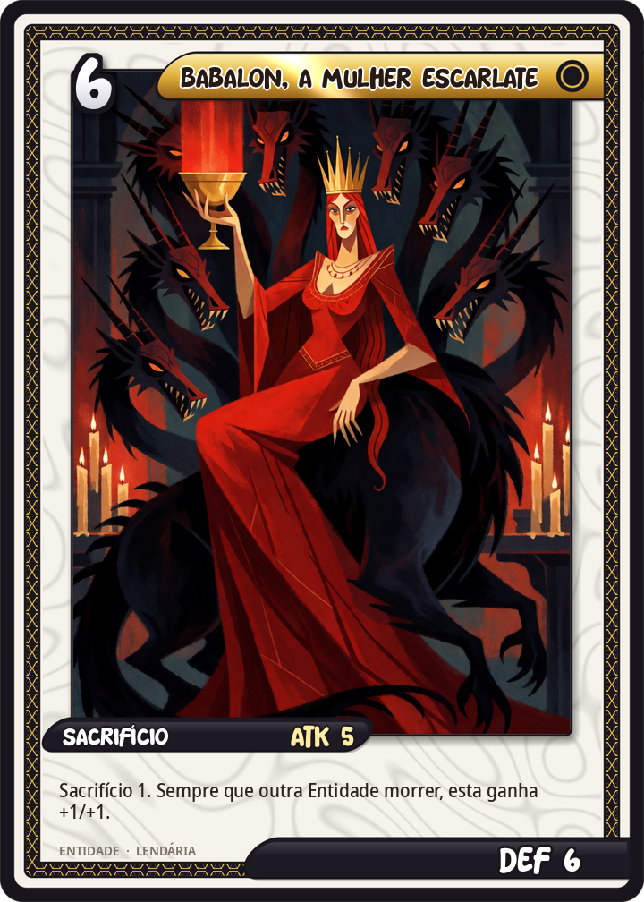
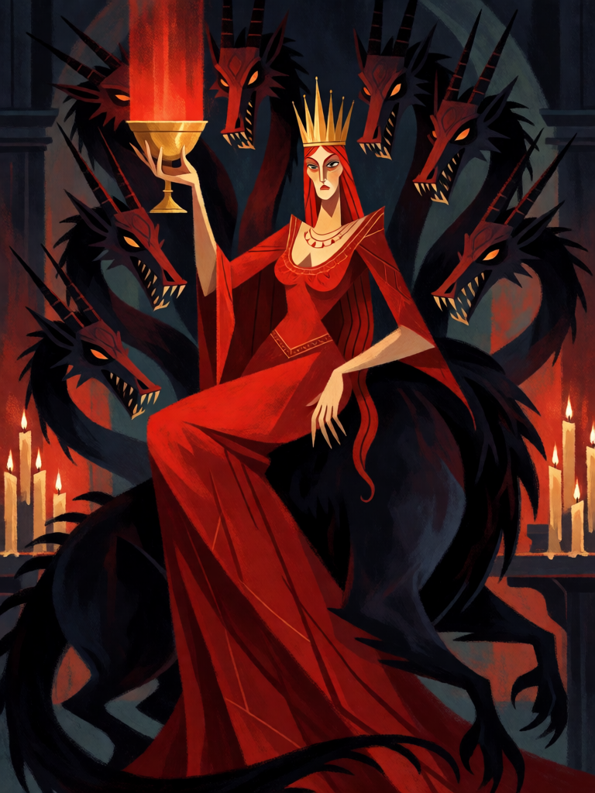

# Babalon, a Mulher Escarlate

[← Alta magia](../alta_magia.md) · [Wiki KodeX](../README.md) · [◀ Paimon, Rei do Oeste](alt_paimon.md) · [Anjo Guardião Sagrado ▶](alt_anjo_guardiao.md)

| Carta | Arte |
|---|---|
|  |  |

| | |
|---|---|
| **Tradição** | Alta magia |
| **Tipo** | Entidade |
| **Custo de Fé** | 6 |
| **ATK / DEF** | 5 / 6 |
| **Sacrifício** | 1 |
| **Palavras-chave** | — |
| **Lendária** | sim |
| **Cópias no deck** | 1 |
| **Id** | `alt_babalon` |

## Texto da carta

> Sacrifício 1. Sempre que qualquer Entidade morrer, Babalon ganha +1/+1 permanente.

**EN — Babalon, the Scarlet Woman:** *Sacrifice 1. Whenever any Entity dies, Babalon gains permanent +1/+1.*

## Contexto mitológico

Babalon é a deusa central da Thelema de Aleister Crowley. Nasce da leitura invertida do Apocalipse 17 — a "grande prostituta" montada na Besta de sete cabeças, com a taça cheia de abominações — e se revela a Crowley nos Aethyrs enochianos em 1909 (*The Vision and the Voice*, Liber 418), sobretudo nos Aethyrs 15º a 12º. Ali ela é a Mulher Escarlate, a Mãe das Abominações, a Cidade das Pirâmides: a porta do Abismo.

Sua Taça é o símbolo decisivo. Quem quer atravessar o Abismo entre Chesed e Binah precisa **verter nela cada gota do próprio sangue** — isto é, dissolver inteiramente o ego — para renascer como Magister Templi. Quem guarda uma gota é despedaçado por Choronzon. Babalon é, assim, a face acolhedora da mesma travessia em que Choronzon é a face que dispersa; Crowley a invoca na 12ª Aethyr com a fórmula da Taça e da Besta, e a torna par da Besta 666 (ele próprio) no sistema do novo Aeon. O nome grafado com "a" e "o" (BABALON, e não Babylon) soma 156 na gematria hebraica — o mesmo valor de *Tzion* (Sião), coincidência que Crowley explora no comentário a Liber 418; a fórmula da Taça está em *Liber Cheth vel Vallum Abiegni* (Liber 156).

A carta é a Taça que bebe: a cada morte em qualquer campo — aliada ou inimiga, sacrifício ou combate — Babalon cresce. O Sacrifício 1 é o preço de entrada: a Taça só começa a encher depois que ela está na mesa.

## Papel no jogo

Lendária de pressão do deck de controle: entra no turno 6 como 5/6 (o Sacrifício que paga a invocação ocorre antes de ela estar em campo e **não** a alimenta) e cresce com tudo o que o deck faz — Homúnculos morrendo, tokens de Paimon e dos Elementais sendo trocados, Andras matando, o oponente perdendo criaturas em combate. Depois de três ou quatro mortes é 8/9 ou 9/10 e fecha o jogo. Vulnerável a devolver à mão (perde o crescimento) e a silêncio; proteja-a com Pentagrama Flamejante.

## Atributos visuais

mulher adulta de cabelos ruivos longos, vestido escarlate que cobre peito e corpo · coroa de ouro · taça dourada erguida transbordando luz vermelha · montada numa besta negra de exatamente sete cabeças

Balanço (conta de custo)

Orçamento P = 2·6+1 = 13 pts; Sacrifício 1 = −2 → 15; Lendária até +2 → 17. Gasto: ATK 5 + Vida 6 = 11 + dois gatilhos repetíveis (`ally_dies`, `enemy_dies`) com +1/+1 permanente, valor cheio = 2 cada → 15 pela tabela. Como num deck de Sacrifício e tokens espera-se 3 mortes enquanto ela vive (medido: 1,7–6 gatilhos por partida, média ~3,5), o valor realista é 11 + 3×2 = 17 = teto lendário. Lendária +2.
Rodada 2 de balanceamento (pacote CA3 do Analista): volta a 5/6 (a revisão a havia baixado para 4/6 por contar 3–4 gatilhos; o Analista mediu ~3). +1,6 pp.

Ficha completa: `cartas/alta_magia/13_babalon.md` · cartas base da versão Alpha
