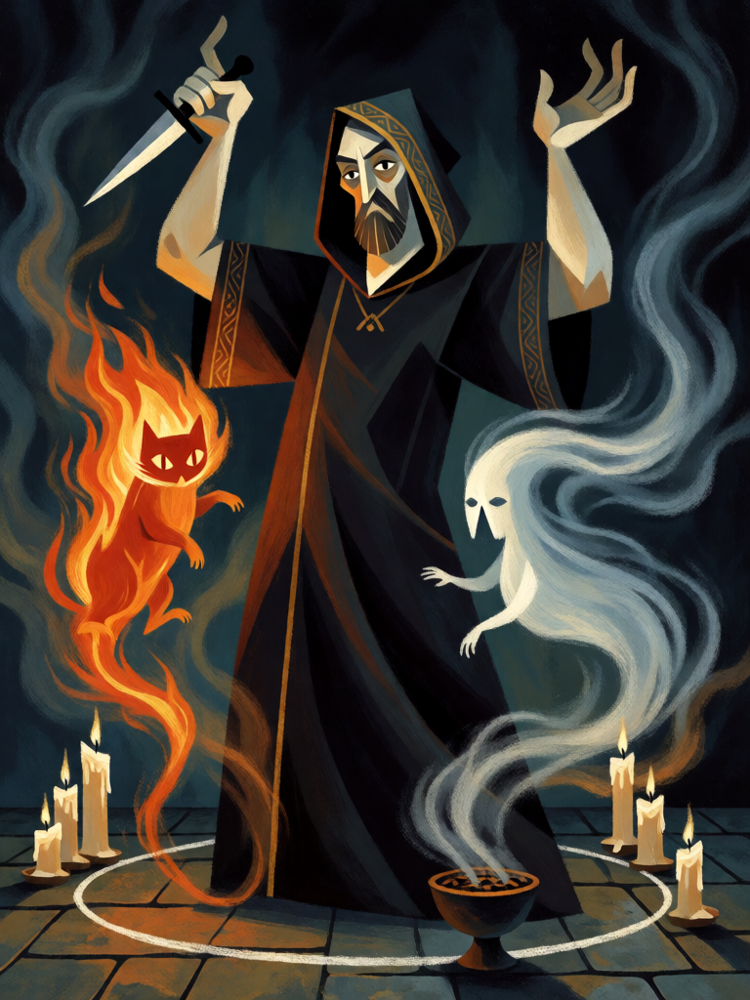

# Conjuração dos Elementais

[← Alta magia](../alta_magia.md) · [Wiki KodeX](../README.md) · [◀ Azoth](alt_azoth.md) · [Ritual Menor do Pentagrama ▶](alt_ritual_menor_pentagrama.md)

| Carta | Arte |
|---|---|
|  |  |

| | |
|---|---|
| **Tradição** | Alta magia |
| **Tipo** | Rito |
| **Custo de Fé** | 2 |
| **Palavras-chave** | — |
| **Lendária** | não |
| **Cópias no deck** | 2 |
| **Id** | `alt_conjuracao_elementais` |

## Texto da carta

> Invoque dois Elementais 1/1 (se houver slots livres).

**EN — Conjuration of the Elementals:** *Summon two 1/1 Elementals (if there are free slots).*

## Contexto mitológico

Paracelso descreveu, no *Liber de nymphis, sylphis, pygmaeis et salamandris* (publicado em 1566, vinte e cinco anos após sua morte), os quatro povos elementais: **gnomos** (pigmeus) na terra, que atravessam a rocha como nós o ar; **ondinas** (ninfas) na água; **silfos** no ar; **salamandras** no fogo. Não são demônios nem anjos — são criaturas de Deus, com corpo e sem alma, que vivem no seu elemento e às vezes aparecem aos homens.

A magia cerimonial dos séculos XIX e XX os organizou nos quatro quadrantes: a Golden Dawn consagra as quatro Armas Elementais e abre as Tábuas de Vigia enochianas de cada elemento; Lévi, no *Ritual* cap. IV, dá as conjurações dos quatro ("Conjuração do Fogo", "da Água", "do Ar", "da Terra") e os sinais de domínio de cada um. O mago que os conjura ganha servos — muitos e pequenos.

A carta é a conjuração dos quatro feita na pressa: três corpos frágeis que servem, bloqueiam e, sobretudo, podem ser oferecidos aos espíritos maiores.

## Papel no jogo

Gera fodder de Sacrifício em massa e bloqueadores de emergência (duas cópias: é o Rito de **invocação** do deck, metade da identidade): dois 1/1 no turno 2 alimentam Astaroth e Dantalion nos turnos seguintes, ou absorvem dois ataques. Com Babalon em campo, cada Elemental que morre a engorda. Cuidado com os slots — o campo tem 4; não jogue com três Entidades já em mesa.

## Atributos visuais

mago inglês adulto de manto escuro com capuz e barra dourada · braços erguidos, adaga ritual na mão direita · dentro de um círculo de giz · dois elementais pequenos: um de fogo à esquerda, um de vento à direita

Balanço (conta de custo)

Orçamento P = 2·2+1 = 5 pts. Gasto: dois tokens 1/1 (1+1 = 2 cada) = 4. Dentro (P−1).
Rodada 1 de balanceamento: era custo 3 com três Elementais (6/7; 54 % na mão). O fodder do pacto precisa existir no turno 2–3, não no 3–4.

Ficha completa: `cartas/alta_magia/25_conjuracao_elementais.md` · cartas base da versão Alpha
