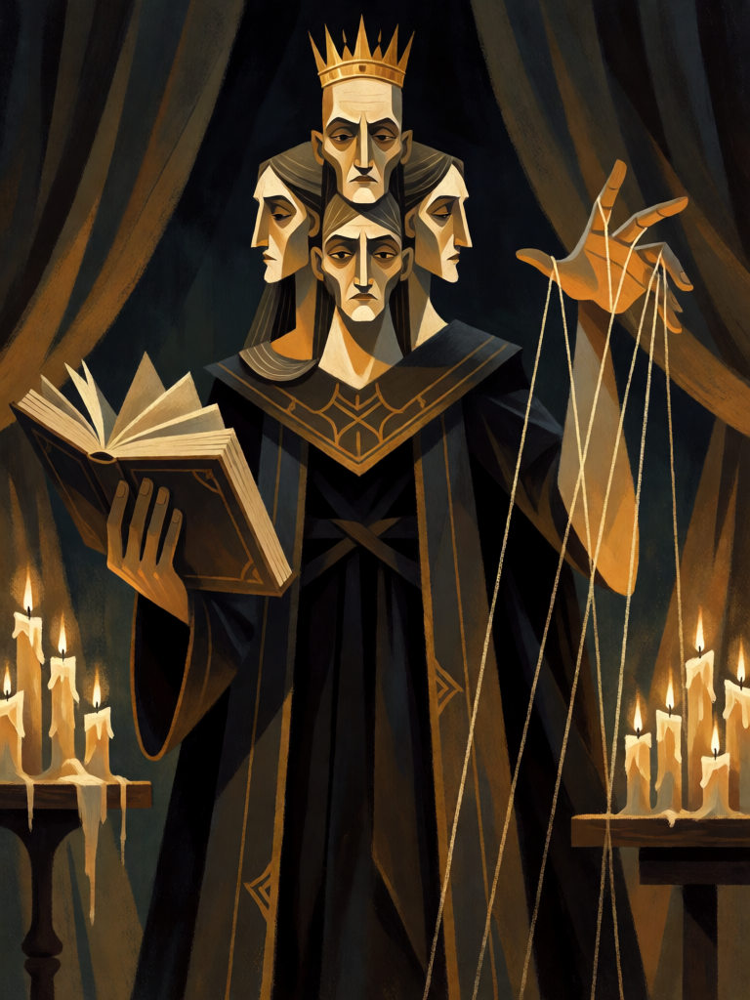

# Dantalion, das Mil Faces

[← Alta magia](../alta_magia.md) · [Wiki KodeX](../README.md) · [◀ Astaroth, o Duque Revelador](alt_astaroth.md) · [Paimon, Rei do Oeste ▶](alt_paimon.md)

| Carta | Arte |
|---|---|
|  |  |

| | |
|---|---|
| **Tradição** | Alta magia |
| **Tipo** | Entidade |
| **Custo de Fé** | 5 |
| **ATK / DEF** | 3 / 4 |
| **Sacrifício** | 1 |
| **Palavras-chave** | — |
| **Lendária** | não |
| **Cópias no deck** | 1 |
| **Id** | `alt_dantalion` |
| **Arte** | provisória nesta Alpha |

## Texto da carta

> Sacrifício 1. Despertar: tome o controle permanente de uma Entidade inimiga.

**EN — Dantalion of a Thousand Faces:** *Sacrifice 1. Awaken: Take permanent control of an enemy Entity.*

## Contexto mitológico

Dantalion é o 71º e penúltimo espírito da *Ars Goetia*, um Grande Duque que aparece "na forma de um homem com muitas faces, todas de homens e mulheres", segurando um livro na mão direita. Ensina todas as artes e ciências e revela o conselho secreto de qualquer pessoa, "pois **conhece os pensamentos de todos os homens e mulheres e pode mudá-los à sua vontade**"; provoca amor e mostra a semelhança de qualquer pessoa em visão, em qualquer parte do mundo. Governa 36 legiões. Como Vassago, Seere e Andromalius, **não aparece em Weyer** (1577): foi acrescentado pelo compilador do Lemegeton no século XVII, o que faz dele um dos espíritos mais "jovens" do catálogo.

É o espírito da mente alheia — o único do catálogo cujo poder central é alterar a vontade de outro. Por isso virou figura recorrente na ficção ocultista moderna como "o que fala por dentro da cabeça". Sua imagem de muitas faces superpostas é das mais fortes do Lemegeton e aparece nas ilustrações do século XIX como um rosto que se desdobra em dezenas.

A carta é literal: Dantalion muda a mente de uma Entidade inimiga e ela passa para o seu lado — para sempre. O preço é o pacto (Sacrifício 1): você entrega um dos seus para ficar com um dos deles.

## Papel no jogo

A jogada de virada do deck. Sacrifica um Homúnculo ou Elemental e rouba a melhor Entidade do oponente — idealmente uma que Marbas já silenciou (sem efeitos perigosos) ou a Lendária dele. Dois corpos entram (Dantalion 3/4 + a roubada), um sai: troca de 2 por 1 em campo e remoção ao mesmo tempo. Fica fraco se o campo inimigo está vazio ou só tem tokens — aí é um 3/4 caro.

## Atributos visuais

homem de manto escuro com exatamente seis faces ao redor da cabeça (homens e mulheres) · coroa de ouro · livro aberto na mão direita · mão esquerda estendida com fios de luz (controle mental)

Balanço (conta de custo)

Orçamento P = 2·5+1 = 11 pts; Sacrifício 1 = −2 de custo → orçamento efetivo 13. Gasto: ATK 3 + Vida 4 + roubar Entidade permanente (estimado 6: destruir = 4, mais ganhar o corpo ≈ 2) = 13. Dentro.

Ficha completa: `cartas/alta_magia/11_dantalion.md` · cartas base da versão Alpha
