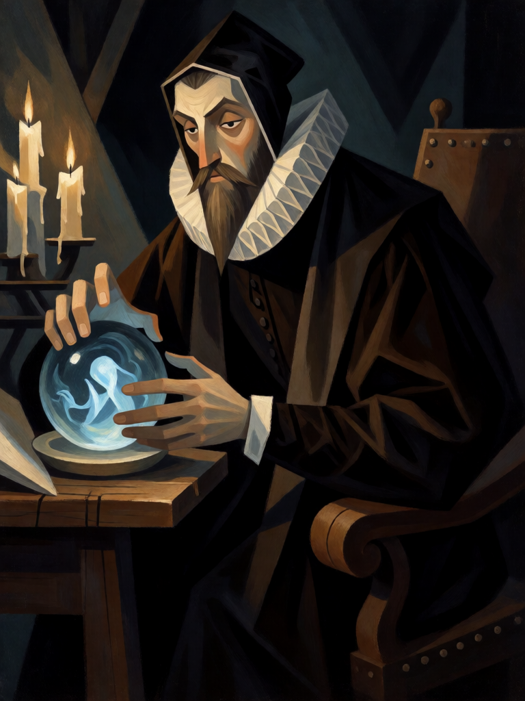

# Edward Kelley, o Vidente

[← Alta magia](../alta_magia.md) · [Wiki KodeX](../README.md) · [◀ Homúnculo](alt_homunculo.md) · [Silfo ▶](alt_silfo.md)

| Carta | Arte |
|---|---|
|  |  |

| | |
|---|---|
| **Tradição** | Alta magia |
| **Tipo** | Entidade |
| **Custo de Fé** | 2 |
| **ATK / DEF** | 1 / 1 |
| **Palavras-chave** | Furtivo |
| **Lendária** | não |
| **Cópias no deck** | 1 |
| **Id** | `alt_edward_kelley` |

## Texto da carta

> Furtivo. Despertar: busque uma Relíquia do seu deck.

**EN — Edward Kelley, the Seer:** *Stealth. Awaken: Search your deck for a Relic.*

## Contexto mitológico

Edward Kelley (1555–1597) foi o *skryer* — vidente — de John Dee de 1582 a 1589. Dee, matemático e astrólogo de Elizabeth I, não via nada no cristal; Kelley via. Sentado diante da pedra de visão, descrevia anjos, tábuas de letras e cenas que Dee anotava palavra por palavra em latim e inglês. Dessas sessões saiu o sistema enochiano inteiro: as 48 Chaves, as Tábuas de Vigia, os 30 Aethyrs. Casaubon publicou os diários em 1659 como *A True & Faithful Relation*, para desacreditar Dee — e acabou criando o cânone.

A lenda pinta Kelley como vigarista: teria tido as orelhas cortadas por falsificação (daí o gorro), e chegou à casa de Dee com um pó vermelho e um livro cifrado desenterrados em Glastonbury, com os quais prometia transmutar ouro. Na Boêmia, Rodolfo II o fez cavaleiro e depois o prendeu para arrancar o segredo; morreu em 1597 das feridas de uma tentativa de fuga pela muralha do castelo.

Na carta, Kelley é o vidente que **acha coisas**: furtivo (ninguém o mira até ele agir), sem força (0 de ATK — ele nunca foi mago, era o olho), e ao entrar busca uma Relíquia — o pó vermelho, a pedra, o sigilo.

## Papel no jogo

Tutor de Relíquias: puxa Pedra de Visão (compra), Sigillum Dei Aemeth (muralha) ou Anel de Salomão (silêncio). Furtivo protege-o de remoção até que ataque — enquanto não ataca é um corpo quase imune que serve de Sacrifício garantido para Dantalion ou Astaroth; com a Pedra de Visão vira 2/3 e passa a ameaçar. Ruim como bloqueador: 1/1.

## Atributos visuais

homem inglês elisabetano de ~30 anos, barba escura · orelhas cobertas por touca preta justa (orelhas cortadas, segundo a lenda) · gola de rufo branca e toga escura · mãos em concha ao redor da bola de cristal · rosto meio na sombra (Furtivo)

Balanço (conta de custo)

Orçamento P = 2·2+1 = 5 pts. Gasto: ATK 1 + Vida 1 + Furtivo (1) + Despertar buscar Relíquia (2) = 5. Dentro.
Rodada 1 de balanceamento: era 0/2 — nunca atacava num deck com 1,6–7,5 de dano de ataque por partida.

Ficha completa: `cartas/alta_magia/03_edward_kelley.md` · cartas base da versão Alpha
