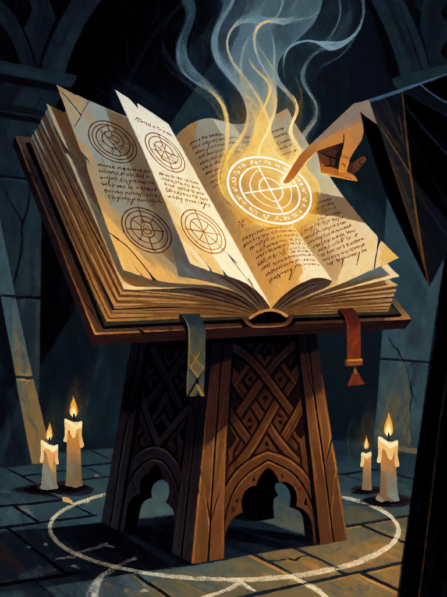

# Lemegeton, a Chave Menor

[← Alta magia](../alta_magia.md) · [Wiki KodeX](../README.md) · [◀ Sigilo de Spare](alt_sigilo_de_spare.md) · [Azoth ▶](alt_azoth.md)

| Carta | Arte |
|---|---|
|  |  |

| | |
|---|---|
| **Tradição** | Alta magia |
| **Tipo** | Rito |
| **Custo de Fé** | 1 |
| **Palavras-chave** | — |
| **Lendária** | não |
| **Cópias no deck** | 2 |
| **Id** | `alt_lemegeton` |

## Texto da carta

> Busque uma Entidade do seu deck e coloque-a na mão.

**EN — Lemegeton, the Lesser Key:** *Search your deck for an Entity and put it into your hand.*

## Contexto mitológico

O *Lemegeton Clavicula Salomonis* — a Chave Menor de Salomão — é o grimório mais influente da magia ocidental. Compilado em inglês no século XVII (Sloane MSS 2731 e 3825, British Library) a partir de materiais mais antigos, reúne cinco livros: a **Ars Goetia**, catálogo dos 72 espíritos com selos, ofícios, legiões e as conjurações para chamá-los; a *Theurgia-Goetia* (espíritos dos pontos cardeais); a *Ars Paulina* (anjos das horas e dos signos); a *Ars Almadel* (anjos das quatro altitudes, via tábua de cera); e a *Ars Notoria* (orações para a ciência instantânea).

A Goetia deriva da *Pseudomonarchia Daemonum* de Johann Weyer (1577), que listou 69 demônios mas omitiu de propósito os selos e o modo de conjurar — o Lemegeton os restitui. Mathers traduziu o texto para a Golden Dawn; Crowley o publicou em 1904 com introdução, a famosa explicação psicológica ("os espíritos da Goetia são porções do cérebro humano"), a Invocação Preliminar (o Rito do Sem-Cabeça) e as conjurações vertidas para o enochiano. Peterson editou criticamente os manuscritos em 2001.

A carta é o grimório aberto: você procura o nome do espírito certo e o chama à mão. É a Clavícula — a chave que abre a lista.

## Papel no jogo

Tutor universal de Entidades por 1 Fé: no turno 1 busca Homúnculo ou Kelley, no turno 4 busca Astaroth ou Dantalion, no turno 6 busca Babalon ou o Anjo. Garante que o deck de controle, que joga poucas Entidades, sempre tenha a certa. É carta de "troca 1 por 1": não gera vantagem, só precisão.

## Atributos visuais

grimório antigo grande e aberto num atril de madeira · páginas cobertas de selos circulares · um selo brilhando em dourado · forma espectral subindo da página · mão do mago apontando

Balanço (conta de custo)

Orçamento P = 2·1+1 = 3 pts. Gasto: buscar carta de tipo específico do deck (2) = 2. Dentro (1 pt abaixo, aceitável para um tutor sem restrição de custo).

Ficha completa: `cartas/alta_magia/21_lemegeton.md` · cartas base da versão Alpha
