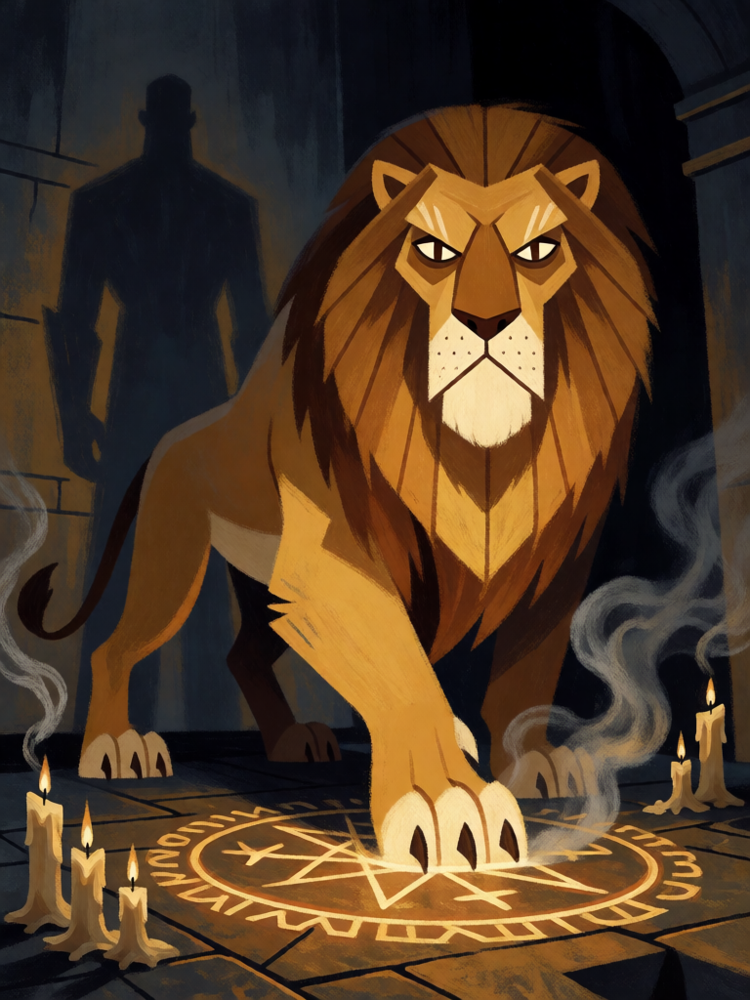

# Marbas, o Leão das Doenças

[← Alta magia](../alta_magia.md) · [Wiki KodeX](../README.md) · [◀ Andras, o Semeador de Discórdia](alt_andras.md) · [Astaroth, o Duque Revelador ▶](alt_astaroth.md)

| Carta | Arte |
|---|---|
|  |  |

| | |
|---|---|
| **Tradição** | Alta magia |
| **Tipo** | Entidade |
| **Custo de Fé** | 4 |
| **ATK / DEF** | 3 / 4 |
| **Palavras-chave** | — |
| **Lendária** | não |
| **Cópias no deck** | 1 |
| **Id** | `alt_marbas` |

## Texto da carta

> Despertar: silencie uma Entidade inimiga (ela perde palavras-chave e efeitos).

**EN — Marbas, Lion of Diseases:** *Awaken: Silence an enemy Entity (it loses keywords and effects).*

## Contexto mitológico

Marbas (ou Barbas) é o quinto espírito da *Ars Goetia*, um Grande Presidente que aparece como um grande leão e, a pedido, toma forma humana. Responde com verdade sobre coisas ocultas e secretas, **causa doenças e as cura**, dá sabedoria nas artes mecânicas e **muda homens para outras formas**. Governa 36 legiões. Weyer o lista como Marbas *alias* Barbas na *Pseudomonarchia Daemonum* (1577), com os mesmos ofícios.

Entre os 72, Marbas é o espírito do corpo: o que adoece e sara, o que desfigura e repara. Os grimórios o associam à medicina e à engenharia — ao que se pode consertar ou quebrar com conhecimento. É também um dos poucos cuja imagem animal (o leão) os ilustradores mantiveram sem monstruosidades.

A carta traduz "causar doença" e "mudar de forma" em **silêncio**: a Entidade inimiga perde o que a tornava especial — Guarda, Furtivo, Último Sopro, auras. Fica só o corpo doente.

## Papel no jogo

Remoção de habilidades: tira Guarda do bloqueador para que o Silfo passe, tira Último Sopro antes de Andras matar, tira efeitos perigosos de uma Entidade que Dantalion vai roubar (ou que Babalon vai ver morrer). Corpo 3/4 sólido no turno 4. Não resolve stats puros — contra um 5/5 sem texto é só um bloqueador.

## Atributos visuais

leão macho enorme, juba dourada · olhos quase humanos, sérios · pata pesada esmagando um sigilo brilhante que se apaga · velas recém-apagadas soltando fumaça

Balanço (conta de custo)

Orçamento P = 2·4+1 = 9 pts. Gasto: ATK 3 + Vida 4 + silenciar Entidade escolhida (estimado 2: menos que devolver à mão, pois o corpo fica) = 9. Dentro.

Ficha completa: `cartas/alta_magia/09_marbas.md` · cartas base da versão Alpha
