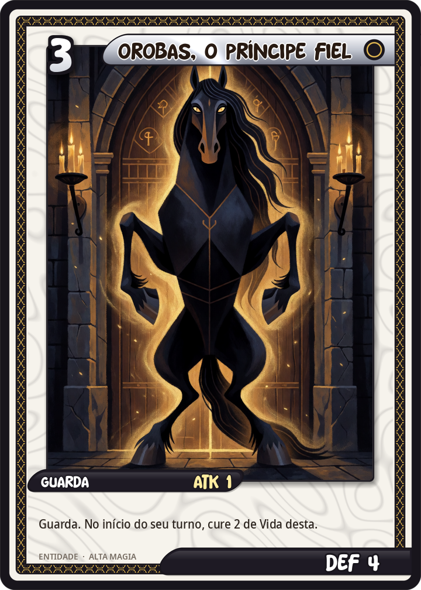
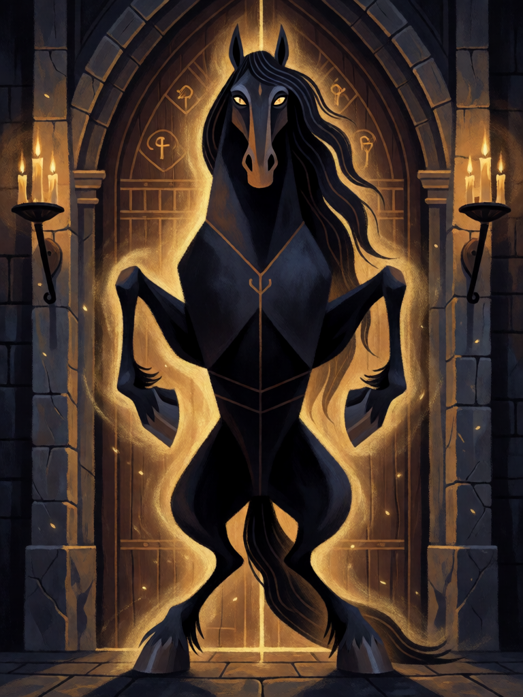

# Orobas, o Príncipe Fiel

[← Alta magia](../alta_magia.md) · [Wiki KodeX](../README.md) · [◀ Vassago, o Príncipe que Acha](alt_vassago.md) · [Andras, o Semeador de Discórdia ▶](alt_andras.md)

| Carta | Arte |
|---|---|
|  |  |

| | |
|---|---|
| **Tradição** | Alta magia |
| **Tipo** | Entidade |
| **Custo de Fé** | 3 |
| **ATK / DEF** | 1 / 4 |
| **Palavras-chave** | Guarda |
| **Lendária** | não |
| **Cópias no deck** | 1 |
| **Id** | `alt_orobas` |

## Texto da carta

> Guarda. No início do seu turno, Orobas cura 2 de Vida de si mesmo.

**EN — Orobas, the Faithful Prince:** *Guard. At the start of your turn, Orobas restores 2 Health to itself.*

## Contexto mitológico

Orobas é o 55º espírito da *Ars Goetia*, um Príncipe que aparece primeiro como cavalo e, a pedido do mago, toma forma humana. Revela passado, presente e futuro, concede dignidades e o favor de amigos e inimigos, e — o traço que o distingue de quase todos os outros — **é fiel ao exorcista e não permite que ele seja tentado por espírito algum**. Governa 20 legiões. Weyer (*Pseudomonarchia*, 1577) já o descreve assim, e Collin de Plancy o desenhou como cavalo de pé, ereto, no *Dictionnaire Infernal* (1863).

Num catálogo onde Andras mata o mago distraído e Furfur mente fora do triângulo, Orobas é a exceção: o espírito que protege. Por isso é um dos mais evocados na prática moderna como "guardião" — o cavalo que fica diante da porta.

A carta é a muralha barata do deck: Guarda (os inimigos têm de atacá-lo primeiro), pouca força, muita vida, e no início de cada turno se recompõe — a lealdade que não se gasta.

## Papel no jogo

"Cola" defensiva do meio de jogo: segura agressão enquanto o mago acumula Fé para o pacto. Combina com Sigillum Dei Aemeth (+0/+3, mais Guarda) para virar uma parede que se cura de 2 por turno, e com Pedra de Visão para comprar sem risco. Ruim contra Ritos de destruição direta e contra silêncio.

## Atributos visuais

cavalo negro em pé sobre as patas traseiras, ereto como um homem · de frente, guardando uma porta fechada (Guarda) · olhos dourados · aura dourada de cura

Balanço (conta de custo)

Orçamento P = 2·3+1 = 7 pts. Gasto: ATK 1 + Vida 4 + Guarda (1) + curar 2 em si a cada início de turno (1) = 7. Dentro.

Ficha completa: `cartas/alta_magia/07_orobas.md` · cartas base da versão Alpha
