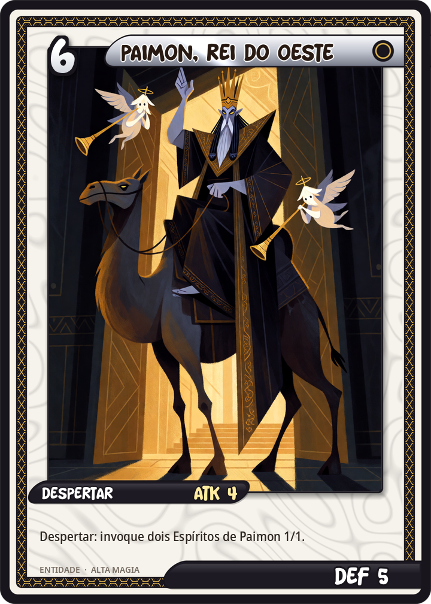
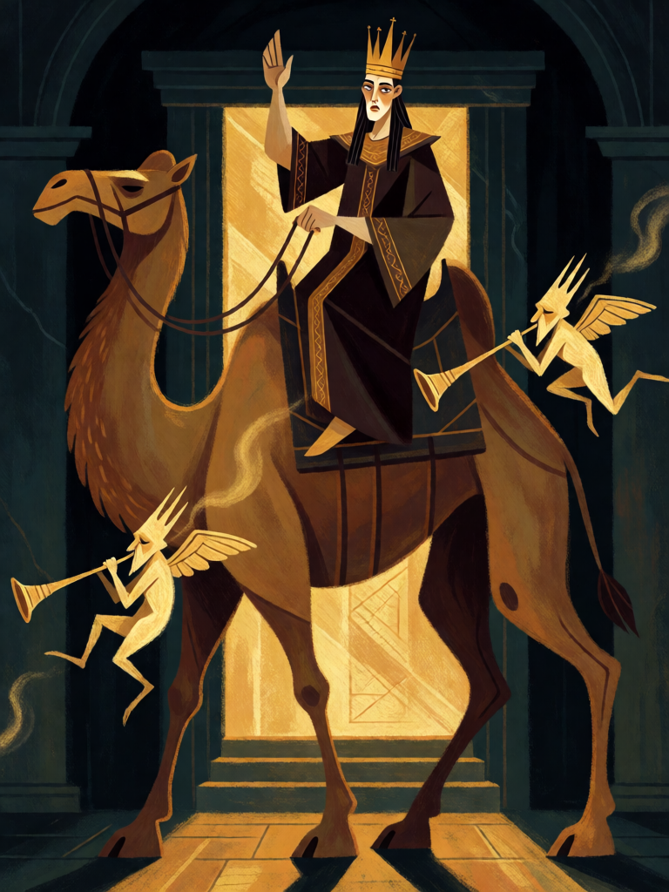

# Paimon, Rei do Oeste

[← Alta magia](../alta_magia.md) · [Wiki KodeX](../README.md) · [◀ Dantalion, das Mil Faces](alt_dantalion.md) · [Babalon, a Mulher Escarlate ▶](alt_babalon.md)

| Carta | Arte |
|---|---|
|  |  |

| | |
|---|---|
| **Tradição** | Alta magia |
| **Tipo** | Entidade |
| **Custo de Fé** | 6 |
| **ATK / DEF** | 4 / 5 |
| **Palavras-chave** | — |
| **Lendária** | não |
| **Cópias no deck** | 1 |
| **Id** | `alt_paimon` |
| **Arte** | provisória nesta Alpha |

## Texto da carta

> Despertar: invoque dois Espíritos de Paimon 1/1.

**EN — Paimon, King of the West:** *Awaken: Summon two 1/1 Spirits of Paimon.*

## Contexto mitológico

Paimon é o nono espírito da *Ars Goetia*, um Grande Rei "muito obediente a Lúcifer". Aparece como um homem coroado sentado num dromedário, com rosto de mulher segundo algumas versões, **precedido por uma hoste de espíritos tocando trombetas, címbalos e toda sorte de instrumentos**. Sua voz é estrondosa; o mago deve obrigá-lo a falar mais baixo. Ensina todas as artes, filosofias e ciências, revela o que é a Terra e o que a sustenta, concede dignidades e familiares. Governa 200 legiões, "parte da ordem dos Anjos, parte das Potestades". Se o mago faz oferenda ou sacrifício, vêm com ele dois reis menores, Labal e Abalim, e outros espíritos.

Está entre os poucos espíritos da Goetia a quem o próprio texto manda **fazer oferenda** — por isso é o Rei do pacto por excelência. O título "Rei do Oeste" vem da direção em que deve ser observado: Weyer (1577) manda olhar para o Ocidente, o Lemegeton para o Noroeste, "onde fica a sua casa"; Weyer já lhe dá a mesma pompa; Collin de Plancy o desenhou de turbante sobre o camelo, e a iconografia moderna o fixou assim.

A carta é a chegada do rei: a oferenda (Sacrifício 1) traz Paimon com sua hoste (dois tokens) e a ciência que ele ensina (compra 1).

## Papel no jogo

A grande invocação do deck no turno 6 (ou 5 com Azoth): o Rei chega com a hoste e preenche a mesa sozinho — Paimon 4/5 mais dois 1/1 que viram, por sua vez, Sacrifício para Babalon, Dantalion e Astaroth, ou bloqueadores descartáveis. É o único pacto do deck que **não** exige Sacrifício: é ele quem traz o fodder para os outros. Com Solve et Coagula, cada Espírito que morre devolve uma Entidade do cemitério à mão. Precisa de slots livres (campo de 4): planeje o campo antes.

## Atributos visuais

rei de rosto feminino e corpo masculino, andrógino · coroa de ouro e túnica escura bordada a ouro · montado num dromedário (uma corcova) · mão erguida em comando · dois espíritos pequenos tocando trombetas

Balanço (conta de custo)

Orçamento P = 2·6+1 = 13 pts. Gasto: ATK 4 + Vida 5 + dois tokens 1/1 (2+2 = 4) = 13. Dentro.
Rodada 1 de balanceamento: era Sacrifício 1 + "compre 1" (14,5/15). Ficava na mão 30 % das partidas (57 % contra hinduismo) porque o fodder morria antes; sem Sacrifício entra sempre, e a compra a menos alivia a autofadiga do deck.

Ficha completa: `cartas/alta_magia/12_paimon.md` · cartas base da versão Alpha
