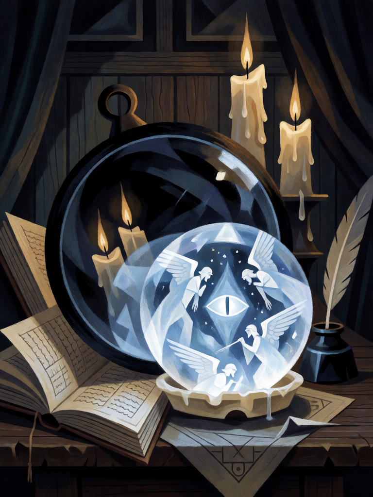

# Pedra de Visão de Dee

[← Alta magia](../alta_magia.md) · [Wiki KodeX](../README.md) · [◀ Sigillum Dei Aemeth](alt_sigillum_dei_aemeth.md)

| Carta | Arte |
|---|---|
|  |  |

| | |
|---|---|
| **Tradição** | Alta magia |
| **Tipo** | Relíquia |
| **Custo de Fé** | 1 |
| **Palavras-chave** | — |
| **Lendária** | não |
| **Cópias no deck** | 2 |
| **Id** | `alt_pedra_de_visao` |

## Texto da carta

> A Entidade equipada ganha +1/+3.

**EN — Dee's Shew Stone:** *The equipped Entity gains +1/+3.*

## Contexto mitológico

A pedra de visão (*shew-stone*) é o cristal em que Edward Kelley via os anjos enquanto John Dee anotava. Dee possuía mais de uma: uma **bola de cristal** de quartzo, e o **espelho de obsidiana** polida — um espelho asteca de Tezcatlipoca, trazido do México após a conquista, que a tradição desde Horace Walpole associa a Dee e cuja origem mexicana a análise geoquímica confirmou em 2021 (Campbell et al., *Antiquity*). Ambos estão no British Museum ao lado dos discos de cera do Sigillum Dei Aemeth.

Nos diários (*Mysteriorum Libri*, 1582–1587; Casaubon, 1659), o procedimento é sempre o mesmo: Dee reza, Kelley senta diante da pedra posta sobre a Mesa Sagrada e sobre o Sigillum, e descreve o que vê — Uriel, Michael, a menina Madimi, tábuas de letras que os anjos apontam com uma vara. Dee pergunta; os anjos respondem através do cristal. Foi assim que chegaram as 48 Chaves, as Tábuas de Vigia e a língua enochiana inteira. O cristal é o instrumento de **conhecimento**: nele o mago vê o que ainda não sabe.

A carta é a pedra na mão de quem a porta: um pouco de proteção (+2 de Vida, o olho vigilante) e, ao olhar, uma carta nova.

## Papel no jogo

A pedra mostra onde ferir e onde não ser ferido: por 1 Fé, +1/+3 numa Entidade — em Kelley (que a busca e vira 2/4), em Orobas (parede que agora bate), num Homúnculo (2/5 que ainda compra ao morrer). Duas cópias porque é o ATK barato que faltava ao deck. Perde valor se não há Entidade em campo para equipar.

## Atributos visuais

bola de cristal transparente sobre disco de cera claro · espelho redondo de obsidiana negra polida apoiado atrás · visões de anjos e um olho brilhando dentro do cristal · brilho azul-pálido

Balanço (conta de custo)

Orçamento P = 2·1+1 = 3 pts + 1 (Relíquia) = 4. Gasto: +1 ATK permanente (1) + +3 Vida permanente (3) = 4. Dentro.
Rodada 2 de balanceamento (pacote CA3 do Analista): +1/+2 → +1/+3 (+3,8 pp medido, o maior ganho do pacote): o deck de controle vive de corpos que não morrem.
Rodada 1 de balanceamento: era "+0/+2, compre 1" (3,5/4). Duas compras a menos no deck que mais sofria autofadiga, e +2 ATK na mesa de um deck com 1,6–7,5 de dano de ataque por partida.

Ficha completa: `cartas/alta_magia/31_pedra_de_visao.md` · cartas base da versão Alpha
