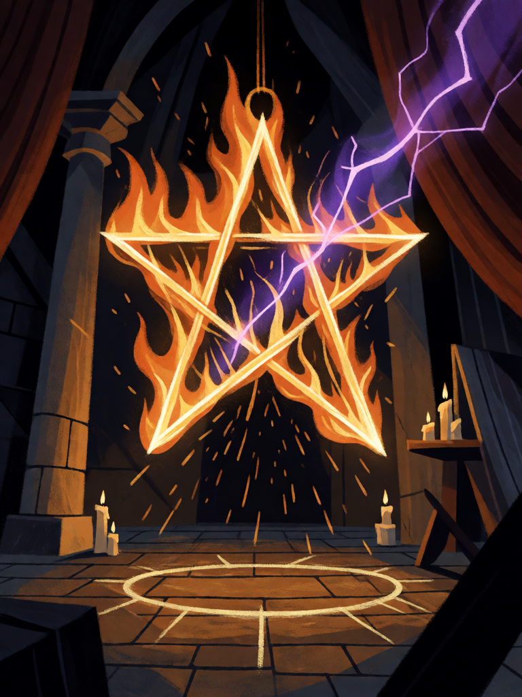

# Pentagrama Flamejante

[← Alta magia](../alta_magia.md) · [Wiki KodeX](../README.md) · [◀ Anjo Guardião Sagrado](alt_anjo_guardiao.md) · [Selo de Salomão ▶](alt_selo_de_salomao.md)

| Carta | Arte |
|---|---|
|  |  |

| | |
|---|---|
| **Tradição** | Alta magia |
| **Tipo** | Selo |
| **Custo de Fé** | 2 |
| **Palavras-chave** | — |
| **Lendária** | não |
| **Cópias no deck** | 2 |
| **Id** | `alt_pentagrama_flamejante` |

## Texto da carta

> Quando o oponente jogar um Rito, anule-o, compre 1 carta e cure 2 da sua Cornucópia.

**EN — Blazing Pentagram:** *When your opponent plays a Rite, counter it, draw 1 card and heal your Cornucopia for 2.*

## Contexto mitológico

O pentagrama é o sinal de proteção mais antigo da magia ocidental — aparece como *Drudenfuss* ("pé de bruxa") nas portas alemãs, no Pentáculo de Salomão do Lemegeton, e nos talismãs de Agrippa (*De occulta philosophia* II.27, onde a estrela de cinco pontas contém o homem de braços abertos). Mas foi Éliphas Lévi quem o fez emblema da alta magia moderna: no *Dogma* (1854), cap. V, a "estrela flamejante" com uma ponta para cima é o microcosmo, o domínio do espírito sobre os quatro elementos — e invertida, com duas pontas para cima, é a cabeça do bode, o signo da matéria que domina.

Lévi afirma que o pentagrama traçado e consagrado **impede a aproximação de qualquer espírito não convidado** e desfaz encantamentos. A Golden Dawn incorporou isso aos Rituais do Pentagrama, onde o mago traça pentagramas flamejantes nos quatro quadrantes para banir ou invocar cada elemento. O próprio Lemegeton manda vestir o **Pentagrama de Salomão** ao peito, gravado em ouro ou prata, com o selo do espírito nas costas — "para que o espírito seja obrigado a obedecer"; a edição Mathers/Crowley (1904) reproduz a figura.

A carta é a função protetora: o Rito inimigo bate no pentagrama e se desfaz — e o mago ainda aprende com isso.

## Papel no jogo

Primeiro contador do deck: nega o Rito de dano ou de remoção que iria matar Orobas, Dantalion ou a Lendária, e o círculo de fogo ainda fecha 2 da Cornucópia — o deck de controle compra tempo com cada negação. Como todo Selo, só dispara no turno do oponente e na primeira ocorrência, então Ritos de utilidade baratos podem "gastá-lo" antes do que importa — contra isso, Vassago busca a segunda cópia. Inútil contra decks quase sem Ritos.

## Atributos visuais

pentagrama de fogo com uma ponta para cima, flutuando · raio mágico roxo se despedaçando contra ele · círculo de giz no chão · câmara ritual escura

Balanço (conta de custo)

Orçamento P = 2·2+1 = 5 pts + 1 (Selo) = 6. Gasto: anular Rito inimigo (3) + comprar 1 (1,5) + curar 2 de Cornucópia (1) = 5,5. Dentro.
Rodada 2 de balanceamento (pacote CA3 do Analista): + cura 2 (+0,8 pp medido); o Selo sai de P−1,5 para P−0,5.

Ficha completa: `cartas/alta_magia/15_pentagrama_flamejante.md` · cartas base da versão Alpha
