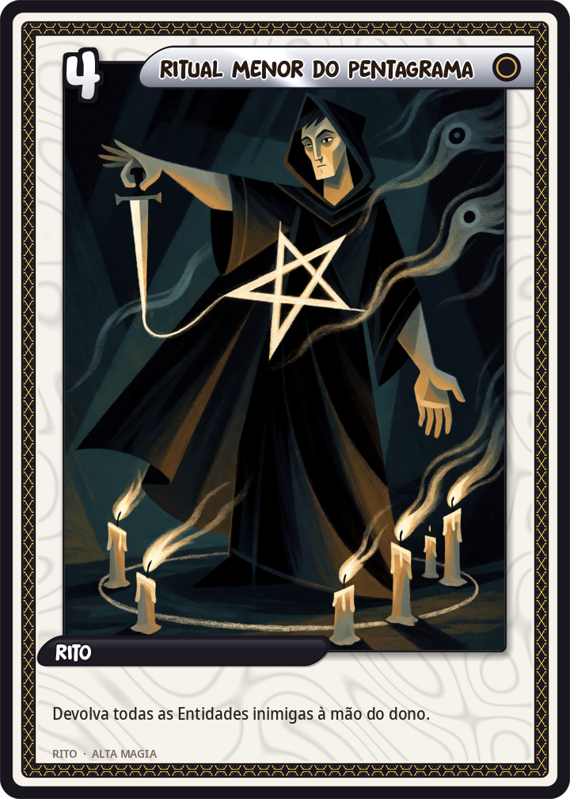
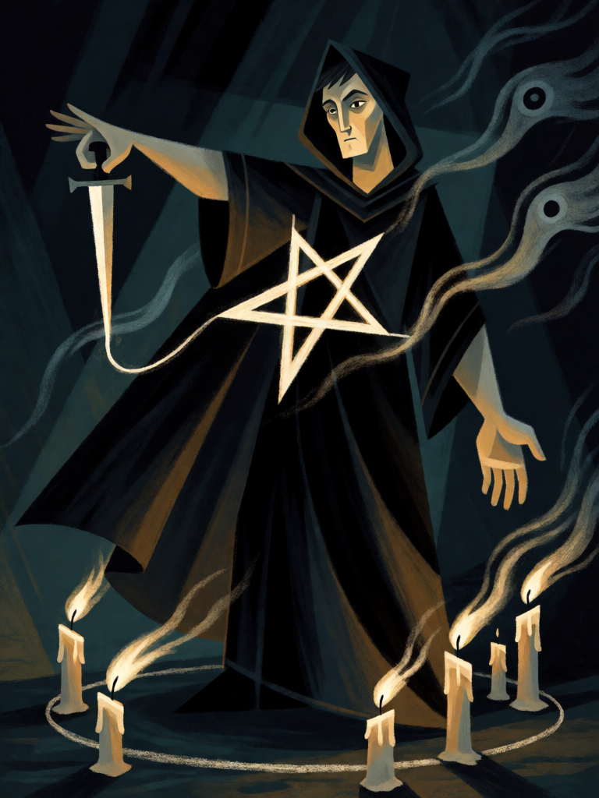

# Ritual Menor do Pentagrama

[← Alta magia](../alta_magia.md) · [Wiki KodeX](../README.md) · [◀ Conjuração dos Elementais](alt_conjuracao_elementais.md) · [Abrahadabra ▶](alt_abrahadabra.md)

| Carta | Arte |
|---|---|
|  |  |

| | |
|---|---|
| **Tradição** | Alta magia |
| **Tipo** | Rito |
| **Custo de Fé** | 4 |
| **Palavras-chave** | — |
| **Lendária** | não |
| **Cópias no deck** | 1 |
| **Id** | `alt_ritual_menor_pentagrama` |

## Texto da carta

> Devolva todas as Entidades inimigas à mão do dono.

**EN — Lesser Banishing Ritual of the Pentagram:** *Return all enemy Entities to their owner's hand.*

## Contexto mitológico

O Ritual Menor de Banimento do Pentagrama (LBRP, *Lesser Banishing Ritual of the Pentagram*) é o rito fundamental da Golden Dawn, ensinado ao Neófito no grau 0=0 e praticado diariamente por todos os graus. O mago faz a **Cruz Cabalística** (toca testa, peito, ombros com as palavras *Ateh, Malkuth, ve-Geburah, ve-Gedulah, le-Olam, Amen*), traça com a adaga um pentagrama flamejante em cada quadrante vibrando um nome divino (YHVH ao leste, Adonai ao sul, Eheieh ao oeste, AGLA ao norte), une-os num círculo e invoca os quatro arcanjos — "diante de mim Rafael, atrás de mim Gabriel, à minha direita Miguel, à minha esquerda Uriel" — fechando com a Cruz de novo.

Seu efeito, segundo Regardie (*The Golden Dawn*, vol. I), é **limpar o espaço de toda influência que não foi convidada**: espíritos, impressões astrais, o próprio ruído mental. Crowley o manteve na A∴A∴ (*Liber O*) e o recomendava antes e depois de qualquer operação; é o rito que Neuburg deveria ter feito melhor no deserto.

A carta é o banimento completo: tudo o que o oponente invocou é expulso do círculo — não destruído, devolvido à mão, porque o LBRP não mata, só manda embora.

## Papel no jogo

Reset de tabuleiro do deck de controle: o oponente investiu quatro turnos de Fé em criaturas e precisa pagar tudo de novo, enquanto você mantém as suas. Devastador contra decks que buffaram Entidades (o buff se perde) e contra tokens (desaparecem — tokens devolvidos à mão deixam de existir). Fraco contra decks de poucas Entidades grandes com Despertar forte, que voltam e repetem o efeito.

## Atributos visuais

mago inglês adulto de manto preto · braço direito estendido com adaga ritual traçando pentagrama de luz no ar · espíritos sombrios sendo soprados para longe · vento forte, manto esvoaçando

Balanço (conta de custo)

Orçamento P = 2·4+1 = 9 pts. Gasto: devolver Entidade inimiga à mão (2) × até 4 Entidades = 8 no máximo, 4–6 no caso típico. Dentro.

Ficha completa: `cartas/alta_magia/27_ritual_menor_pentagrama.md` · cartas base da versão Alpha
