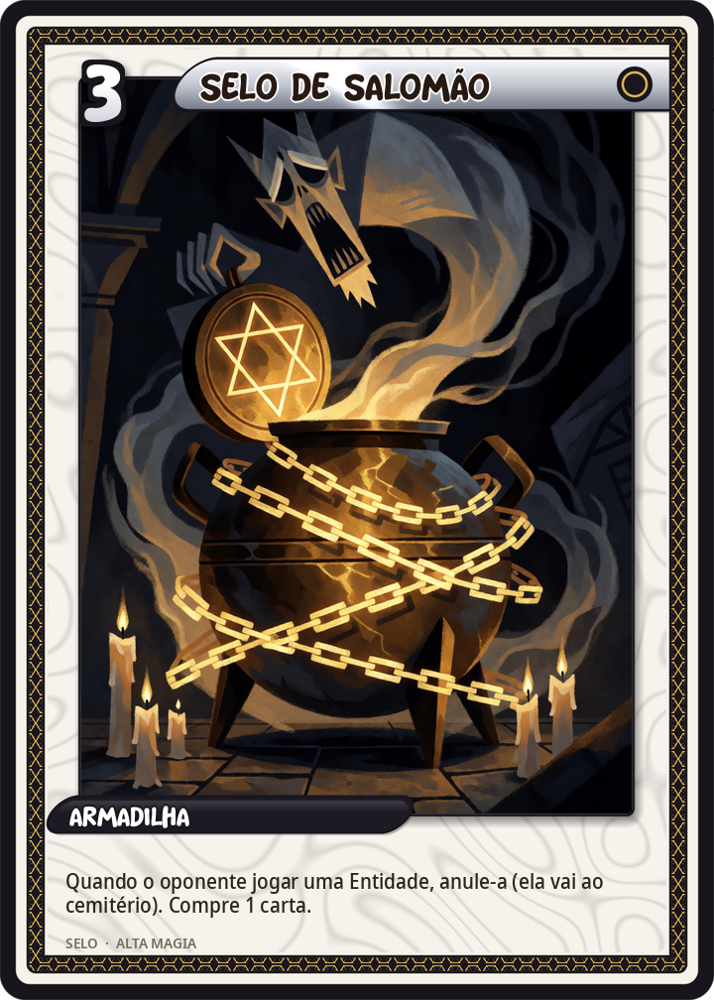
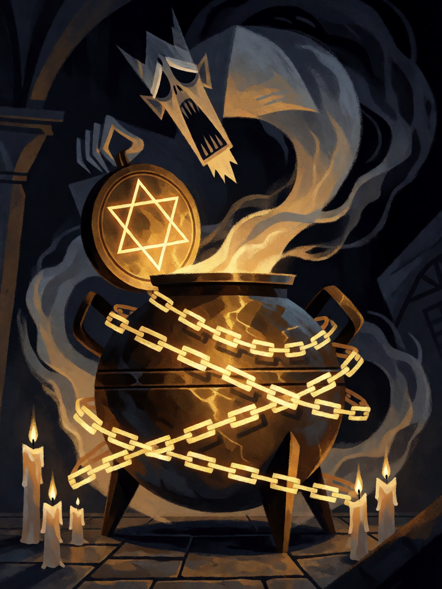

# Selo de Salomão

[← Alta magia](../alta_magia.md) · [Wiki KodeX](../README.md) · [◀ Pentagrama Flamejante](alt_pentagrama_flamejante.md) · [Solve et Coagula ▶](alt_solve_et_coagula.md)

| Carta | Arte |
|---|---|
|  |  |

| | |
|---|---|
| **Tradição** | Alta magia |
| **Tipo** | Selo |
| **Custo de Fé** | 3 |
| **Palavras-chave** | — |
| **Lendária** | não |
| **Cópias no deck** | 1 |
| **Id** | `alt_selo_de_salomao` |

## Texto da carta

> Quando o oponente invocar uma Entidade, anule-a (ela vai ao cemitério) e compre 1 carta.

**EN — Seal of Solomon:** *When your opponent summons an Entity, counter it (it goes to the graveyard) and draw 1 card.*

## Contexto mitológico

O Selo de Salomão é o sinal gravado no anel que, segundo o *Testamento de Salomão* (séc. I–III d.C.), o arcanjo Miguel entregou ao rei para que ele **comandasse os demônios** e os pusesse a trabalhar na construção do Templo. Na tradição islâmica e na magia medieval o selo é o hexagrama — duas triângulos entrelaçados, fogo e água, acima e abaixo — e é com ele que Salomão aprisiona os espíritos no Vaso de Latão, que lança ao lago (Lemegeton, "Observações").

O Lemegeton descreve o Anel e o Pentáculo de Salomão como os instrumentos que o mago deve exibir ao espírito: o Pentáculo, gravado em metal e vestido ao peito, obriga o espírito a assumir forma humana e a obedecer; o Anel, de prata, protege do hálito venenoso de Astaroth e Beleth. Agrippa (III.11) e Reuchlin (*De verbo mirifico*, 1494) explicam os nomes divinos que vão gravados nesses selos — o Tetragrammaton e suas permutações — e por que o espírito não resiste a eles.

A carta é o selo que aprisiona: a Entidade inimiga é invocada e, antes de pisar o campo, cai no vaso. O "compre 1" é o que Salomão ganhava — mais um servo para o Templo.

## Papel no jogo

Resposta dura a Lendárias e a Entidades caras: o oponente paga 6–8 Fé e perde a carta. Custa 3, então é um Selo do meio de jogo — coloque-o quando o oponente estiver com Fé para invocar algo grande. Como dispara na primeira Entidade invocada, decks de muitas criaturas baratas o gastam fácil; contra esses, prefira Andras e o Ritual Menor do Pentagrama. **Uma cópia só** (revisão): com Pentagrama Flamejante ×2, o deck fica com 3 contadores, o teto de sanidade; Vassago busca esta cópia quando ela é a resposta certa.

## Atributos visuais

vaso de latão com tampa gravada com hexagrama brilhante · espírito fantasmagórico sendo sugado para dentro como fumaça · correntes de luz envolvendo o vaso

Balanço (conta de custo)

Orçamento P = 2·3+1 = 7 pts + 1 (Selo) = 8. Gasto: anular Entidade inimiga (destruir Entidade escolhida = 5, +1 porque também nega o Despertar e qualquer custo de Sacrifício já pago = 6) + comprar 1 (1,5) = 7,5. Dentro (P−0,5). _(Rodada 1: reconta com `destroy` a 5 pts; antes 6,5. Sem mudança na carta.)_

Ficha completa: `cartas/alta_magia/17_selo_de_salomao.md` · cartas base da versão Alpha
