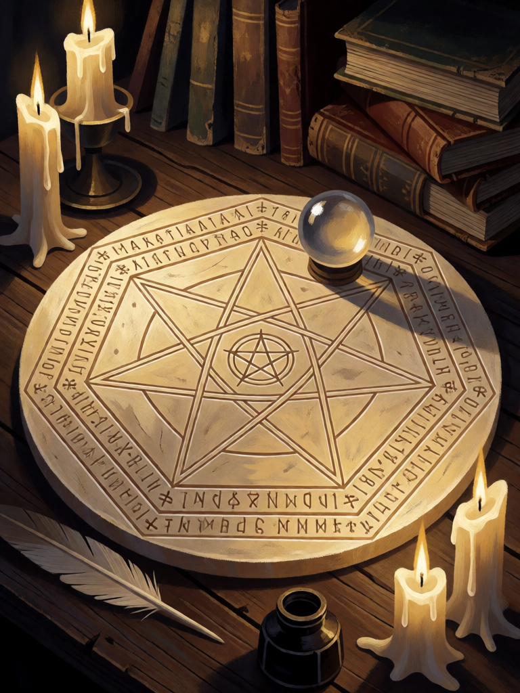

# Sigillum Dei Aemeth

[← Alta magia](../alta_magia.md) · [Wiki KodeX](../README.md) · [◀ Anel de Salomão](alt_anel_de_salomao.md) · [Pedra de Visão de Dee ▶](alt_pedra_de_visao.md)

| Carta | Arte |
|---|---|
|  |  |

| | |
|---|---|
| **Tradição** | Alta magia |
| **Tipo** | Relíquia |
| **Custo de Fé** | 2 |
| **Palavras-chave** | — |
| **Lendária** | não |
| **Cópias no deck** | 1 |
| **Id** | `alt_sigillum_dei_aemeth` |

## Texto da carta

> A Entidade equipada ganha +0/+3 e Guarda. Quando ela morrer, compre 1 carta.

**EN — Sigillum Dei Aemeth:** *The equipped Entity gains +0/+3 and Guard. When it dies, draw 1 card.*

## Contexto mitológico

O *Sigillum Dei Aemeth* — "Selo de Deus da Verdade" (*Aemeth*, אמת, "verdade" em hebraico) — é o disco de cera de nove polegadas que John Dee recebeu, letra por letra, de Edward Kelley em março de 1582, nas primeiras sessões com a pedra de visão (Sloane MS 3188, *Mysteriorum Liber Primus*). Traz um heptagrama dentro de heptágonos concêntricos, com nomes de Deus e dos sete anjos planetários dispostos em tabelas de letras e números, e um pentagrama central. Dee fez cinco: quatro sob os pés da Mesa Sagrada e um sobre ela, **debaixo da pedra de visão** — o cristal repousava sobre o selo, que o protegia e autenticava a visão.

O desenho descende do *Sigillum Dei* do *Liber Juratus Honorii* (séc. XIII), onde garante ao operador a visão de Deus em vida; Dee o reformou com a ajuda dos anjos. Três discos originais sobreviveram e estão no British Museum (o grande e dois dos pequenos), junto com o espelho de obsidiana e a bola de cristal. É o objeto mais famoso da magia enochiana e um dos poucos instrumentos mágicos históricos que se pode ver numa vitrine.

A carta é o selo sob o cristal: quem o porta fica protegido (+3 de Vida) e atrai sobre si todo ataque (Guarda); e, se cair, a verdade que ele guardava vira uma carta.

## Papel no jogo

Faz um guardião de qualquer corpo: em Orobas vira 1/7 que se cura 2 por turno; no Anjo, 4/11; num Homúnculo, um 1/5 com Guarda que compra 2 ao morrer (Último Sopro + Sigillum). É a resposta do deck a agressão quando os Selos já foram gastos. Fraco contra Ritos de destruição que ignoram Vida, e contra silêncio (perde Guarda).

## Atributos visuais

grande disco de cera de abelha claro, plano, sobre mesa escura · estrela de sete pontas no centro e anéis concêntricos de símbolos gravados · pequena bola de cristal sobre o disco · brilho dourado suave

Balanço (conta de custo)

Orçamento P = 2·2+1 = 5 pts + 1 (Relíquia) = 6. Gasto: +3 Vida permanente (3) + Guarda (1) + comprar 1 ao morrer (1,5) = 5,5. Dentro.

Ficha completa: `cartas/alta_magia/30_sigillum_dei_aemeth.md` · cartas base da versão Alpha
