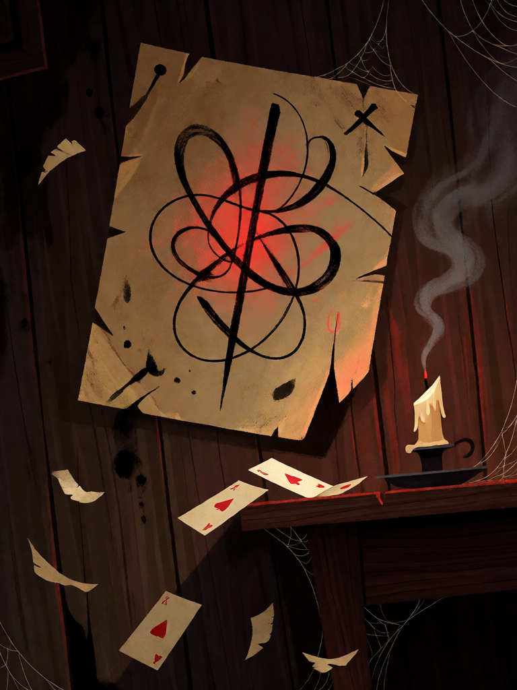

# Sigilo de Spare

[← Alta magia](../alta_magia.md) · [Wiki KodeX](../README.md) · [◀ Solve et Coagula](alt_solve_et_coagula.md) · [Lemegeton, a Chave Menor ▶](alt_lemegeton.md)

| Carta | Arte |
|---|---|
|  |  |

| | |
|---|---|
| **Tradição** | Alta magia |
| **Tipo** | Selo |
| **Custo de Fé** | 1 |
| **Palavras-chave** | — |
| **Lendária** | não |
| **Cópias no deck** | 1 |
| **Id** | `alt_sigilo_de_spare` |

## Texto da carta

> No fim do turno do oponente, ele descarta 1 carta aleatória da mão e você compra 1 carta.

**EN — Spare's Sigil:** *At the end of your opponent's turn, they discard 1 random card from their hand and you draw 1 card.*

## Contexto mitológico

Austin Osman Spare (1886–1956), artista londrino que a imprensa chamou de "o novo Beardsley" aos dezoito anos, abandonou as galerias para desenvolver uma magia pessoal, descrita em *The Book of Pleasure (Self-Love): The Psychology of Ecstasy* (1913). Seu método — a **sigilização** — tornou-se a técnica mais influente da magia moderna: escreve-se o desejo numa frase, eliminam-se as letras repetidas, condensam-se as restantes num glifo abstrato, carrega-se o glifo num momento de exaustão ou êxtase (o "vazio", a *death posture*) e, essencial, **esquece-se o desejo**, para que trabalhe no subconsciente sem a interferência da mente consciente. O sigilo não age na hora: fica guardado e dispara sozinho, mais tarde, quando a mente desatenta lhe dá passagem.

Spare rejeitava a parafernália cerimonial de Crowley — que o admitiu na A∴A∴ como *Probationer* em 1909 e o perdeu logo depois; Spare ridicularizou os rituais e Crowley chamou-o de "Black Brother". Para Spare, o grimório inteiro cabe num traço. O "alfabeto do desejo", a cosmologia Zos/Kia (o corpo-mente e o vazio) e os "atavismos" herdados da bruxa Mrs. Paterson completam o sistema, mais tarde adotado pela magia do caos dos anos 1970 (Carroll, *Liber Null*).

A carta deixou de ser Rito para ser **Selo** justamente por isso: um sigilo é traçado, carregado e esquecido — fica virado para baixo até o momento em que o oponente baixa a guarda (fim do turno dele) e então algo sai da mente dele sem que saiba o quê. O esquecimento é dele; a lembrança (a carta comprada) é sua.

## Papel no jogo

Descarte barato e atrasado: colocado no turno 1 ou 2, dispara no fim do turno seguinte do oponente, quando a mão dele ainda está cheia e cada carta vale mais. Reduz a chance de ele ter a resposta na mão quando o pacto (Astaroth, Dantalion) chegar. Aleatório, então não é confiável — por isso só uma cópia. Ocupa um dos 2 slots de Selo por um turno: não o coloque se precisar de Pentagrama Flamejante e Selo de Salomão ao mesmo tempo.

## Atributos visuais

um único pedaço de pergaminho pregado numa parede de madeira · glifo abstrato de linhas de tinta preta emaranhadas, brilho vermelho fraco · cartas de baralho caindo da mesa · vela apagada

Balanço (conta de custo)

Orçamento P = 2·1+1 = 3 pts + 1 (Selo) = 4. Gasto: oponente descarta 1 carta aleatória (2) + comprar 1 (1,5) = 3,5. Dentro.

Ficha completa: `cartas/alta_magia/20_sigilo_de_spare.md` · cartas base da versão Alpha
