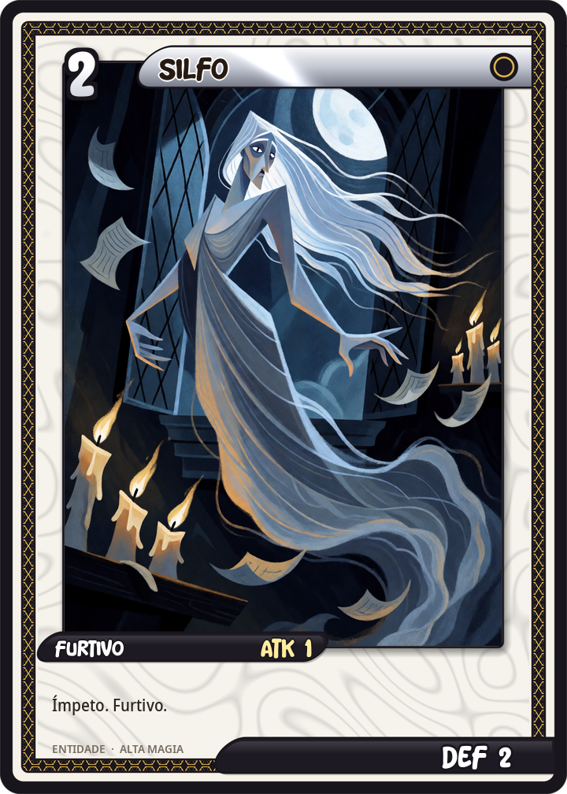
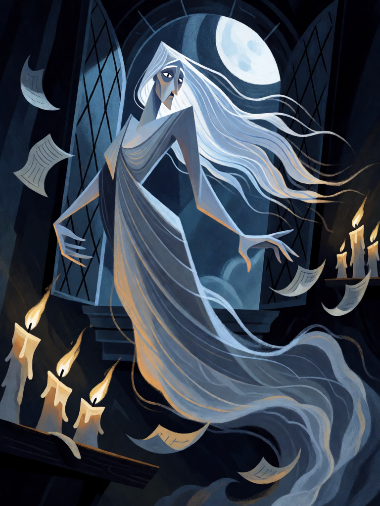

# Silfo

[← Alta magia](../alta_magia.md) · [Wiki KodeX](../README.md) · [◀ Edward Kelley, o Vidente](alt_edward_kelley.md) · [Vassago, o Príncipe que Acha ▶](alt_vassago.md)

| Carta | Arte |
|---|---|
|  |  |

| | |
|---|---|
| **Tradição** | Alta magia |
| **Tipo** | Entidade |
| **Custo de Fé** | 2 |
| **ATK / DEF** | 1 / 2 |
| **Palavras-chave** | Ímpeto, Furtivo |
| **Lendária** | não |
| **Cópias no deck** | 1 |
| **Id** | `alt_silfo` |

## Texto da carta

> Ímpeto. Furtivo.

**EN — Sylph:** *Rush. Stealth.*

## Contexto mitológico

Os silfos são os espíritos do ar na classificação de Paracelso (*Liber de nymphis, sylphis, pygmaeis et salamandris*, publicado postumamente em 1566). Cada elemento tem seu povo: gnomos ou pigmeus na terra, ninfas ou ondinas na água, salamandras no fogo, silfos no ar. São "entre homem e espírito": têm corpo, comem, dormem e morrem, mas não têm alma — e por isso buscam o homem, seja para servir, seja para casar e ganhar alma pelo matrimônio (a história de Melusina).

Paracelso descreve os silfos como mais altos e esguios que os homens, rápidos, quase invisíveis, vivendo no ar como o peixe na água. Abade de Villars os tornou galantes e sedutores no *Comte de Gabalis* (1670), e daí passaram a Pope (*The Rape of the Lock*) e aos ocultistas do século XIX, que os invocam no quadrante do Leste com a adaga do ar.

A carta traduz o ar em movimento e invisibilidade: Ímpeto (ataca ao chegar) e Furtivo (não pode ser alvo até atacar). É a única Entidade do deck sem efeito escrito — a identidade de controle quer poucas assim.

## Papel no jogo

Ataque-surpresa e Sacrifício flexível: entra, bate 1 numa Entidade ferida ou numa Cornucópia desprotegida, e no turno seguinte pode ser oferecido a Astaroth ou Dantalion. Furtivo o torna um corpo que o oponente não consegue remover antes do pacto. Muito frágil se forçado a bloquear.

## Atributos visuais

espírito do ar alto e esguio, andrógino · corpo semitransparente, branco-azulado, que se desfaz em nuvem nos pés · veste longa e diáfana que cobre o tronco · avançando em pleno voo (Ímpeto) · meio invisível (Furtivo)

Balanço (conta de custo)

Orçamento P = 2·2+1 = 5 pts. Gasto: ATK 1 + Vida 2 + Ímpeto (1) + Furtivo (1) = 5. Dentro.

Ficha completa: `cartas/alta_magia/04_silfo.md` · cartas base da versão Alpha
