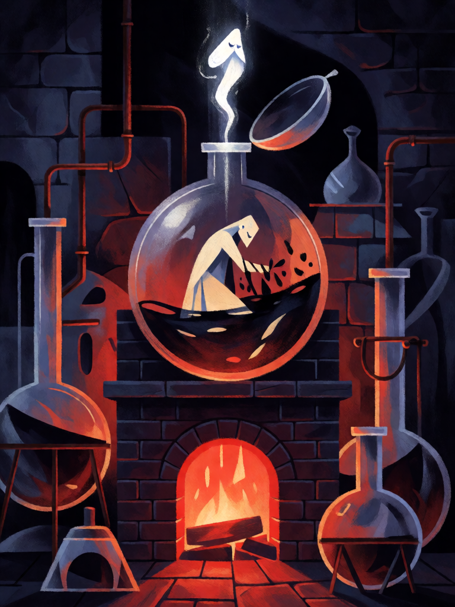

# Solve et Coagula

[← Alta magia](../alta_magia.md) · [Wiki KodeX](../README.md) · [◀ Selo de Salomão](alt_selo_de_salomao.md) · [Sigilo de Spare ▶](alt_sigilo_de_spare.md)

| Carta | Arte |
|---|---|
|  |  |

| | |
|---|---|
| **Tradição** | Alta magia |
| **Tipo** | Selo |
| **Custo de Fé** | 1 |
| **Palavras-chave** | — |
| **Lendária** | não |
| **Cópias no deck** | 2 |
| **Id** | `alt_solve_et_coagula` |

## Texto da carta

> Quando uma Entidade aliada morrer no turno do oponente, devolva uma Entidade do seu cemitério à mão e compre 1 carta.

**EN — Solve et Coagula:** *When an allied Entity dies on your opponent's turn, return an Entity from your graveyard to your hand and draw 1 card.*

## Contexto mitológico

*Solve et coagula* — "dissolve e coagula" — é o lema da Grande Obra alquímica. A matéria-prima deve ser dissolvida (nigredo, putrefação, a morte do corpo) para que o espírito se separe dela e volte a fixar-se num corpo novo e purificado (albedo, rubedo). O *Rosarium Philosophorum* (1550) mostra o rei e a rainha morrendo no banho, a alma subindo e descendo, e o Rebis ressurgindo. A fórmula circula como máxima anônima nos tratados dos séculos XVI–XVII (Khunrath, Maier, o corpus de "Basílio Valentim") antes de ganhar a forma lapidar que hoje se cita.

Éliphas Lévi a tornou visível para sempre: no frontispício do *Ritual da Alta Magia* (1856), o Baphomet de Mendes ergue um braço com "Solve" e baixa o outro com "Coagula" — o equilíbrio do que se desfaz e do que se refaz. Para Lévi, é a lei de toda operação mágica: nada se cria sem antes dissolver.

A carta é a Obra em miniatura: quando algo seu morre (solve), uma Entidade do cemitério volta à mão (coagula), e você ainda aprende uma carta.

## Papel no jogo

Recicla o fodder: cada Homúnculo, Silfo ou Vassago que o oponente mata no turno dele devolve uma Entidade do cemitério (pode ser outra — um Astaroth que morreu antes) e compra 1. Combina com Último Sopro do Homúnculo (duas compras numa morte). Custa 1, então vai para baixo no turno 1 sem atrasar nada. Não dispara em mortes por Sacrifício (acontecem no seu turno).

## Atributos visuais

frasco alquímico de vidro redondo sobre o atanor em brasa · corpo pálido se dissolvendo em líquido negro · pequeno espírito branco luminoso subindo do frasco

Balanço (conta de custo)

Orçamento P = 2·1+1 = 3 pts + 1 (Selo) = 4. Gasto: reviver Entidade do cemitério para a mão (2) + comprar 1 (1,5) = 3,5. Dentro.

Ficha completa: `cartas/alta_magia/18_solve_et_coagula.md` · cartas base da versão Alpha
