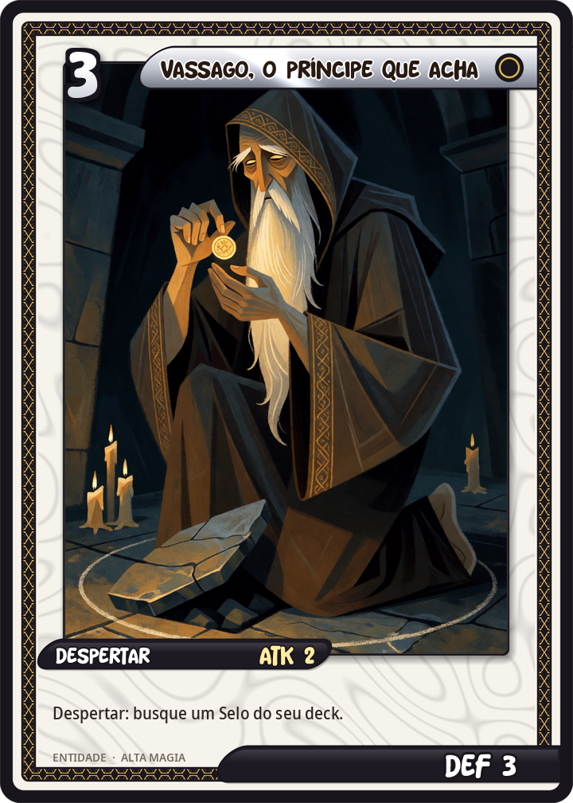
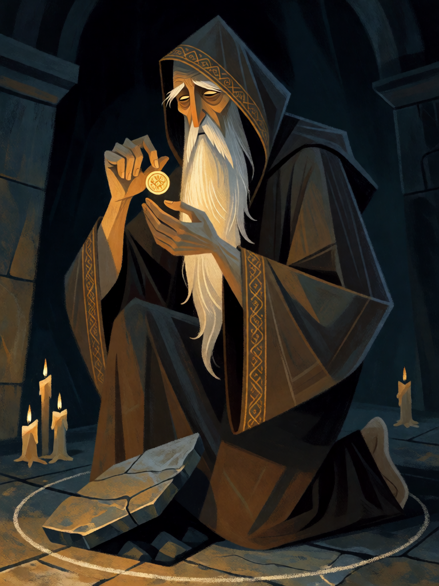

# Vassago, o Príncipe que Acha

[← Alta magia](../alta_magia.md) · [Wiki KodeX](../README.md) · [◀ Silfo](alt_silfo.md) · [Orobas, o Príncipe Fiel ▶](alt_orobas.md)

| Carta | Arte |
|---|---|
|  |  |

| | |
|---|---|
| **Tradição** | Alta magia |
| **Tipo** | Entidade |
| **Custo de Fé** | 3 |
| **ATK / DEF** | 2 / 3 |
| **Palavras-chave** | — |
| **Lendária** | não |
| **Cópias no deck** | 2 |
| **Id** | `alt_vassago` |

## Texto da carta

> Despertar: busque um Selo do seu deck.

**EN — Vassago, the Prince Who Finds:** *Awaken: Search your deck for a Seal.*

## Contexto mitológico

Vassago é o terceiro espírito da *Ars Goetia* (Lemegeton, séc. XVII), um Príncipe "da mesma natureza de Agares", de boa índole. Seu ofício é declarar coisas passadas e futuras e **descobrir tudo o que está escondido ou perdido**; governa 26 legiões. É um dos poucos espíritos da lista que o próprio texto descreve como benigno ("of a good nature"), e por isso virou favorito dos magos que querem adivinhação sem risco. Detalhe de filologia: Vassago **não consta** na *Pseudomonarchia Daemonum* de Weyer (1577), fonte dos outros 68; é um dos quatro espíritos (com Seere, Dantalion e Andromalius) acrescentados pelo compilador do Lemegeton no século XVII — provavelmente de outra lista hoje perdida.

A Goetia não lhe dá forma fixa; a iconografia posterior o mostra como um ancião sereno ou como uma figura encapuzada segurando algo que acabou de encontrar. Como todo espírito do Lemegeton, ele vem quando o mago mostra o Pentáculo de Salomão e o chama pelo selo gravado em metal.

A carta pega o ofício ao pé da letra: ao chegar, Vassago acha o que está escondido no deck — um Selo, a carta virada para baixo. É a tutoria de armadilhas do deck de controle.

## Papel no jogo

Motor dos Selos: garante Pentagrama Flamejante contra decks de Ritos, Selo de Salomão contra decks de Entidades grandes ou Solve et Coagula quando há fodder para reciclar. Corpo 2/3 razoável no turno 3, que segura um atacante pequeno e depois vira Sacrifício. Duas cópias porque é a carta que faz o resto do deck funcionar.

## Atributos visuais

espírito em forma de ancião de pele pálida, barba branca longa · manto escuro com capuz e barra dourada · ajoelhado, erguendo um pequeno selo dourado redondo · olhos de brilho pálido, expressão serena

Balanço (conta de custo)

Orçamento P = 2·3+1 = 7 pts. Gasto: ATK 2 + Vida 3 + Despertar buscar Selo (2) = 7. Dentro.

Ficha completa: `cartas/alta_magia/05_vassago.md` · cartas base da versão Alpha
