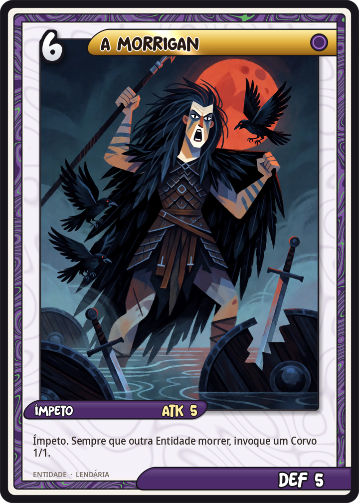
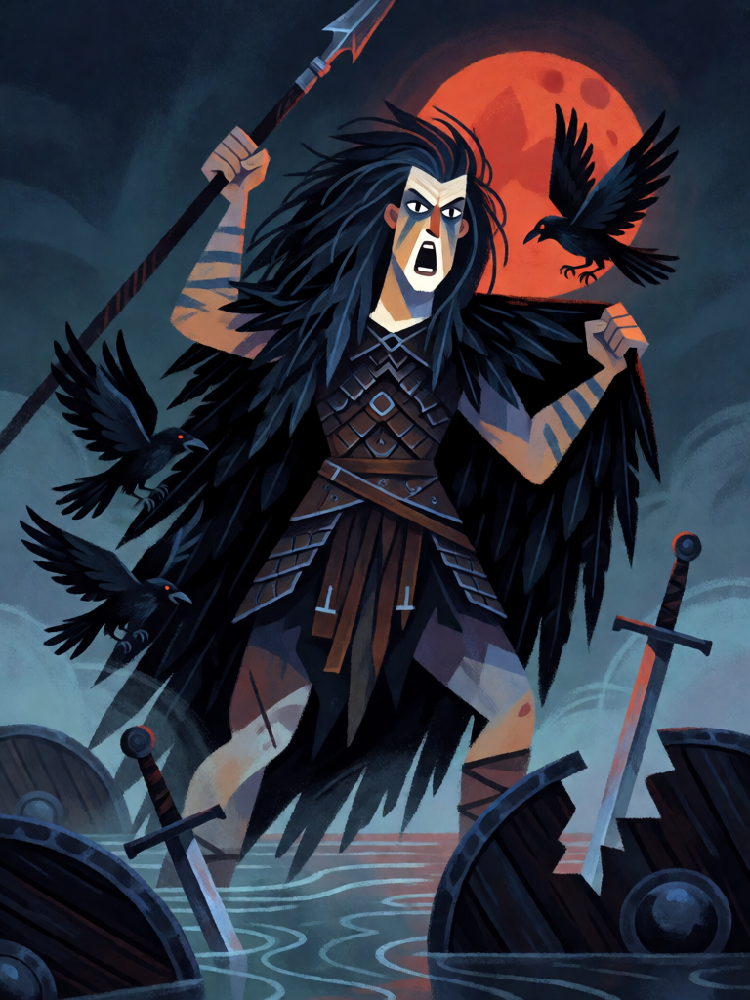

# A Morrigan

[← Bruxaria](../bruxaria.md) · [Wiki KodeX](../README.md) · [◀ Cerridwen, Senhora do Caldeirão](bru_cerridwen.md) · [Hécate, Senhora das Encruzilhadas ▶](bru_hecate.md)

| Carta | Arte |
|---|---|
|  |  |

| | |
|---|---|
| **Tradição** | Bruxaria |
| **Tipo** | Entidade |
| **Custo de Fé** | 6 |
| **ATK / DEF** | 5 / 5 |
| **Palavras-chave** | Ímpeto |
| **Lendária** | sim |
| **Cópias no deck** | 1 |
| **Id** | `bru_a_morrigan` |

## Texto da carta

> Ímpeto. Sempre que uma Entidade — aliada ou inimiga — morrer, invoque um Corvo 1/1.

**EN — The Morrígan:** *Rush. Whenever an Entity — allied or enemy — dies, summon a 1/1 Crow.*

## Contexto mitológico

*An Mórrígan*, "a Grande Rainha" (ou "Rainha dos Fantasmas"), é a deusa irlandesa da guerra, da profecia e da soberania da terra. Aparece quase sempre como uma de três irmãs — com Badb ("corvo-de-batalha") e Macha, ou Nemain — e por isso é também "as Morrígna". No *Cath Maige Tuired* ("A Segunda Batalha de Mag Tuired") ela se une ao Dagda no Samhain, à beira de um rio, com um pé em cada margem, e promete a vitória aos Tuatha Dé Danann; depois da batalha profetiza o fim dos tempos.

No *Táin Bó Cúailnge* ela oferece seu amor a Cú Chulainn em forma de jovem; rejeitada, ataca-o durante o combate no vau como enguia que lhe enrola as pernas, loba que estoura o gado contra ele e novilha vermelha à frente da manada; ferido em cada forma, ela depois o engana como velha ordenhando uma vaca para que ele a cure com três bênçãos. Quando Cú Chulainn morre amarrado a uma pedra (*Aided Con Culainn*, a história de sua morte), ninguém se aproxima até que um corvo — a Morrigan — pousa em seu ombro. Antes da batalha, lava-se em rios a armadura dos que vão morrer: a "lavadeira do vau".

Não é uma bruxa no sentido dos processos, mas é a divindade que a bruxaria moderna de linha céltica mais invoca como Senhora Negra: morte, corvo, metamorfose, profecia. Na carta é a rainha a quem toda morte alimenta — de cada cadáver, de qualquer lado, levanta um corvo.

## Papel no jogo

A Lendária agressiva do deck: 5/5 com Ímpeto que ataca no turno em que entra. Cada morte na mesa — a Entidade que ela mata, o familiar sacrificado para Hécate, o porco de Circe que cai — vira mais um corpo 1/1 para o Sabá ou para o próximo Sacrifício. Com Pó de Ossos (dano em área), uma única jogada pode encher o campo de corvos. Sem Guarda no deck, ela é também o alvo que o oponente precisa remover; Garrafa de Bruxa protege-a de um Rito de remoção.

## Atributos visuais

deusa guerreira irlandesa · capa de penas pretas e armadura de couro escuro · lança erguida, avançando · corvos irrompendo da capa · vau de rio com escudos quebrados

Balanço (conta de custo)

Orçamento P = 2·6+1 = 13 pts; Lendária pode ir até 15. Gasto: ATK 5 + Vida 5 + Ímpeto 1 + `ally_dies` → Corvo 1/1 (2 pts, gatilho repetível vale cheio) + `enemy_dies` → Corvo 1/1 (2 pts) = 15. No teto lendário. (Versão anterior 5/6 somava 16 com a tabela oficial — cortou-se 1 de Vida.)

Ficha completa: `cartas/bruxaria/11_a_morrigan.md` · cartas base da versão Alpha
