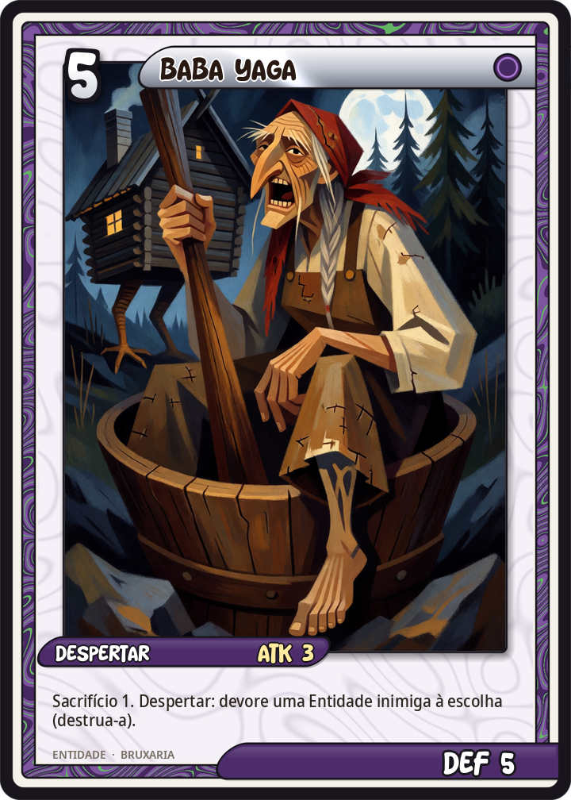
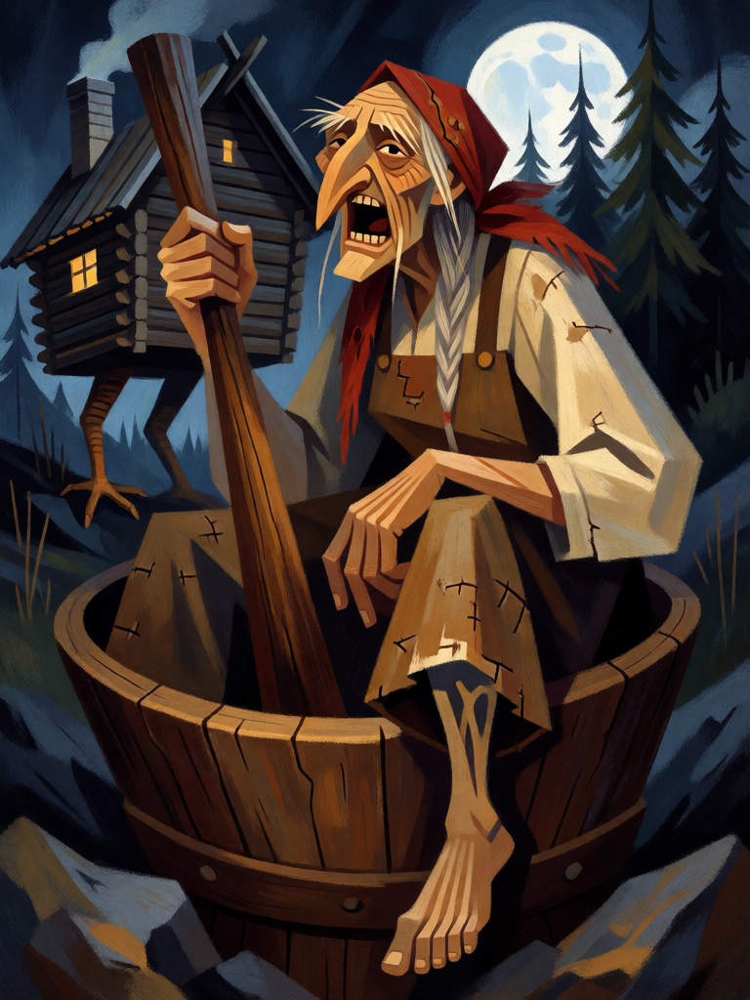

# Baba Yaga

[← Bruxaria](../bruxaria.md) · [Wiki KodeX](../README.md) · [◀ A Bruxa de Endor](bru_bruxa_de_endor.md) · [Cerridwen, Senhora do Caldeirão ▶](bru_cerridwen.md)

| Carta | Arte |
|---|---|
|  |  |

| | |
|---|---|
| **Tradição** | Bruxaria |
| **Tipo** | Entidade |
| **Custo de Fé** | 5 |
| **ATK / DEF** | 3 / 5 |
| **Sacrifício** | 1 |
| **Palavras-chave** | — |
| **Lendária** | não |
| **Cópias no deck** | 1 |
| **Id** | `bru_baba_yaga` |
| **Arte** | provisória nesta Alpha |

## Texto da carta

> Sacrifício 1. Despertar: devore uma Entidade inimiga à escolha (destrua-a).

**EN — Baba Yaga:** *Sacrifice 1. Awaken: Devour an enemy Entity of your choice (destroy it).*

## Contexto mitológico

Baba Yaga é a velha da floresta dos contos russos e eslavos: nariz que toca o teto, perna de osso, dentes de ferro. Mora numa *izbá* que gira sobre pés de galinha e só se abre quando se diz "cabaninha, cabaninha, fica de costas para a floresta e de frente para mim"; a cerca é de ossos humanos e os postes têm caveiras cujos olhos brilham à noite. Voa num pilão, remando com o socador e apagando o rastro com a vassoura. Fareja o visitante — "cheira a russo aqui!" — e come quem não cumpre suas tarefas.

No conto "Vasilisa, a Bela" (Afanasiev, nº 104), a menina mandada pela madrasta a buscar fogo é posta a separar milho de joio e papoula de terra; cumpre tudo com a ajuda da boneca da mãe morta, e Baba Yaga, descobrindo que ela é protegida por uma bênção, expulsa-a — mas dá-lhe a caveira de fogo que, em casa, incinera a madrasta e as irmãs. Vladimir Propp (*As raízes históricas do conto maravilhoso*, 1946) lê Baba Yaga como a guardiã da fronteira entre o mundo dos vivos e o reino dos mortos: a cabana é a porta, as tarefas são o rito de iniciação, e ela é ao mesmo tempo devoradora e doadora.

Na carta ela é as duas coisas. Chega exigindo um sacrifício — alguém tem que entrar na cabana — e, uma vez na mesa, come o inimigo que escolher.

## Papel no jogo

A primeira Entidade de pacto do deck: paga-se com um Sapo (que ainda dispara o Último Sopro) ou uma Strix — ou com um Gato, lembrando que Sacrifício **não** aciona Renascer e o Gato não volta —, e ganha-se uma 3/5 que remove a melhor Entidade inimiga ao entrar. É a resposta pesada do turno 5. Com Pacto na Encruzilhada sai no turno 4. Depois de entrar é um corpo grande que exige que o oponente gaste remoção. Risco: sem familiar em campo ela fica presa na mão — por isso o deck tem tantos corpos baratos.

## Atributos visuais

anciã eslava muito velha · perna esquerda de osso (canela e pé de esqueleto) · nariz longo e adunco e dentes de ferro · lenço e vestido camponês remendado · pilão grande na mão

Balanço (conta de custo)

Orçamento P = 2·5+1 + 2·1 (Sacrifício 1) = 13 pts. Gasto: ATK 3 + Vida 5 + Despertar: destruir Entidade inimiga escolhida (5 pts) = 13. Dentro.
Rodada 1 de balanceamento: era 4/5 (14 com `destroy` a 5 pts; 63 % no espelho).

Ficha completa: `cartas/bruxaria/09_baba_yaga.md` · cartas base da versão Alpha
