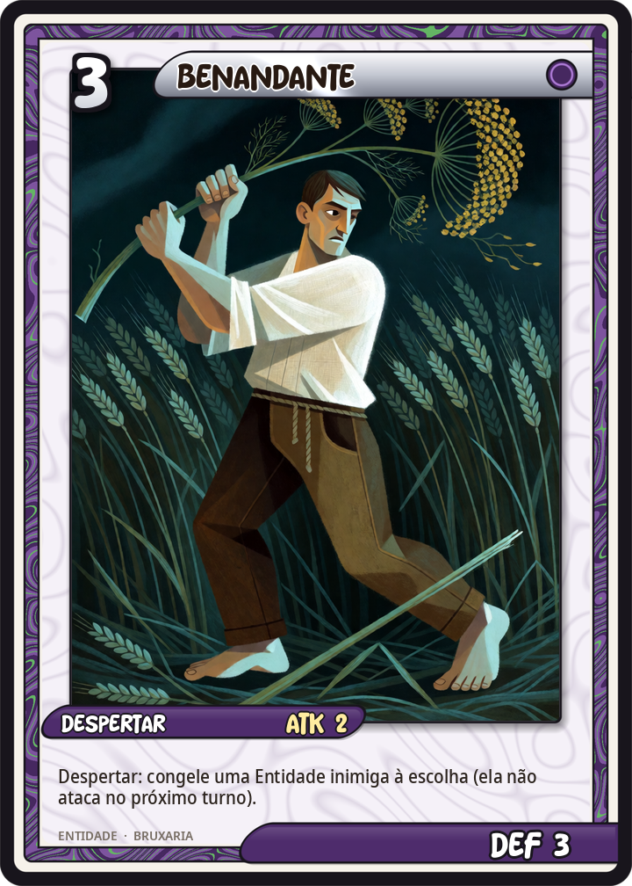
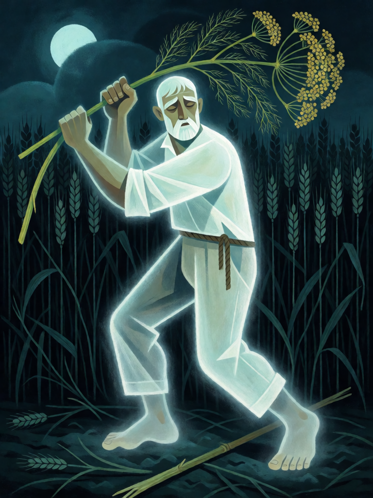

# Benandante

[← Bruxaria](../bruxaria.md) · [Wiki KodeX](../README.md) · [◀ Strega de Benevento](bru_strega_de_benevento.md) · [Circe ▶](bru_circe.md)

| Carta | Arte |
|---|---|
|  |  |

| | |
|---|---|
| **Tradição** | Bruxaria |
| **Tipo** | Entidade |
| **Custo de Fé** | 3 |
| **ATK / DEF** | 2 / 3 |
| **Palavras-chave** | — |
| **Lendária** | não |
| **Cópias no deck** | 2 |
| **Id** | `bru_benandante` |
| **Arte** | provisória nesta Alpha |

## Texto da carta

> Despertar: congele uma Entidade inimiga à escolha (ela não ataca no próximo turno).

**EN — Benandante:** *Awaken: Freeze an enemy Entity of your choice (it can't attack on its next turn).*

## Contexto mitológico

Os *benandanti* ("os que andam bem") do Friul, nordeste da Itália, são o achado de Carlo Ginzburg em *Os Andarilhos do Bem* (1966). Entre 1575 e 1675 dezenas de camponeses contaram à Inquisição de Aquileia e Concórdia a mesma história: nascidos "com a camisa" (a membrana amniótica), eram chamados quatro vezes por ano, nas noites das Têmporas, a sair do corpo em espírito — em forma de rato ou borboleta, ou montados em lebres e gatos — para lutar nos campos de Josafat contra os bruxos (*malandanti*). Os benandanti iam armados de ramos de funcho; os bruxos, de canas de sorgo. Se os benandanti vencessem, a colheita seria farta; se perdessem, viria a fome.

Eles também curavam enfeitiçados, viam os mortos em procissão e se consideravam defensores da fé. A Inquisição, sem categoria para isso, levou um século de interrogatórios para convencê-los de que eram bruxos também — e eles, aos poucos, passaram a confessar o sabá que os juízes esperavam. Ginzburg lê nos benandanti o resto vivo de um culto agrário de êxtase de tipo xamânico, parente do *táltos* húngaro e dos *kresniki* eslovenos (*História Noturna*, 1989).

Na carta o benandante é um guerreiro da bruxaria popular: entra em campo e já derruba um bruxo inimigo na batalha noturna. O derrotado não some — fica atordoado uma volta.

## Papel no jogo

Tempo e controle: 2/3 por 3 Fé que impede o melhor atacante inimigo de agir no próximo turno — tempo para posicionar Mau-Olhado, invocar Strega ou juntar os familiares do Sacrifício. Duas cópias para que o deck congele com frequência. Combina com Malefício (o alvo congelado é silenciado e reduzido antes de voltar a atacar). Mau contra Entidades que valem pelo Despertar, não pelo ataque.

## Atributos visuais

camponês adulto friulano · camisa de linho branca e calça marrom, descalço · talo de funcho com flores amarelas · corpo espectral translúcido · campo de trigo à noite

Balanço (conta de custo)

Orçamento P = 2·3+1 = 7 pts. Gasto: ATK 2 + Vida 3 + Despertar: freeze em inimigo escolhido (1,5 pts, tabela §10) = 6,5. Dentro (0,5 de folga).

Ficha completa: `cartas/bruxaria/05_benandante.md` · cartas base da versão Alpha
