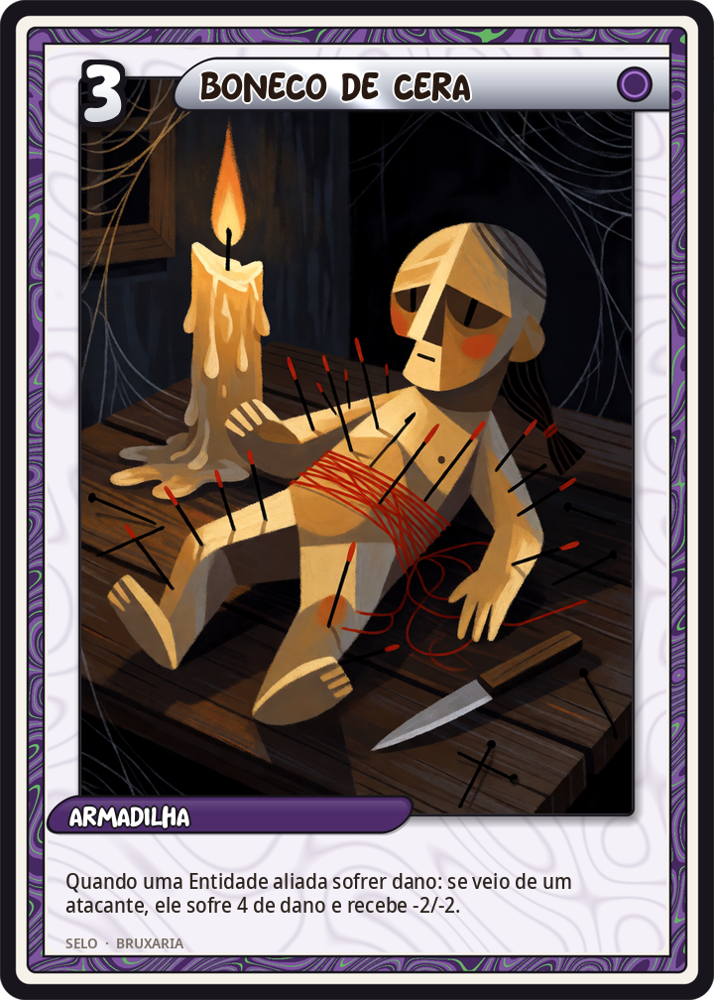
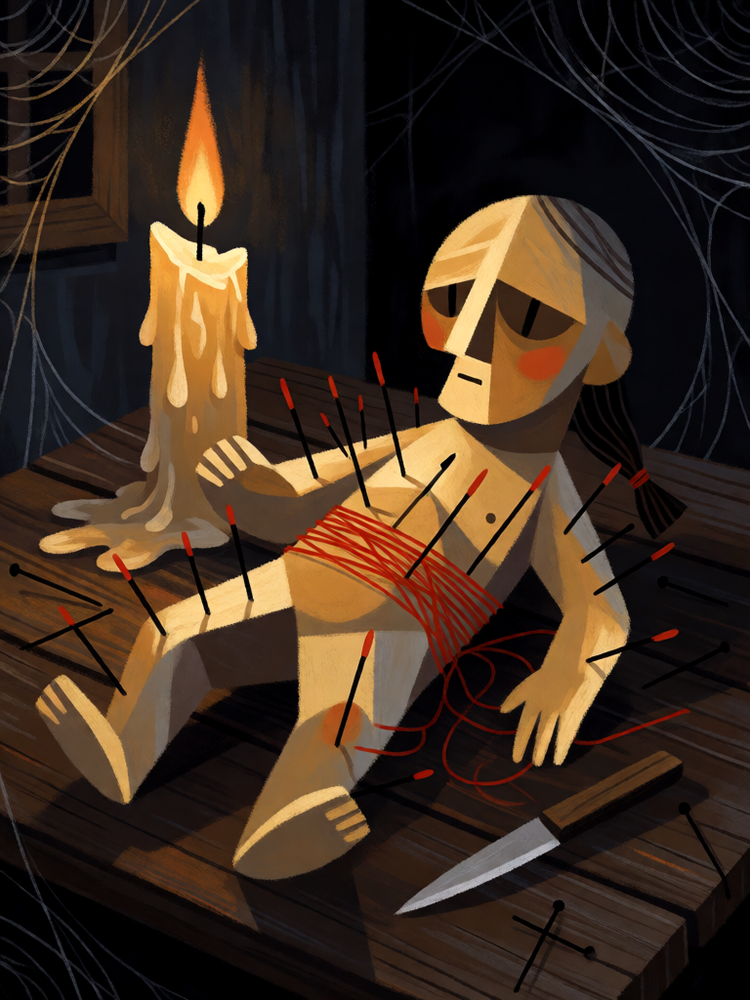

# Boneco de Cera

[← Bruxaria](../bruxaria.md) · [Wiki KodeX](../README.md) · [◀ Garrafa de Bruxa](bru_garrafa_de_bruxa.md) · [Poção de Beladona ▶](bru_pocao_de_beladona.md)

| Carta | Arte |
|---|---|
|  |  |

| | |
|---|---|
| **Tradição** | Bruxaria |
| **Tipo** | Selo |
| **Custo de Fé** | 3 |
| **Palavras-chave** | — |
| **Lendária** | não |
| **Cópias no deck** | 1 |
| **Id** | `bru_boneco_de_cera` |

## Texto da carta

> Quando uma Entidade aliada sofrer dano de um ataque, o atacante sofre 4 de dano e perde 2 ATK e 2 Vida permanentemente.

**EN — Wax Poppet:** *When an allied Entity takes damage from an attack, the attacker takes 4 damage and loses 2 ATK and 2 Health permanently.*

## Contexto mitológico

O boneco (*poppet*, *dagyde*, *kolossós*) é a forma mais antiga da magia simpática: o que se faz à imagem acontece ao corpo. Teócrito (*Idílio* 2, séc. III a.C.) mostra a jovem Simeta derretendo cera ao fogo para que o amante Delfis derreta de amor; os gregos enterravam *kolossoi* de chumbo com as mãos atadas junto a *defixiones* (tabuletas de maldição) traspassadas por pregos; Ovídio faz uma rival "espetar o fígado de agulhas finas" numa imagem de cera (*Amores* III.7.29–30). No Egito, figuras de cera dos inimigos do faraó eram queimadas nos templos.

Nos processos de bruxaria o boneco vira a prova material do *maleficium*: em Lancashire (1612) as acusadas descreveram "pictures" de argila com espinhos, assadas aos poucos para que a vítima adoecesse aos poucos; o *Malleus* (II.1.11) explica como as bruxas fazem imagens e as espetam. Na Escócia, a tentativa de matar o rei Jaime VI com uma imagem de cera foi parte das acusações de North Berwick (1590). A tradição seguiu no *hoodoo* americano e na bruxaria moderna, onde o boneco também cura: o que se faz à imagem para o bem acontece ao corpo também.

Na carta a bruxa guarda um boneco de quem ousar ferir os seus: o golpe dado na aliada é devolvido ao corpo do atacante, e a cera continua espetada.

## Papel no jogo

A punição pesada do deck para quem ataca os familiares: o inimigo bate numa Strix, e leva 4 de dano mais −2/−2 permanente — o que mata quase tudo de custo até 5 e aleija as grandes. Força o oponente a atacar com cuidado ou a gastar remoção no Selo às cegas. Melhor com Entidades que sobrevivem ao golpe (Endor 2/4, Medeia 3/4), para que o dano simultâneo mais o Boneco somem. Caro para ser posto cedo; peça de meio de jogo. Cuidado: o gatilho é `ally_damaged` — se o dano vier de um Rito inimigo (não de ataque), o Selo dispara, não há `attacker`, as ações são puladas e o Selo vai ao cemitério em branco.

## Atributos visuais

boneco de cera amarelo-pálido tosco · agulhas longas e espinhos cravados · fio vermelho enrolado · mecha de cabelo amarrada · mesa de madeira com vela derretendo

Balanço (conta de custo)

Orçamento P = 2·3+1 + 1 (Selo) = 8 pts. Gasto: 4 de dano ao atacante (4) + −2/−2 permanente ao atacante (2+2 = 4) = 8. Dentro.
Rodada 1 de balanceamento: era 3 de dano (7/8; 43 % no espelho) — os malefícios rendiam menos que os corpos grandes; o Selo sobe para P.

Ficha completa: `cartas/bruxaria/16_boneco_de_cera.md` · cartas base da versão Alpha
