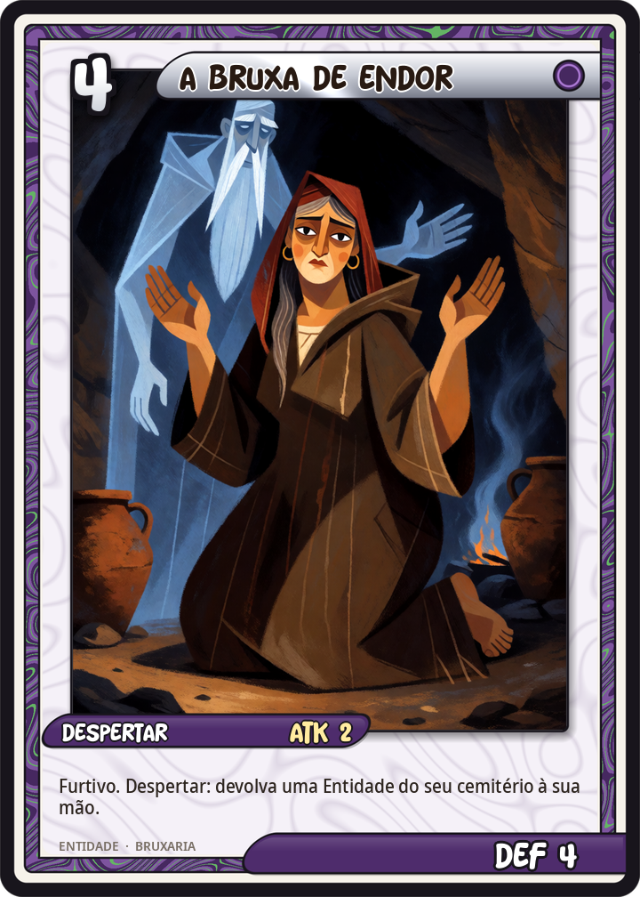
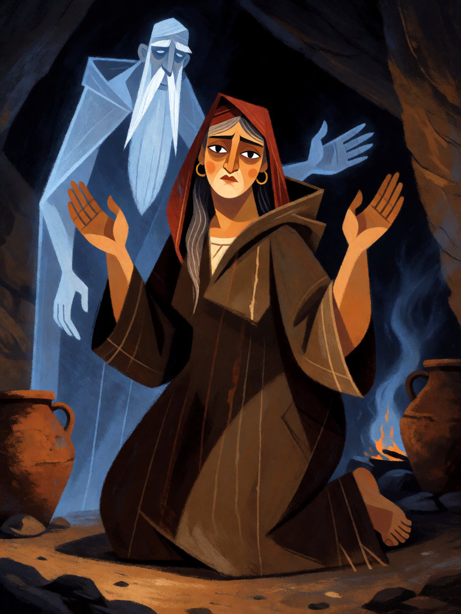

# A Bruxa de Endor

[← Bruxaria](../bruxaria.md) · [Wiki KodeX](../README.md) · [◀ Medeia, a Envenenadora](bru_medeia.md) · [Baba Yaga ▶](bru_baba_yaga.md)

| Carta | Arte |
|---|---|
|  |  |

| | |
|---|---|
| **Tradição** | Bruxaria |
| **Tipo** | Entidade |
| **Custo de Fé** | 4 |
| **ATK / DEF** | 2 / 4 |
| **Palavras-chave** | Furtivo |
| **Lendária** | não |
| **Cópias no deck** | 1 |
| **Id** | `bru_bruxa_de_endor` |

## Texto da carta

> Furtivo. Despertar: devolva uma Entidade do seu cemitério à sua mão.

**EN — The Witch of Endor:** *Stealth. Awaken: Return an Entity from your graveyard to your hand.*

## Contexto mitológico

Em 1 Samuel 28, na véspera da batalha de Gilboa contra os filisteus, o rei Saul — que havia expulsado de Israel os necromantes e adivinhos — disfarça-se e vai de noite a Endor consultar "uma mulher que tem um *ôb*" (um espírito familiar, ou o próprio ofício de evocar os mortos). Ela teme uma armadilha; ele jura por Yahweh que nada lhe acontecerá. Ela faz subir da terra um ancião envolto num manto: é Samuel, que pergunta por que o perturbaram e anuncia que Saul e seus filhos morrerão no dia seguinte. A mulher, vendo o rei prostrado, mata um bezerro e assa pães para que ele coma antes de partir.

É o único relato detalhado de necromancia na Bíblia hebraica, e por isso foi debatido por quinze séculos: Justino e Orígenes acharam que era Samuel de verdade; Tertuliano e Agostinho, que era um demônio disfarçado; a tradição rabínica (*Hagigá* 4b; *Levítico Rabá* 26) ensina que os mortos evocados sobem de cabeça para baixo — menos Samuel, que subiu em pé por respeito ao rei, e assustado porque pensou que era o Juízo Final. O *Malleus Maleficarum* a cita para provar que os demônios podem fingir ressuscitar os mortos. A "Pitonisa de Endor" tornou-se o protótipo da necromante no imaginário cristão — mas o texto a mostra competente, cautelosa e, no fim, compassiva.

Na carta ela faz exatamente o que fez por Saul: traz de volta quem já estava no chão.

## Papel no jogo

Recuperação sem Cornucópia: devolve à mão o familiar certo (um Sapo para sacrificar de novo, a Strega para outra Strix) ou a Entidade grande que morreu cedo. Furtivo a protege de remoção até ela atacar, então ela pode ficar atrás como "banco" de 4 de Vida e portadora segura de uma Relíquia. Combina com o Caldeirão de Renascimento (um revive ao campo, outro à mão). Ruim se o cemitério estiver vazio no turno 4 — guardá-la para o meio do jogo.

## Atributos visuais

idosa hebreia de manto escuro com capuz · ajoelhada, braços erguidos · fantasma translúcido de ancião de barba e manto · brilho azul espectral · habitação em caverna

Balanço (conta de custo)

Orçamento P = 2·4+1 = 9 pts. Gasto: ATK 2 + Vida 4 + Furtivo 1 + Despertar: reviver Entidade do cemitério para a mão (2 pts) = 9. Dentro.

Ficha completa: `cartas/bruxaria/08_bruxa_de_endor.md` · cartas base da versão Alpha
