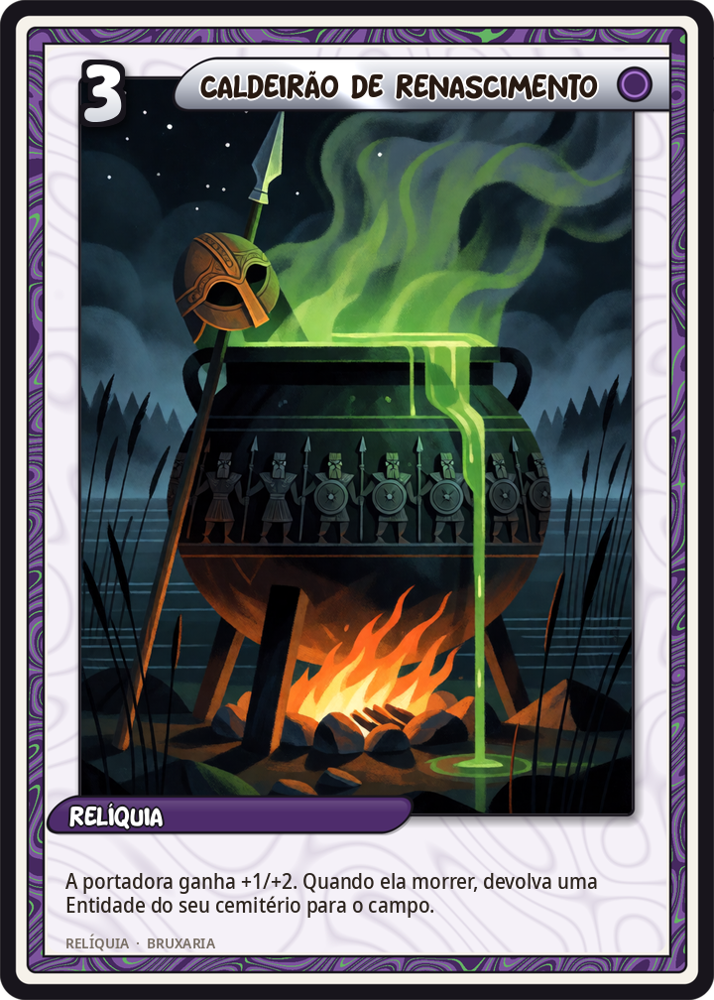
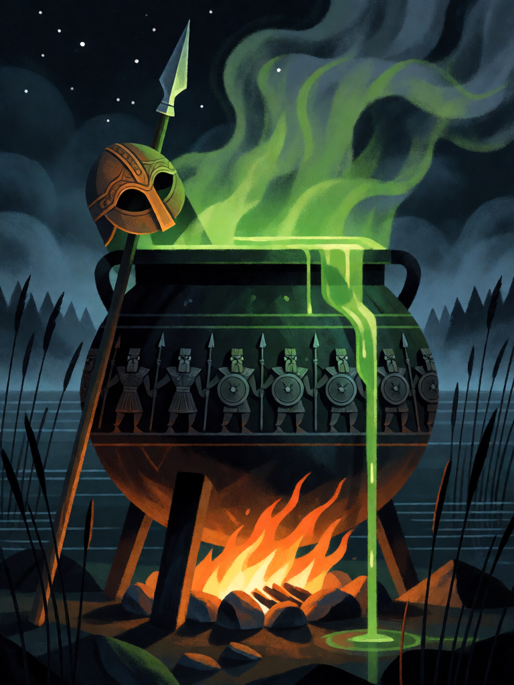

# Caldeirão de Renascimento

[← Bruxaria](../bruxaria.md) · [Wiki KodeX](../README.md) · [◀ Livro das Sombras](bru_livro_das_sombras.md)

| Carta | Arte |
|---|---|
|  |  |

| | |
|---|---|
| **Tradição** | Bruxaria |
| **Tipo** | Relíquia |
| **Custo de Fé** | 3 |
| **Palavras-chave** | — |
| **Lendária** | não |
| **Cópias no deck** | 1 |
| **Id** | `bru_caldeirao_de_renascimento` |

## Texto da carta

> A portadora ganha +1 ATK e +2 Vida. Quando ela morrer, reviva uma Entidade do seu cemitério para o campo.

**EN — Cauldron of Rebirth:** *The bearer gains +1 ATK and +2 Health. When it dies, revive an Entity from your graveyard to the field.*

## Contexto mitológico

O caldeirão é o objeto da bruxa por excelência — Cerridwen o ferve um ano e um dia pela inspiração (*Hanes Taliesin*), Medeia rejuvenesce Éson nele e mata Pélias por ele (Ovídio, *Metamorfoses* VII), as Três Irmãs de *Macbeth* (IV.1) jogam nele "olho de salamandra e dedo de rã" para ver o futuro. Mas o caldeirão deste nome específico vem do segundo ramo do *Mabinogion*, *Branwen ferch Llŷr*: o *Pair Dadeni*, "Caldeirão de Renascimento", trazido da Irlanda por um gigante que saía de um lago com a mulher, e dado por Bendigeidfran (Brân, o Abençoado) ao rei irlandês Matholwch como presente de casamento com sua irmã Branwen.

A propriedade do *Pair Dadeni* é precisa: o guerreiro morto que nele é mergulhado levanta no dia seguinte tão bom quanto antes — mas sem fala. Quando a guerra entre Gales e Irlanda estoura, os irlandeses enchem o caldeirão de mortos a cada noite, até que Efnisien, o meio-irmão de Brân que causou tudo, se deita entre os cadáveres, é jogado dentro vivo e se estica até rachar o caldeirão e o próprio coração. O caldeirão de Gundestrup (séc. I a.C.), com sua placa de um deus mergulhando guerreiros numa cuba, é frequentemente lido como a versão continental da mesma ideia.

Na carta o caldeirão é equipado numa bruxa ou familiar: enquanto ela vive, protege-a; quando ela cai, a cuba devolve alguém ao campo — mudo, mas inteiro.

## Papel no jogo

Segurança contra a remoção: equipado em Baba Yaga ou Cerridwen, garante que a morte delas devolva ao campo a melhor Entidade do cemitério — inclusive a própria portadora, que pela regra de resolução já está no cemitério quando `equipped_dies` resolve. A revivida volta **sem Despertar** (reviver para o campo não o dispara, regras §8): Baba Yaga volta como 3/5, Hécate como 5/7 — o corpo, sem o pacto de novo. Equipado num familiar que vai ser sacrificado para Hécate, transforma o Sacrifício em um revive gratuito — a jogada mais "pacto" do deck. O +1/+2 ainda dá corpo a quem o carrega. Caro para o turno em que sai; melhor a partir do meio do jogo, com cemitério cheio.

## Atributos visuais

caldeirão de ferro preto enorme · figuras de guerreiros em relevo · líquido verde brilhante transbordando · lança e elmo de bronze apoiados nele · margem de lago à noite

Balanço (conta de custo)

Orçamento P = 2·3+1 + 1 (Relíquia) = 8 pts. Gasto: +1 ATK / +2 Vida permanentes (3) + reviver Entidade do cemitério para o campo (3 + custo médio 4 ÷ 2 = 5) = 8. Dentro.
Rodada 1 de balanceamento: o Analista propôs reviver para a mão (+2/+3). Recusado: a regra nova de Despertar já tira o laço "Hécate/Baba Yaga voltam com Despertar sem Sacrifício"; a carta fica como está e é observada na rodada 2.

Ficha completa: `cartas/bruxaria/25_caldeirao_de_renascimento.md` · cartas base da versão Alpha
