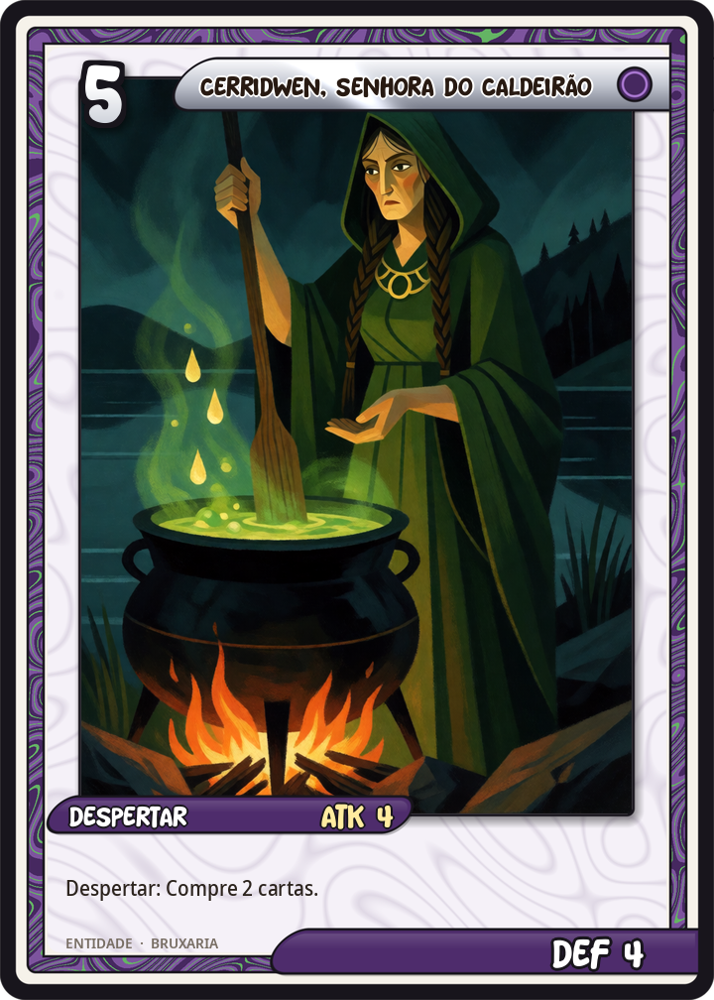
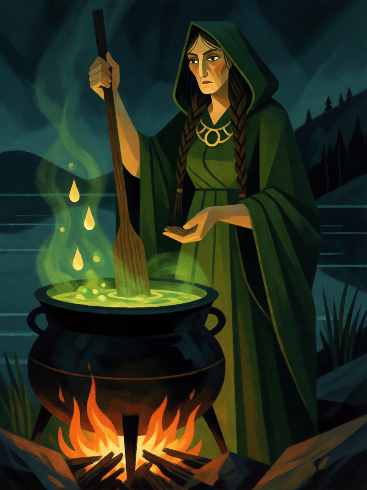

# Cerridwen, Senhora do Caldeirão

[← Bruxaria](../bruxaria.md) · [Wiki KodeX](../README.md) · [◀ Baba Yaga](bru_baba_yaga.md) · [A Morrigan ▶](bru_a_morrigan.md)

| Carta | Arte |
|---|---|
|  |  |

| | |
|---|---|
| **Tradição** | Bruxaria |
| **Tipo** | Entidade |
| **Custo de Fé** | 5 |
| **ATK / DEF** | 4 / 4 |
| **Palavras-chave** | — |
| **Lendária** | não |
| **Cópias no deck** | 1 |
| **Id** | `bru_cerridwen` |

## Texto da carta

> Despertar: compre 2 cartas.

**EN — Cerridwen, Lady of the Cauldron:** *Awaken: Draw 2 cards.*

## Contexto mitológico

Cerridwen é a feiticeira do *Hanes Taliesin* ("História de Taliesin"), conto galês posto por escrito no séc. XVI por Elis Gruffydd a partir de tradição bem mais antiga. Vive no lago Bala com o marido Tegid Foel e dois filhos: a bela Creirwy e o feioso Morfran, apelidado Afagddu ("Trevas Totais"). Para compensar o filho, decide fervê-lo um caldeirão de inspiração e ciência (*Awen*) que precisa cozinhar por um ano e um dia; o cego Morda cuida do fogo e o menino Gwion Bach mexe o caldo.

No último dia três gotas escaldantes saltam na mão de Gwion, que as leva à boca — e recebe toda a sabedoria destinada a Afagddu. O resto do caldeirão vira veneno e racha o vaso. Gwion foge; Cerridwen o persegue numa cadeia de metamorfoses: ele lebre, ela galga; ele peixe, ela lontra; ele pássaro, ela falcão; ele grão de trigo no celeiro, ela galinha preta que o engole. Grávida, ela o pare nove meses depois e, incapaz de matar o bebê, põe-no num saco de couro no mar. Ele é encontrado por Elffin e nomeado Taliesin, "fronte radiante", o maior bardo de Gales.

Na bruxaria moderna Cerridwen virou deusa da transformação e do caldeirão, a Anciã da tríade. Na carta é o que o conto diz: a senhora de um caldeirão que contém *conhecimento* — e quem a traz à mesa prova duas gotas.

## Papel no jogo

O motor de cartas do deck. Um deck de peças pequenas gasta a mão depressa; Cerridwen a reabastece com duas cartas e ainda deixa um corpo 4/4. Jogá-la no turno 5 quando a mão está vazia é o uso ideal; no turno 7 com Hécate na mão, as duas cartas podem ser o familiar que falta para o Sacrifício. Sinergia com Livro das Sombras (mais compra) e Seiðr (buscar Cerridwen). Vulnerável a Selos de "ao invocar" do oponente, mas o Despertar já terá resolvido.

## Atributos visuais

mulher galesa madura de tranças escuras · manto verde-escuro com capuz e torque de prata · caldeirão de ferro preto enorme · três gotas douradas brilhantes · margem de lago à noite

Balanço (conta de custo)

Orçamento P = 2·5+1 = 11 pts. Gasto: ATK 4 + Vida 4 + Despertar: comprar 2 cartas (2 × 1,5 = 3 pts) = 11. Dentro.

Ficha completa: `cartas/bruxaria/10_cerridwen.md` · cartas base da versão Alpha
