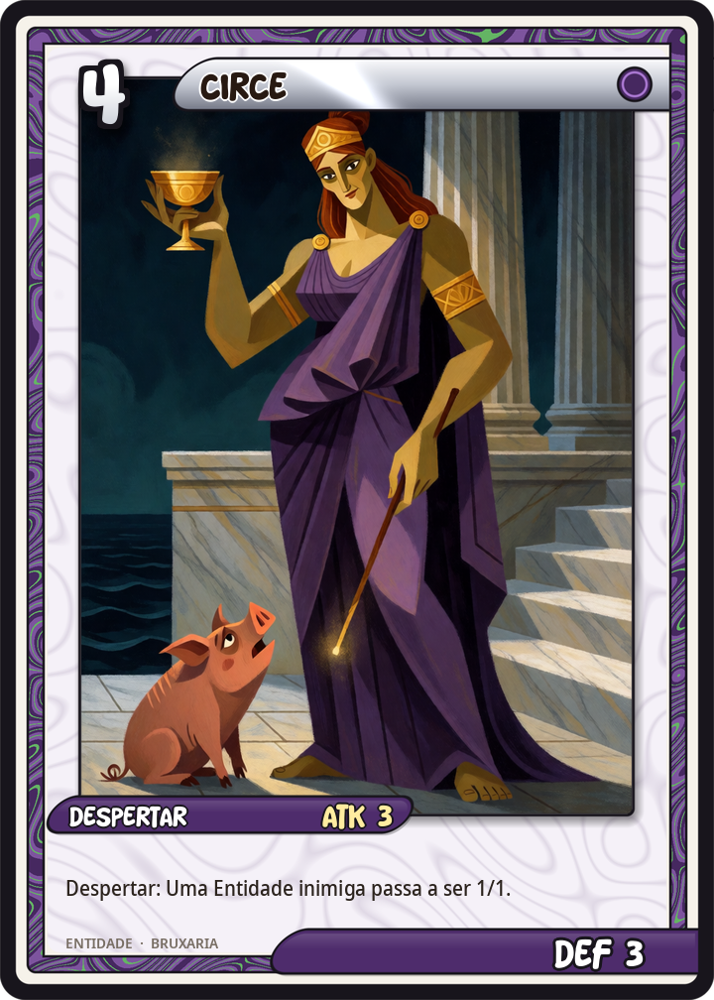
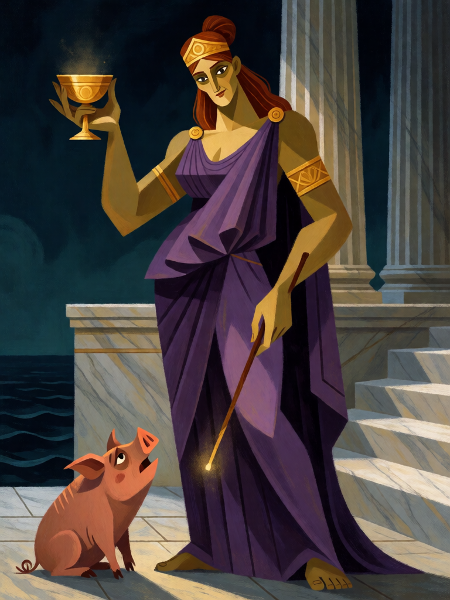

# Circe

[← Bruxaria](../bruxaria.md) · [Wiki KodeX](../README.md) · [◀ Benandante](bru_benandante.md) · [Medeia, a Envenenadora ▶](bru_medeia.md)

| Carta | Arte |
|---|---|
|  |  |

| | |
|---|---|
| **Tradição** | Bruxaria |
| **Tipo** | Entidade |
| **Custo de Fé** | 4 |
| **ATK / DEF** | 3 / 3 |
| **Palavras-chave** | — |
| **Lendária** | não |
| **Cópias no deck** | 1 |
| **Id** | `bru_circe` |

## Texto da carta

> Despertar: uma Entidade inimiga à escolha vira porco — seu ATK e sua Vida passam a ser 1/1.

**EN — Circe:** *Awaken: An enemy Entity of your choice becomes a pig — its ATK and Health become 1/1.*

## Contexto mitológico

Circe (*Kirke*), filha de Hélio e da oceânide Perse, vive na ilha de Eeia entre lobos e leões que já foram homens. Em *Odisseia* X, os companheiros de Odisseu bebem de sua taça de queijo, farinha, mel e "drogas funestas" (*pharmaka lygra*), ela os toca com a varinha e eles ganham cabeça, voz e cerdas de porco — mas conservam a mente humana. Odisseu resiste graças à erva *moly* dada por Hermes, obriga-a a desfazer o encanto e fica um ano em sua cama; é ela quem lhe ensina o caminho ao Hades e o modo de passar pelas Sereias e por Cila.

Homero chama-a *polypharmakos*, "de muitas drogas", e *deinē theos audēessa*, "deusa terrível de voz humana": é uma deusa, não uma mortal, e a primeira feiticeira da literatura ocidental. Ovídio amplia o repertório (*Metamorfoses* XIV): transforma o rei Pico em pica-pau por rejeitá-la e envenena a fonte onde Cila se banha. Apolônio de Rodes (*Argonáuticas* IV) faz dela a tia que purifica Medeia e Jasão do sangue de Apsirto — a feiticeira mais velha recebendo a mais nova.

Na carta Circe faz o que sempre fez: não mata o herói inimigo, torna-o um porco. A Entidade continua lá, ocupando o slot, com toda a sua glória reduzida a 1/1.

## Papel no jogo

Resposta ao "grandão" adversário sem gastar um `destroy`: a Entidade grande fica 1/1, ainda ocupando um slot do oponente (o que atrapalha o campo dele) e virando presa fácil para qualquer familiar. Sinergia com Mau-Olhado (−1/−1 depois do porco = morte) e com o Sapo. Como 3/3 de custo 4 ela é frágil para o custo; usar o Despertar bem é tudo. Perde valor contra campos de muitos tokens.

## Atributos visuais

deusa grega adulta de cabelo ruivo · quíton roxo longo e diadema de ouro · taça dourada erguida na mão direita · varinha fina na mão esquerda · porquinho rosa aos pés

Balanço (conta de custo)

Orçamento P = 2·4+1 = 9 pts. Gasto: ATK 3 + Vida 3 + Despertar: `set_stats` inimigo → 1/1 (3 pts, convenção do deck) = 9. Dentro.

Ficha completa: `cartas/bruxaria/06_circe.md` · cartas base da versão Alpha
