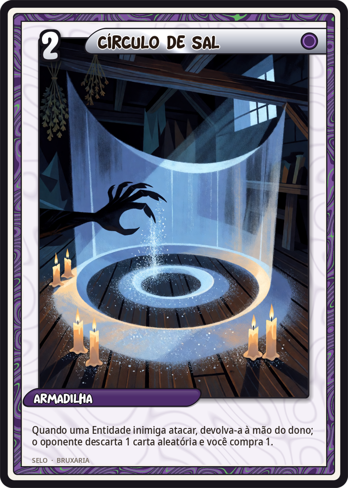
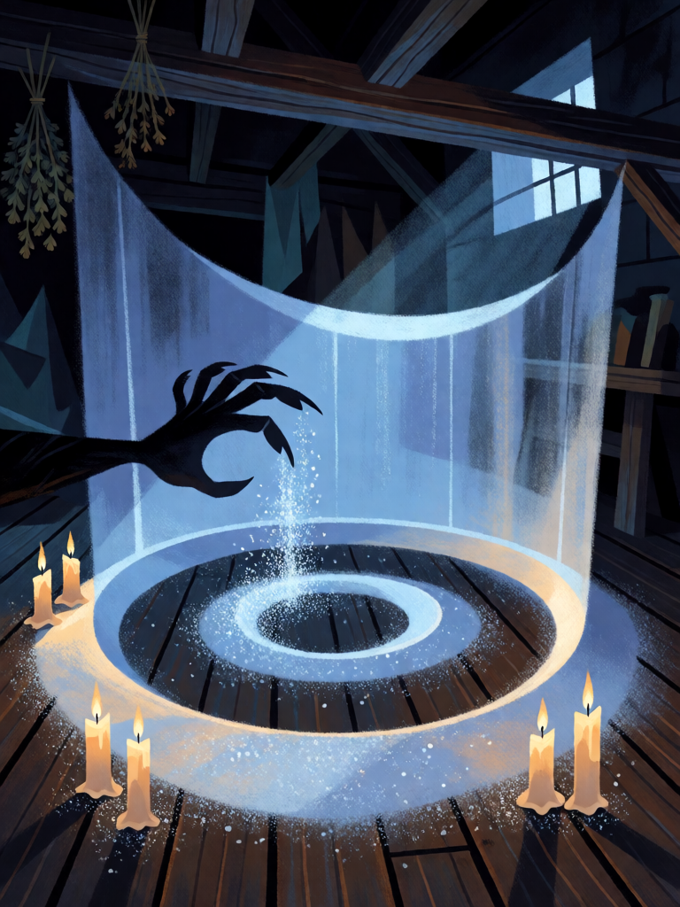

# Círculo de Sal

[← Bruxaria](../bruxaria.md) · [Wiki KodeX](../README.md) · [◀ Mau-Olhado](bru_mau_olhado.md) · [Garrafa de Bruxa ▶](bru_garrafa_de_bruxa.md)

| Carta | Arte |
|---|---|
|  |  |

| | |
|---|---|
| **Tradição** | Bruxaria |
| **Tipo** | Selo |
| **Custo de Fé** | 2 |
| **Palavras-chave** | — |
| **Lendária** | não |
| **Cópias no deck** | 2 |
| **Id** | `bru_circulo_de_sal` |

## Texto da carta

> Quando uma Entidade inimiga atacar, devolva-a à mão do dono; o oponente descarta 1 carta aleatória e você compra 1.

**EN — Salt Circle:** *When an enemy Entity attacks, return it to its owner's hand; your opponent discards 1 random card and you draw 1.*

## Contexto mitológico

O sal é o purificador universal da magia popular europeia: jogado por cima do ombro esquerdo contra o azar de derrubá-lo, posto no berço e no bolso do recém-nascido antes do batismo, misturado à água benta na liturgia (que o exorciza expressamente, "para que o inimigo fuja de onde for aspergido"), espalhado na soleira para que a bruxa não entre. É o que não apodrece e por isso o que o apodrecido — o morto, o demônio, o malefício — não cruza.

O círculo traçado no chão como barreira vem da alta magia (a *Clavicula Salomonis* o quer de nove pés, com nomes divinos escritos), mas a versão da bruxaria popular e da Wicca é mais simples: uma linha de sal, uma vassoura passada em volta, e quem está dentro está em outro lugar. Gardner e Valiente fizeram do círculo de nove pés "o espaço entre os mundos" onde o coven trabalha. No desenho de Guazzo e nas confissões, a bruxa também traça círculos para proteger-se do que ela mesma invoca.

Na carta o círculo não fere: **repele**. O atacante bate no sal, volta para onde veio — a mão do dono — e algo se perde no caminho enquanto a bruxa ganha o que tinha ido buscar.

## Papel no jogo

Resposta de tempo contra a Entidade grande do oponente: ela ataca, volta à mão (perde buffs, Relíquia, posição), ele precisa pagar o custo todo de novo, descartou uma carta e você comprou uma. Duas cópias para que o deck segure o campo enquanto junta familiares. É a única "defesa" do deck sem Guarda. Fraco contra enxames de tokens baratos (devolver um 1/1 não vale 2 Fé). Só dispara em ataque a **Entidade** (`enemy_attacks`); com o campo da bruxa vazio o inimigo ataca a Cornucópia e o Círculo fica dormindo — manter sempre um familiar na mesa.

## Atributos visuais

círculo de sal branco brilhante no chão · barreira de luz azul-pálida · mão de garras de sombra recuando · velas na borda · interior de cabana escura

Balanço (conta de custo)

Orçamento P = 2·2+1 + 1 (Selo) = 6 pts. Gasto: devolver atacante à mão (2) + oponente descarta 1 aleatória (2) + comprar 1 (1,5) = 5,5. Dentro.

Ficha completa: `cartas/bruxaria/14_circulo_de_sal.md` · cartas base da versão Alpha
