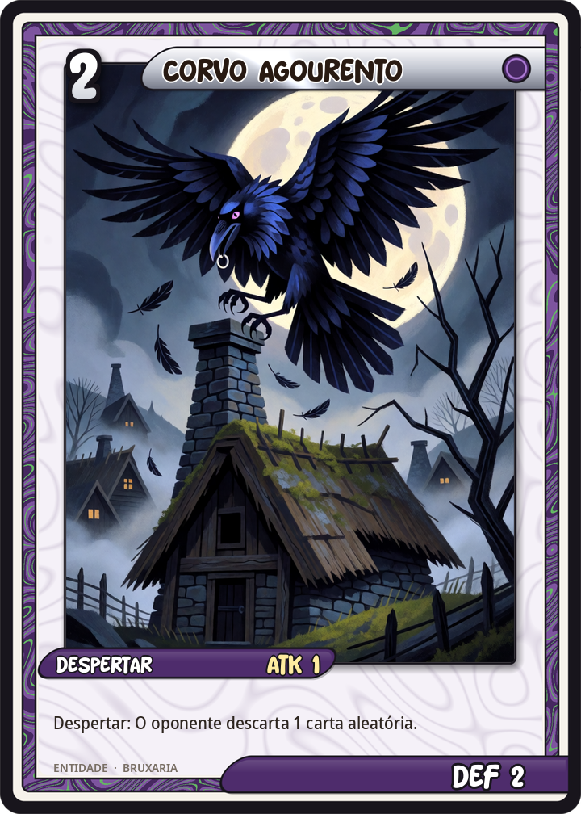
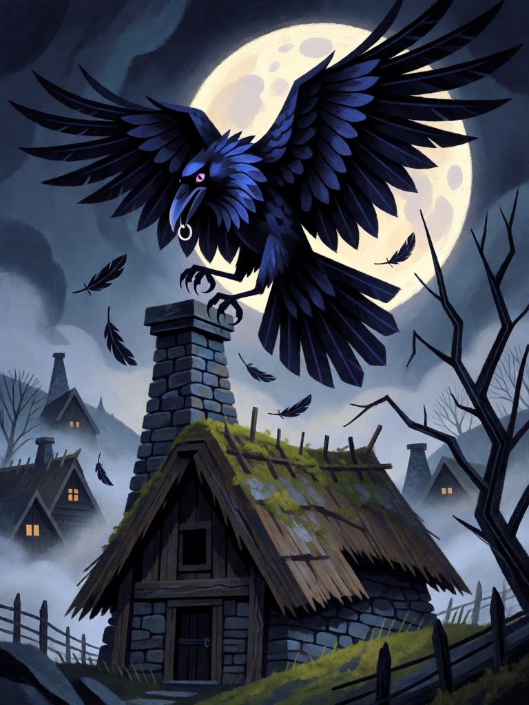

# Corvo Agourento

[← Bruxaria](../bruxaria.md) · [Wiki KodeX](../README.md) · [◀ Gato Preto](bru_gato_preto.md) · [Strega de Benevento ▶](bru_strega_de_benevento.md)

| Carta | Arte |
|---|---|
|  |  |

| | |
|---|---|
| **Tradição** | Bruxaria |
| **Tipo** | Entidade |
| **Custo de Fé** | 2 |
| **ATK / DEF** | 1 / 2 |
| **Palavras-chave** | — |
| **Lendária** | não |
| **Cópias no deck** | 1 |
| **Id** | `bru_corvo_agourento` |

## Texto da carta

> Despertar: o oponente descarta 1 carta aleatória da mão.

**EN — Ill-Omened Crow:** *Awaken: Your opponent discards 1 random card from their hand.*

## Contexto mitológico

Em toda a Europa o corvo e a gralha são aves de agouro: comem os mortos nos campos de batalha, gritam sobre as casas onde alguém vai morrer e repetem palavras humanas. Na Irlanda são a forma da Morrigan e de Badb, a "corvo-de-batalha", que pousa no ombro de Cú Chulainn morto para que seus inimigos saibam que ele já não é perigoso (*Aided Con Culainn*, "A morte de Cú Chulainn", no ciclo do Ulster). No Norte, Huginn e Muninn — Pensamento e Memória — voam o mundo todo e voltam a sussurrar no ouvido de Odin (*Grímnismál* 20).

Nos julgamentos de bruxaria o corvo aparece menos que o gato, mas o folclore o faz mensageiro e espião da bruxa: ela o manda rondar a casa do vizinho, ouvir o que se diz, pousar no telhado e "secar" a sorte de quem mora ali. É o veículo do **olho-gordo** — a inveja que, só de olhar, faz perder.

Daí a mecânica: quando o Corvo pousa, algo do oponente se perde. Não é dano, não é combate: é a carta que ele tinha na mão e já não tem.

## Papel no jogo

Disrupção barata no turno 2: 1/2 e o oponente perde uma carta aleatória — antes de ela chegar à mesa, o que é melhor do que lidar com ela depois. Casa com Pó de Ossos e Garrafa de Bruxa para esvaziar a mão inimiga no meio do jogo. O corpo 1/2 sobrevive a tokens 1/1 e serve de Sacrifício; é ruim contra oponentes que jogam toda a mão rápido (sem o que descartar).

## Atributos visuais

corvo grande negro · asas abertas pousando · olho roxo brilhante · bugiganga roubada no bico · chaminé torta de cabana

Balanço (conta de custo)

Orçamento P = 2·2+1 = 5 pts. Gasto: ATK 1 + Vida 2 + Despertar: oponente descarta 1 aleatória (2 pts) = 5. Dentro.

Ficha completa: `cartas/bruxaria/03_corvo_agourento.md` · cartas base da versão Alpha
