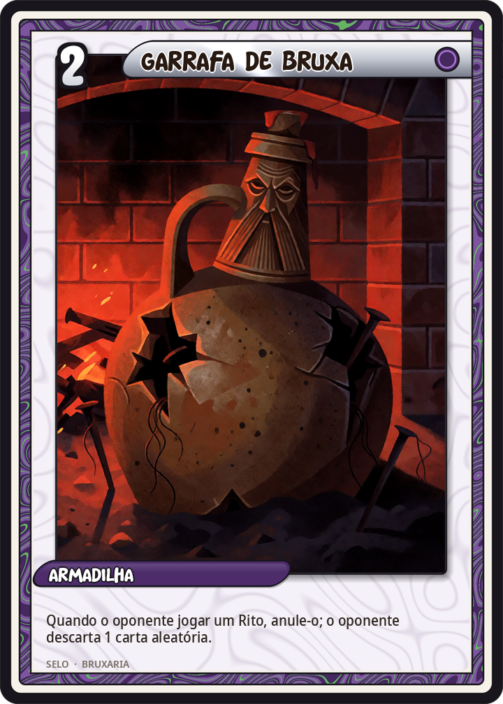
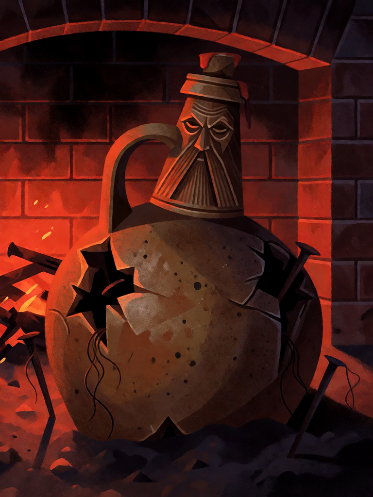

# Garrafa de Bruxa

[← Bruxaria](../bruxaria.md) · [Wiki KodeX](../README.md) · [◀ Círculo de Sal](bru_circulo_de_sal.md) · [Boneco de Cera ▶](bru_boneco_de_cera.md)

| Carta | Arte |
|---|---|
|  |  |

| | |
|---|---|
| **Tradição** | Bruxaria |
| **Tipo** | Selo |
| **Custo de Fé** | 2 |
| **Palavras-chave** | — |
| **Lendária** | não |
| **Cópias no deck** | 1 |
| **Id** | `bru_garrafa_de_bruxa` |

## Texto da carta

> Quando o oponente jogar um Rito, anule-o; o oponente descarta 1 carta aleatória.

**EN — Witch Bottle:** *When your opponent plays a Rite, counter it; your opponent discards 1 random card.*

## Contexto mitológico

A garrafa de bruxa (*witch bottle*) é um dos poucos objetos de magia popular que a arqueologia encontra em quantidade: jarras de grés de barba (tipo *Bellarmine*, importadas da Renânia), do séc. XVII em diante, enterradas de boca para baixo sob a lareira ou a soleira de casas inglesas, cheias de urina, pregos e alfinetes dobrados, cabelo, unhas, às vezes um coração de pano espetado. Ralph Merrifield (*The Archaeology of Ritual and Magic*, 1987) catalogou dezenas; a garrafa de Greenwich (2004) chegou lacrada e com conteúdo intacto. A prática atravessou o Atlântico e seguiu até o séc. XX.

A lógica é a da magia simpática em espelho: a urina e o cabelo da vítima enfeitiçada fazem da garrafa um "corpo" dela; os pregos e espinhos, quando a garrafa é aquecida, atormentam a bruxa que lançou o malefício, obrigando-a a desfazê-lo — ou devolvem o feitiço à sua origem. Joseph Blagrave (*Astrological Practice of Physick*, 1671) dá a receita; os *cunning folk* a vendiam como contra-feitiço padrão.

Na carta a garrafa faz o que fazia: o feitiço lançado contra a bruxa não chega — e volta, levando algo de quem o lançou.

## Papel no jogo

Única anulação do deck: protege Hécate e a Morrigan de um Rito de remoção, ou nega um Rito de cura/buff adversário no momento errado. O descarte adicional castiga o oponente por tentar. Boa para pôr virada no turno em que se invoca a Lendária. Como todo *counter*, é inútil contra decks pobres em Ritos; aí fica no campo ocupando um slot de Selo.

## Atributos visuais

jarra de grés marrom tipo Bellarmine · rosto de barbudo moldado no gargalo · rolha com lacre vermelho · pregos e alfinetes tortos saindo por uma rachadura · meio enterrada sob a lareira

Balanço (conta de custo)

Orçamento P = 2·2+1 + 1 (Selo) = 6 pts. Gasto: anular Rito inimigo (3) + oponente descarta 1 aleatória (2) = 5. Dentro (P−1).
Rodada 2 de balanceamento: o Analista propôs acrescentar "cura 2 na Cornucópia" (6/6). **Recusado**: a identidade do deck é não curar a Cornucópia (nenhum `heal` nela, `_deck.md`), e o ganho medido foi +0,4 pp — ruído. A folga de 1 pt fica.

Ficha completa: `cartas/bruxaria/15_garrafa_de_bruxa.md` · cartas base da versão Alpha
