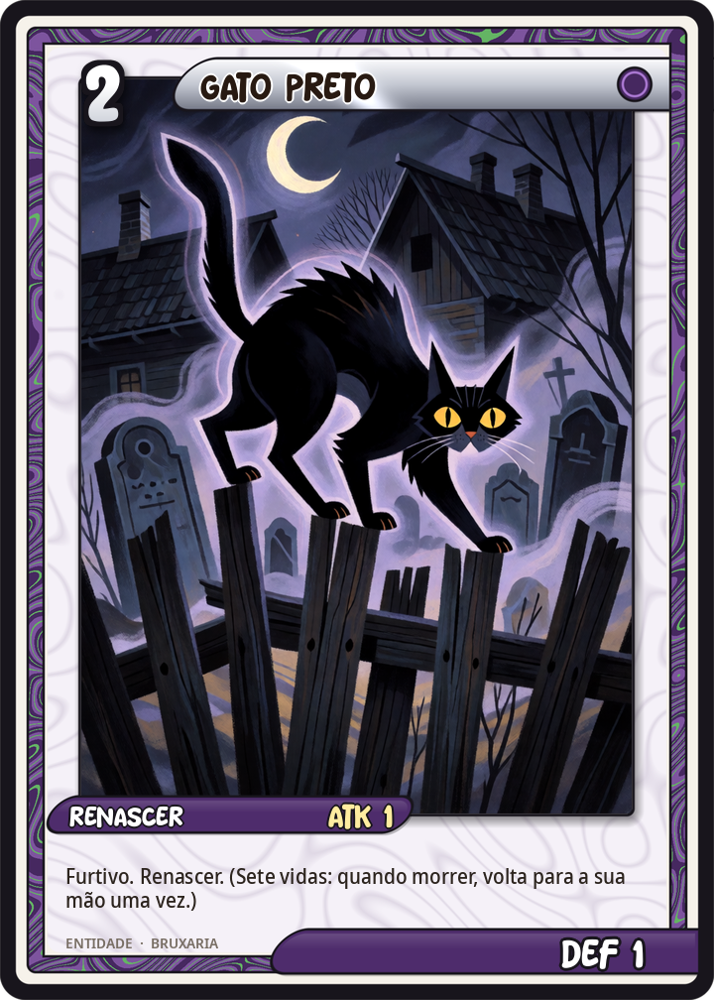
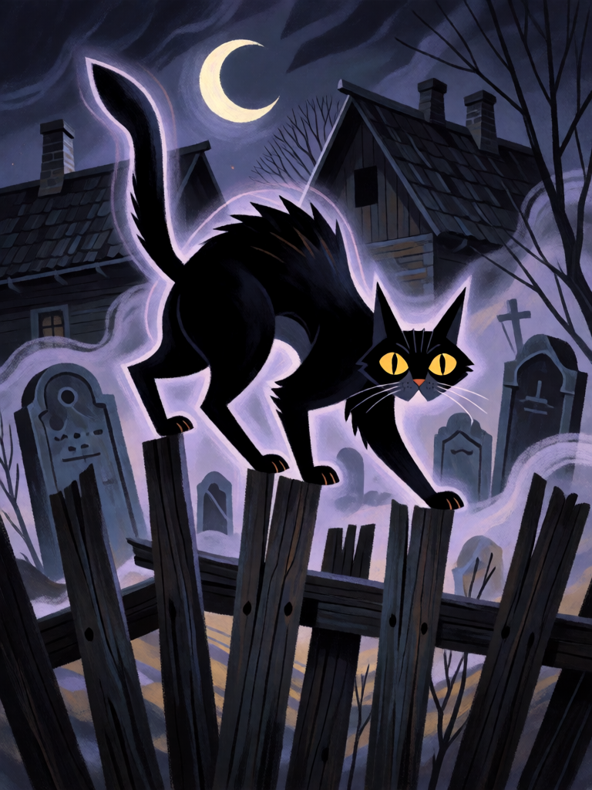

# Gato Preto

[← Bruxaria](../bruxaria.md) · [Wiki KodeX](../README.md) · [◀ Sapo Familiar](bru_sapo_familiar.md) · [Corvo Agourento ▶](bru_corvo_agourento.md)

| Carta | Arte |
|---|---|
|  |  |

| | |
|---|---|
| **Tradição** | Bruxaria |
| **Tipo** | Entidade |
| **Custo de Fé** | 2 |
| **ATK / DEF** | 1 / 1 |
| **Palavras-chave** | Furtivo, Renascer |
| **Lendária** | não |
| **Cópias no deck** | 2 |
| **Id** | `bru_gato_preto` |

## Texto da carta

> Furtivo. Renascer. *(Sete vidas: quando morre, volta à sua mão uma vez.)*

**EN — Black Cat:** *Stealth. Rebirth. *(Nine lives: when it dies, it returns to your hand once.)**

## Contexto mitológico

O gato preto é o familiar por excelência da bruxaria insular. No primeiro grande julgamento inglês, em Chelmsford (1566), Elizabeth Francis confessou ter recebido da avó um gato malhado chamado "Sathan", que alimentava com pão, leite e gotas do próprio sangue, e que lhe trazia ovelhas e maridos em troca. A partir daí os tribunais ingleses procuraram sistematicamente o animal doméstico da acusada como prova do pacto — o familiar como pequeno demônio em forma de bicho.

No continente a associação é mais antiga e vem de cima: a bula *Vox in Rama* (1233), de Gregório IX, descreve hereges renanos beijando um gato preto durante seus ritos, e já no séc. XII Alain de Lille (*De fide catholica*) derivava o nome dos cátaros de *cattus*, porque beijariam um gato nas assembleias — a calúnia que depois recairá sobre as bruxas. O folclore europeu acrescentou as "sete vidas", o azar de cruzar o caminho (ou a sorte, na Inglaterra e no Japão) e o gato como forma preferida da bruxa para rondar à noite sem ser vista.

Na carta, o gato é o que o folclore diz dele: difícil de alvejar (Furtivo) e difícil de matar de vez (Renascer, uma vez — as sete vidas do jogo). Não é um lutador; é uma presença que não vai embora.

## Papel no jogo

Familiar reutilizável: morre em combate ou sob remoção, volta à mão, é reinvocado por 2 Fé. **Atenção**: Sacrifício conta como morte mas **não aciona Renascer** — sacrificado para Baba Yaga ou Hécate, o Gato não volta. A moeda de pacto preferida é o Sapo (Último Sopro) ou a Strix; o Gato é o corpo que absorve o ataque inimigo e retorna. Furtivo protege-o de Ritos e Selos inimigos até ele atacar, o que o faz um bom portador do Livro das Sombras (ataca, compra, não pode ser alvejado antes). Fraco em combate puro; não deve atacar Entidades maiores a menos que esteja com Vassoura ou Sabá.

## Atributos visuais

gato preto de pelo liso · olhos amarelos brilhantes · costas arqueadas e rabo erguido · aura fantasma roxa · cerca torta sobre cemitério

Balanço (conta de custo)

Orçamento P = 2·2+1 = 5 pts. Gasto: ATK 1 + Vida 1 + Furtivo 1 + Renascer 2 = 5. Dentro.

Ficha completa: `cartas/bruxaria/02_gato_preto.md` · cartas base da versão Alpha
