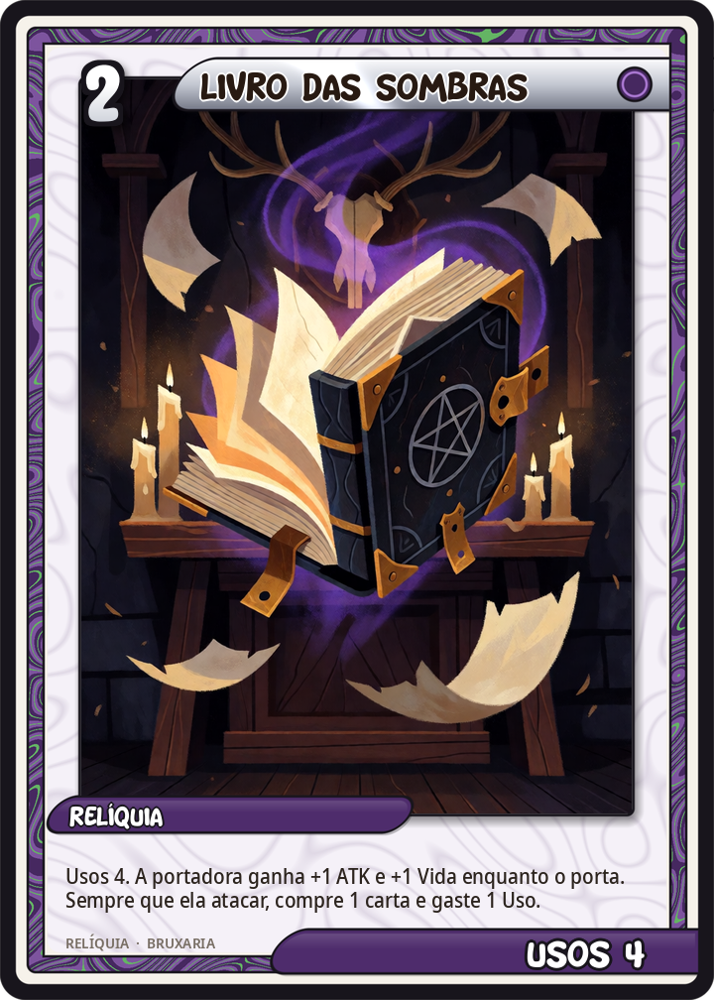
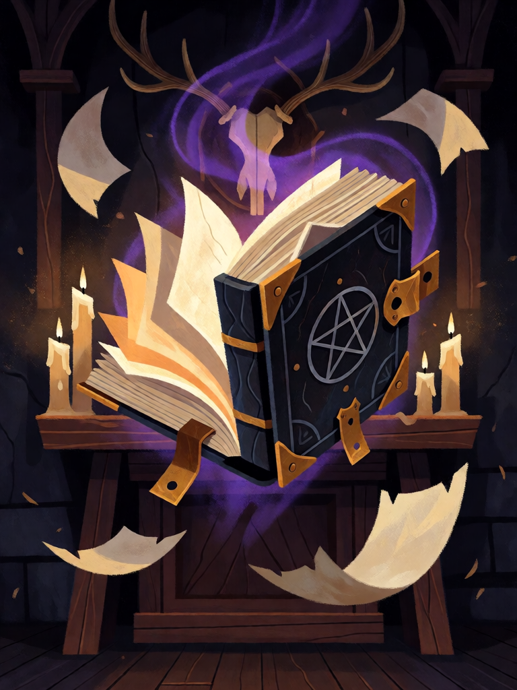

# Livro das Sombras

[← Bruxaria](../bruxaria.md) · [Wiki KodeX](../README.md) · [◀ Vassoura](bru_vassoura.md) · [Caldeirão de Renascimento ▶](bru_caldeirao_de_renascimento.md)

| Carta | Arte |
|---|---|
|  |  |

| | |
|---|---|
| **Tradição** | Bruxaria |
| **Tipo** | Relíquia |
| **Custo de Fé** | 2 |
| **Usos** | 4 |
| **Palavras-chave** | — |
| **Lendária** | não |
| **Cópias no deck** | 1 |
| **Id** | `bru_livro_das_sombras` |

## Texto da carta

> Usos 4. A portadora ganha +1 ATK e +1 Vida enquanto o porta. Sempre que ela atacar, compre 1 carta e gaste 1 Uso.

**EN — Book of Shadows:** *Uses 4. The bearer has +1 ATK and +1 Health while equipped. Whenever it attacks, draw 1 card and spend 1 Use.*

## Contexto mitológico

O **Livro das Sombras** é a contribuição mais duradoura de Gerald Gardner (1884–1964) à bruxaria: o caderno manuscrito de rituais, invocações, leis e receitas que cada iniciado de um coven wiccano copia à mão do livro de quem o iniciou, e ao qual acrescenta o seu. Gardner compilou o primeiro entre 1949 e 1953 (um rascunho, *Ye Bok of ye Art Magical*, sobrevive), afirmando ter recebido o material de um coven antigo de New Forest; Ronald Hutton (*The Triumph of the Moon*, 1999) mostra as fontes reais — a *Clavicula Salomonis* na edição de Mathers, Crowley, a maçonaria, Leland e Murray — e defende que isso não lhe tira o valor: a Wicca é uma religião nova, honestamente costurada.

Doreen Valiente, Alta Sacerdotisa de Gardner a partir de 1953, reescreveu boa parte do Livro, tirando os trechos crowleyanos mais visíveis e dando-lhe poesia própria; o *Charge of the Goddess* ("Ouvi as palavras da Grande Mãe…"), em parte tirado do *Aradia* de Leland, é a peça mais citada. O nome "sombras" é incerto — Gardner o teria visto num artigo sobre um manual sânscrito de adivinhação pelo comprimento da sombra. Não confundir com o **grimório** medieval (*Clavicula*, *Grand Grimoire*, *Picatrix*): esse pertence à alta magia e ao seu deck.

Na carta o Livro é o que é para o coven: um saber que se abre a cada trabalho — e que tem só algumas páginas antes de precisar ser copiado de novo.

## Papel no jogo

Compra de cartas num deck que gasta a mão rápido: equipado num Gato Preto (Furtivo, difícil de alvejar), rende quatro cartas em quatro ataques e deixa o gato 2/2 enquanto lê. Com Vassoura em outro familiar, o deck ataca com dois pequenos e compra enquanto espera as Lendárias. Após o quarto Uso a Relíquia some — e o +1/+1 some com ela (buff de `on_equip`). Fraco em Entidades que não vão atacar (Sapo) — escolher a portadora com cuidado.

## Atributos visuais

grimório grande de couro preto · pentáculo de prata gravado na capa · fechos de latão · aberto flutuando sobre altar · páginas em branco brilhando

Balanço (conta de custo)

Orçamento P = 2·2+1 + 1 (Relíquia) = 6 pts. Gasto: +1/+1 enquanto equipado, some com os Usos (2 × 0,7 = 1,4) + comprar 1 carta ao atacar × 4 Usos (1,5 × 4 × 0,7 = 4,2) = 5,6. Dentro.
Rodada 2 de balanceamento (pacote CB3 do Analista): Usos 3 → 4 (+0,3 pp medido); a Relíquia sai de P−1,5 para P−0,4. (Versão anterior, Usos 2 e buff contado como permanente, somava 3,1 pela regra oficial — ficava abaixo de P−2; subiu para Usos 3.)

Ficha completa: `cartas/bruxaria/24_livro_das_sombras.md` · cartas base da versão Alpha
