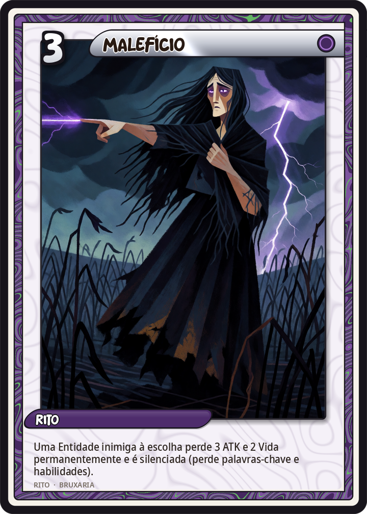
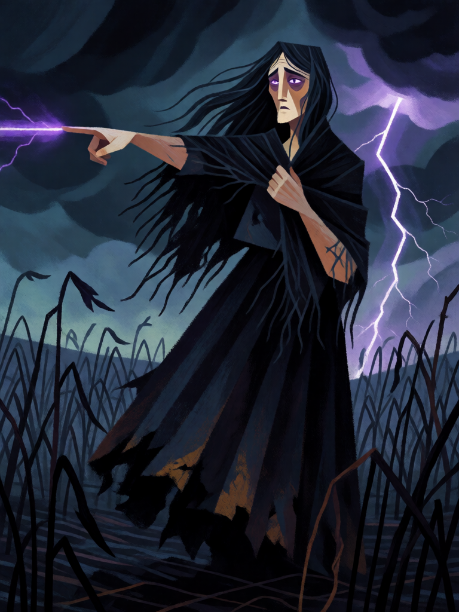

# Malefício

[← Bruxaria](../bruxaria.md) · [Wiki KodeX](../README.md) · [◀ Pó de Ossos](bru_po_de_ossos.md) · [Sabá de Walpurgis ▶](bru_saba_de_walpurgis.md)

| Carta | Arte |
|---|---|
|  |  |

| | |
|---|---|
| **Tradição** | Bruxaria |
| **Tipo** | Rito |
| **Custo de Fé** | 3 |
| **Palavras-chave** | — |
| **Lendária** | não |
| **Cópias no deck** | 2 |
| **Id** | `bru_maleficio` |

## Texto da carta

> Uma Entidade inimiga à escolha perde 3 ATK e 2 Vida permanentemente e é silenciada (perde palavras-chave e habilidades).

**EN — Maleficium:** *An enemy Entity of your choice loses 3 ATK and 2 Health permanently and is silenced (loses keywords and abilities).*

## Contexto mitológico

*Maleficium* — "mal-feito" — é a palavra latina para o dano causado por magia, e é o que a bruxaria foi, antes de tudo, aos olhos de vizinhos e juízes: a vaca que seca, o leite que não vira manteiga, a criança que definha, o homem que fica impotente na noite de núpcias, a tempestade de granizo sobre a vinha. Os tribunais seculares puniam o *maleficium* como crime de dano muito antes de a Igreja o tratar como heresia (Brian Levack, *The Witch-Hunt in Early Modern Europe*); o próprio título do *Malleus Maleficarum* — "martelo das malfeitoras" — toma a palavra como nome do ofício.

O *Malleus* (parte II, questão 1) é um catálogo de malefícios: como as bruxas impedem a geração, tiram o membro viril "por ilusão", transformam homens em bestas, provocam granizo, fazem adoecer o gado e secar o leite, e como tudo isso se faz com toque, olhar, palavra ou objeto escondido. O que os perseguidores chamaram de pacto, as aldeias chamavam de inveja: a maldição era a arma de quem não tinha outra. Nos contos, a bruxa que não é convidada ao batizado amaldiçoa a princesa; a que é ofendida na estrada tira a sorte do cavaleiro.

Na carta o malefício é o que a palavra sempre disse: a vítima não morre, mas fica menor, mais fraca e muda — sem a graça que a fazia o que era.

## Papel no jogo

A remoção flexível do deck: um −3/−2 permanente mata qualquer Entidade de até 2 de Vida, deixa as médias sem dentes e as grandes sem o efeito que as justificava (silêncio remove Guarda, Furtivo, auras, Último Sopro). Melhor do que destruir quando a Entidade inimiga tem Renascer ou Último Sopro perigoso — silenciada, morre em silêncio depois. Duas cópias porque é o verbo do deck. Combina com Mau-Olhado e Sapo para completar a morte; é cara demais para gastar num token. O −3/−2 e o silêncio recaem na **mesma** Entidade escolhida (uma escolha só).

## Atributos visuais

bruxa adulta de cabelo preto ao vento · vestido escuro esfarrapado e xale preto · dedo apontado disparando maldição roxa · olhos roxos brilhantes · plantação murchando

Balanço (conta de custo)

Orçamento P = 2·3+1 = 7 pts. Gasto: −3/−2 permanente a inimigo escolhido (3+2 = 5) + silêncio (2) = 7. Dentro.
Rodada 2 de balanceamento (pacote CB3 do Analista): era −2/−2 (6/7; +1,2 pp medido). O verbo do deck sobe para P.

Ficha completa: `cartas/bruxaria/21_maleficio.md` · cartas base da versão Alpha
