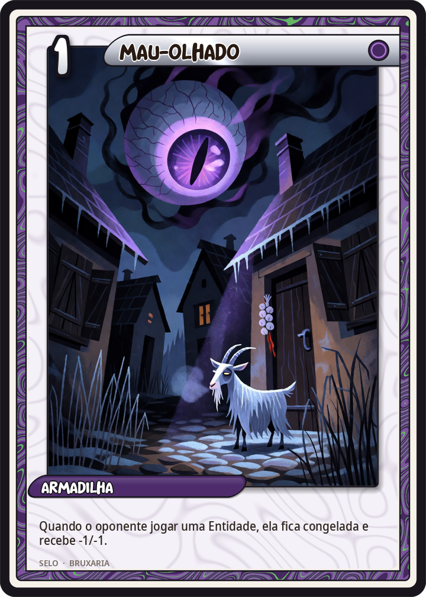
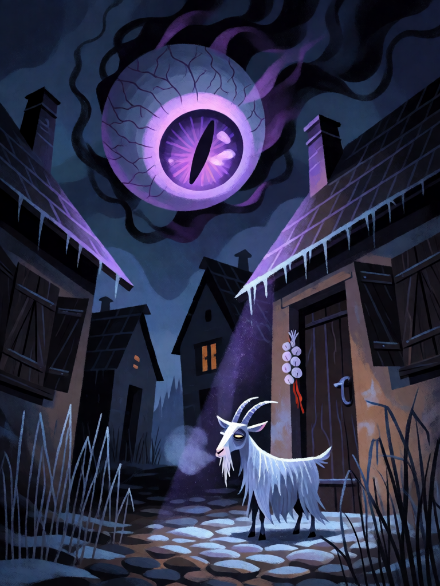

# Mau-Olhado

[← Bruxaria](../bruxaria.md) · [Wiki KodeX](../README.md) · [◀ Hécate, Senhora das Encruzilhadas](bru_hecate.md) · [Círculo de Sal ▶](bru_circulo_de_sal.md)

| Carta | Arte |
|---|---|
|  |  |

| | |
|---|---|
| **Tradição** | Bruxaria |
| **Tipo** | Selo |
| **Custo de Fé** | 1 |
| **Palavras-chave** | — |
| **Lendária** | não |
| **Cópias no deck** | 2 |
| **Id** | `bru_mau_olhado` |

## Texto da carta

> Quando o oponente invocar uma Entidade, ela fica congelada e perde 1 ATK e 1 Vida permanentemente.

**EN — Evil Eye:** *When your opponent summons an Entity, it is frozen and loses 1 ATK and 1 Health permanently.*

## Contexto mitológico

O mau-olhado (*fascinatio*, *malocchio*, *ayin ha-ra*) é a crença mediterrânea e oriental de que um olhar — em especial o olhar da inveja — pode ferir, secar o leite da vaca, murchar a criança, quebrar a sorte. Plutarco dedica-lhe um debate inteiro (*Quaestiones Convivales* V.7), tentando explicar como partículas saídas dos olhos atingem a vítima; Plínio (*História Natural* VII.16–18) fala de famílias africanas que matavam com o olhar e com o elogio. É um poder tão difundido que raramente é "bruxaria" formal: qualquer um pode ter o olho-gordo sem saber.

Os teólogos da caça às bruxas, porém, o absorveram: o *Malleus Maleficarum* (I, q.2) pergunta se as bruxas podem fascinar com os olhos e responde que o demônio age por meio delas; o olhar fixo da acusada no tribunal era prova. Contra o mau-olhado existe a maior família de amuletos do mundo: o olho azul turco, o *cornicello* napolitano, a mão de figa, a fita vermelha, a cuspida tripla, o alho atrás da porta — e os Selos do deck.

Aqui o Mau-Olhado é o mais barato dos malefícios armados: o oponente põe sua Entidade na mesa cheio de esperança e ela já chega torta, menor, incapaz de atacar na próxima volta.

## Papel no jogo

Selo de abertura por 1 Fé que pune a invocação seguinte: tokens 1/1 morrem na hora; uma 3/3 vira 2/2 congelada, e o freeze compra um turno inteiro contra Ímpeto. Duas cópias porque é o malefício que define o deck. Combina com Circe (porco 1/1 + Mau-Olhado = morto) e com Hécate (depois do −2/−2 em área, pouco sobra). O oponente pode "testar" com uma Entidade barata — aceitável: ele gastou o turno dele.

## Atributos visuais

olho gigante flutuando no céu · íris roxa e pupila em fenda · tentáculos de sombra · cabrita branca congelada · porta com alho e fita vermelha

Balanço (conta de custo)

Orçamento P = 2·1+1 + 1 (Selo) = 4 pts. Gasto: freeze na Entidade invocada (1,5, tabela §10) + −1/−1 permanente (1+1 = 2) = 3,5. Dentro (0,5 de folga).

Ficha completa: `cartas/bruxaria/13_mau_olhado.md` · cartas base da versão Alpha
