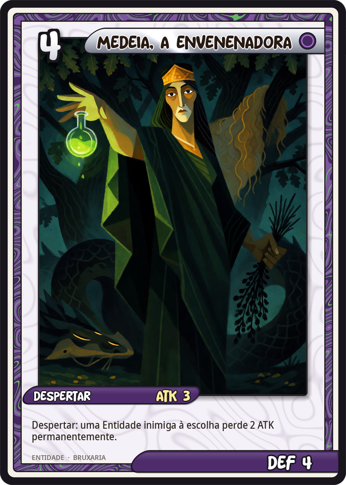
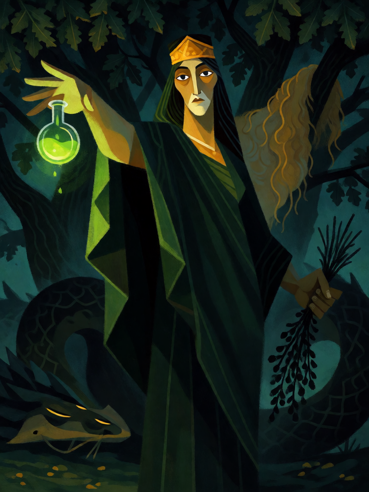

# Medeia, a Envenenadora

[← Bruxaria](../bruxaria.md) · [Wiki KodeX](../README.md) · [◀ Circe](bru_circe.md) · [A Bruxa de Endor ▶](bru_bruxa_de_endor.md)

| Carta | Arte |
|---|---|
|  |  |

| | |
|---|---|
| **Tradição** | Bruxaria |
| **Tipo** | Entidade |
| **Custo de Fé** | 4 |
| **ATK / DEF** | 3 / 4 |
| **Palavras-chave** | — |
| **Lendária** | não |
| **Cópias no deck** | 1 |
| **Id** | `bru_medeia` |

## Texto da carta

> Despertar: uma Entidade inimiga à escolha perde 2 ATK permanentemente.

**EN — Medea, the Poisoner:** *Awaken: An enemy Entity of your choice loses 2 ATK permanently.*

## Contexto mitológico

Medeia, princesa da Cólquida, é neta de Hélio, sobrinha de Circe e sacerdotisa de Hécate. Em Apolônio de Rodes (*Argonáuticas* III) ela se apaixona por Jasão e lhe dá o unguento de Prometeu, que o torna invulnerável ao fogo dos touros de bronze; no livro IV é ela quem adormece com cantos e drogas o dragão guardião do Velo de Ouro e quem arma a emboscada em que Jasão mata seu irmão Apsirto. Em Apolodoro (*Biblioteca* I.9.24) e Ovídio (*Tristia* III.9) a versão é mais crua: Medeia mesma esquarteja o irmão e espalha os pedaços para atrasar a perseguição do pai. É a feiticeira que trai a casa pelo estrangeiro — e será traída por ele.

Ovídio (*Metamorfoses* VII) dá o auge de seu poder: para rejuvenescer Éson, pai de Jasão, Medeia ferve num caldeirão de bronze raízes colhidas sob a lua, pedras do Oriente, areia do Oceano, geada, asas de coruja, entranhas de lobo, pele de cobra, fígado de cervo e cabeça de corvo de nove gerações; corta a garganta do velho, drena-lhe o sangue e o enche com a poção, e ele acorda jovem. Depois convence as filhas de Pélias a fazerem o mesmo com o pai — e deixa o caldeirão sem o remédio. Em Eurípides (*Medeia*, 431 a.C.), abandonada por Jasão em Corinto, ela manda à nova noiva Glauce um vestido e um diadema untados de veneno que a queimam viva junto com o rei Creonte, mata os próprios filhos e foge no carro de serpentes de Hélio.

Na carta Medeia é a envenenadora: o inimigo que ela toca não morre de imediato, mas perde a força do braço — como o vestido que consome Glauce ou o unguento que Jasão não devia ter recebido.

## Papel no jogo

Corpo sólido de 3/4 com um debuff permanente que transforma um atacante médio (3 ATK) em um corpo inofensivo, ou tira o perigo de um grande. Diferente de Circe, deixa a Vida intacta: boa contra Entidades de ATK alto e Vida baixa. Combina com Benandante (congela, depois enfraquece) e com o Boneco de Cera (um atacante fraco ainda devolve dano). Fraca contra campos de muitos tokens e Entidades que valem pelo efeito.

## Atributos visuais

mulher da Cólquida (georgiana) alta · túnica verde-escura e diadema de ouro · frasco de veneno verde na mão direita · ervas escuras na mão esquerda · dragão-serpente adormecido

Balanço (conta de custo)

Orçamento P = 2·4+1 = 9 pts. Gasto: ATK 3 + Vida 4 + Despertar: −2 ATK permanente a inimigo escolhido (2 pts) = 9. Dentro.

Ficha completa: `cartas/bruxaria/07_medeia.md` · cartas base da versão Alpha
