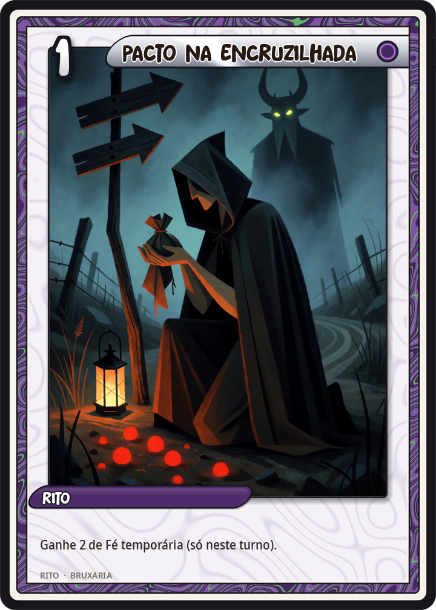
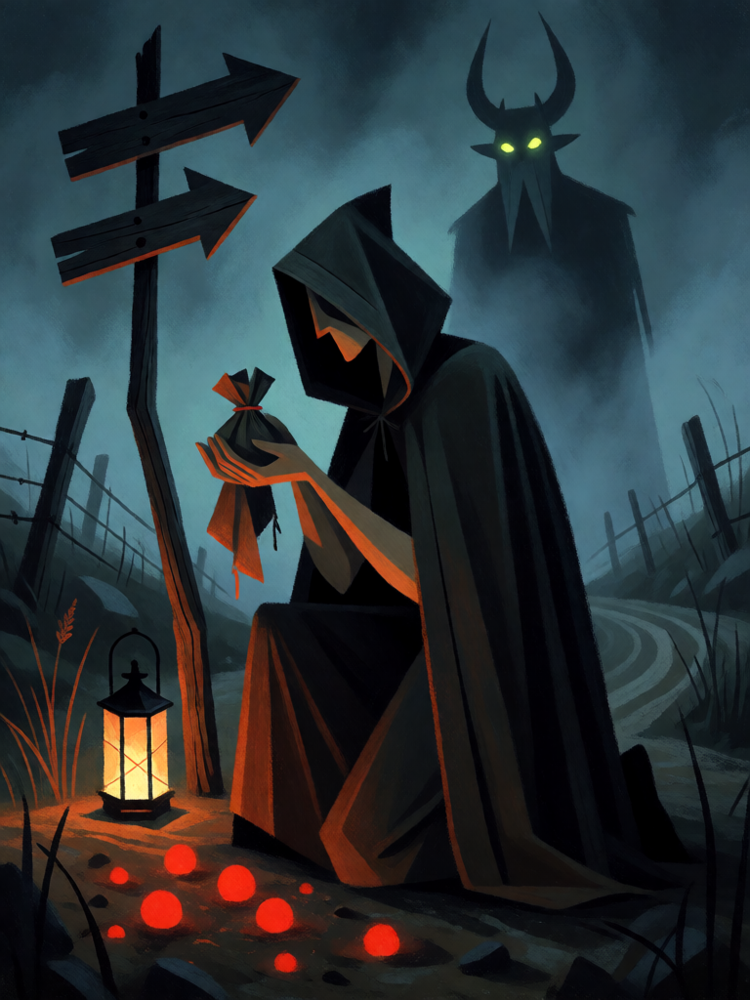

# Pacto na Encruzilhada

[← Bruxaria](../bruxaria.md) · [Wiki KodeX](../README.md) · [◀ Poção de Beladona](bru_pocao_de_beladona.md) · [Seiðr ▶](bru_seidr.md)

| Carta | Arte |
|---|---|
|  |  |

| | |
|---|---|
| **Tradição** | Bruxaria |
| **Tipo** | Rito |
| **Custo de Fé** | 1 |
| **Palavras-chave** | — |
| **Lendária** | não |
| **Cópias no deck** | 1 |
| **Id** | `bru_pacto_na_encruzilhada` |

## Texto da carta

> Ganhe 2 de Fé temporária (só neste turno).

**EN — Crossroads Pact:** *Gain 2 temporary Faith (this turn only).*

## Contexto mitológico

O pacto é o coração da bruxaria tal como os teólogos a definiram: não o feitiço, mas o acordo. A lenda mais antiga é a de Teófilo de Adana (séc. VI, grego; latim no séc. IX), ecônomo que vende a alma por escrito a um demônio para recuperar um cargo e é salvo pela Virgem, que rouba o contrato do inferno — fonte de todos os "Faustos". A *Historia von D. Johann Fausten* (Frankfurt, 1587) fixa o modelo moderno: o sábio assina com sangue, recebe vinte e quatro anos de poder e paga no fim. Em Loudun (1634) o pacto de Urbain Grandier com Lúcifer, Belzebu e Leviatã, "assinado" por eles em latim invertido, foi apresentado em juízo e sobrevive na Biblioteca Nacional da França.

O *Malleus Maleficarum* (II.1.2) descreve o pacto da bruxa: feito em assembleia, com renúncia explícita à fé e ao batismo, ou em segredo, e selado com a marca do demônio no corpo — a que os *witch-prickers* escoceses procuravam com agulhas. A **encruzilhada** é o lugar natural do pacto porque é o lugar de Hécate e dos mortos sem repouso; no folclore europeu é onde se enterram os suicidas, onde o violinista aprende a tocar à meia-noite e onde se faz a oferenda que compra uma habilidade.

No jogo, o pacto propriamente dito é o **Sacrifício** das Entidades grandes. Este Rito é a versão barata: a oferenda deixada na encruzilhada que devolve mais do que custou — por uma única noite.

## Papel no jogo

Aceleração: paga-se 1 e recebe-se 2 no mesmo turno, saldo +1 Fé temporária. Isso adianta Baba Yaga (turno 4), a Morrigan (turno 5) ou Hécate (turno 6), ou permite jogar Malefício + Vassoura no turno 3 (3 − 1 + 2 = 4 Fé). Carta de uma cópia porque é "ar" quando não há no que gastar. Buscada indiretamente via Cerridwen e Livro das Sombras.

## Atributos visuais

bruxa de capuz ajoelhada na encruzilhada · rosto na sombra · trouxinha oferecida com as duas mãos · gotas de sangue brilhando na terra · silhueta de demônio com chifres na névoa

Balanço (conta de custo)

Orçamento P = 2·1+1 = 3 pts. Gasto: +2 Fé temporária (2 × 1,5 = 3) = 3. Dentro.

Ficha completa: `cartas/bruxaria/18_pacto_na_encruzilhada.md` · cartas base da versão Alpha
