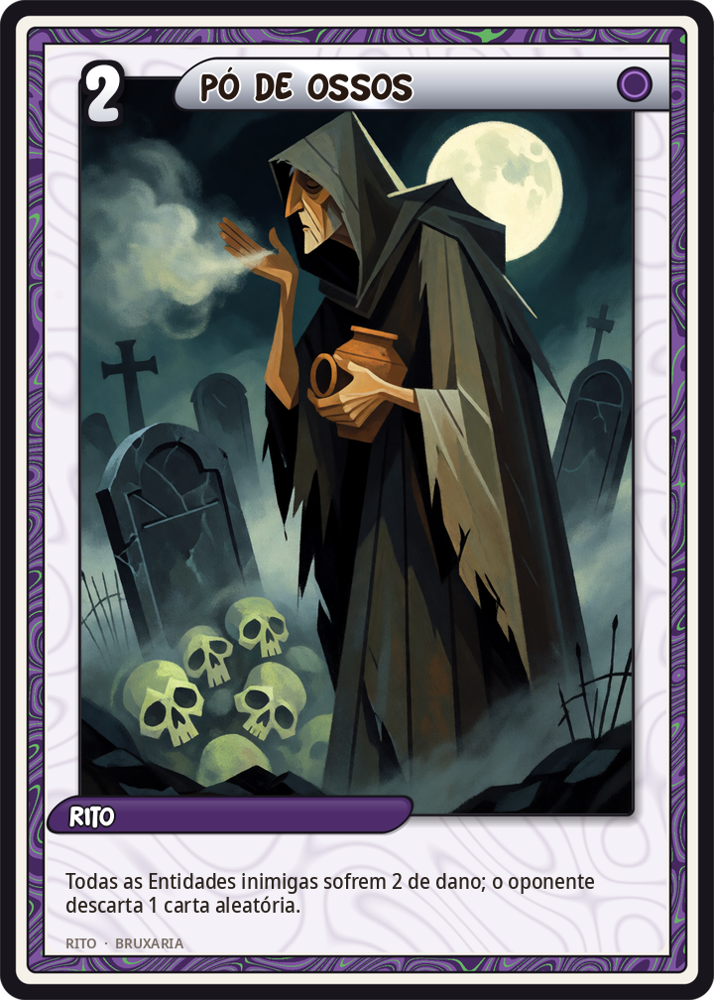
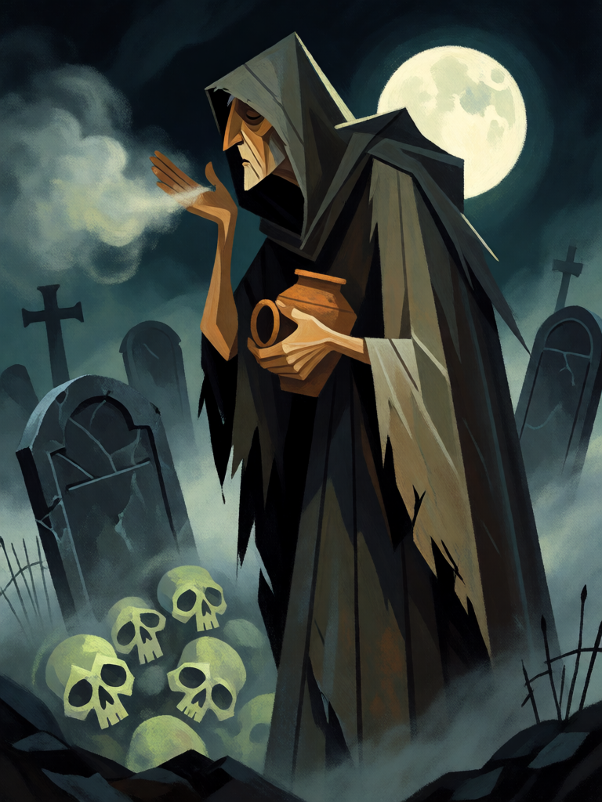

# Pó de Ossos

[← Bruxaria](../bruxaria.md) · [Wiki KodeX](../README.md) · [◀ Seiðr](bru_seidr.md) · [Malefício ▶](bru_maleficio.md)

| Carta | Arte |
|---|---|
|  |  |

| | |
|---|---|
| **Tradição** | Bruxaria |
| **Tipo** | Rito |
| **Custo de Fé** | 2 |
| **Palavras-chave** | — |
| **Lendária** | não |
| **Cópias no deck** | 1 |
| **Id** | `bru_po_de_ossos` |

## Texto da carta

> Todas as Entidades inimigas sofrem 2 de dano; o oponente descarta 1 carta aleatória.

**EN — Bone Dust:** *All enemy Entities take 2 damage; your opponent discards 1 random card.*

## Contexto mitológico

Osso moído, cinza de pira e terra de sepultura são os ingredientes da necromancia clássica. Erictho, a bruxa tessália de Lucano (*Farsália* VI.533–569), recolhe nos campos de batalha e nas piras funerárias "as cinzas que ainda fumegam e os ossos que ainda ardem dos jovens", arranca com os dentes os pregos e as cordas dos enforcados, e com isso prepara o caldo que fará um soldado morto falar. Medeia, no caldeirão de Ovídio (*Metamorfoses* VII.264–274), junta ossos, asas de coruja e a cabeça de um corvo de nove gerações. As *defixiones* gregas e romanas eram depositadas em túmulos para que os mortos as levassem aos deuses de baixo.

Na magia popular europeia a terra de cemitério vira pó de maldição e de proteção ao mesmo tempo — polvilhado na soleira do inimigo ou carregado num saquinho contra ele — e segue, pelo Atlântico, no *goofer dust* do hoodoo norte-americano, que é já outra tradição. O **Samhain** irlandês, noite em que os *síd* se abrem e os mortos circulam entre os vivos (*Tochmarc Emire*), é a data natural para este tipo de trabalho; a Wicca o guarda como o sabá dos mortos e da Anciã.

Na carta o pó é soprado sobre o campo inimigo: tudo o que estiver vivo ali sente o frio da sepultura, e algo da mão do oponente se vai com o vento.

## Papel no jogo

A única limpeza de área do deck antes de Hécate: mata tokens e Entidades de 2 de Vida, encolhe o resto para o alcance dos familiares, e ainda tira uma carta da mão inimiga. Com a Morrigan em campo, cada inimigo que morre vira um Corvo — a jogada que enche a mesa. Depois de Mau-Olhado (−1/−1), mata Entidades de 3 de Vida. Uma cópia porque a identidade do deck é maldição seletiva, não dano em massa.

## Atributos visuais

bruxa idosa de capuz com o rosto na sombra · mão ossuda junto aos lábios · soprando nuvem de pó de osso cinza · pequenos crânios na poeira · cemitério à noite

Balanço (conta de custo)

Orçamento P = 2·2+1 = 5 pts. Gasto: 2 de dano a todas as Entidades inimigas (2 × 1,5 = 3) + oponente descarta 1 aleatória (2) = 5. Dentro.

Ficha completa: `cartas/bruxaria/20_po_de_ossos.md` · cartas base da versão Alpha
