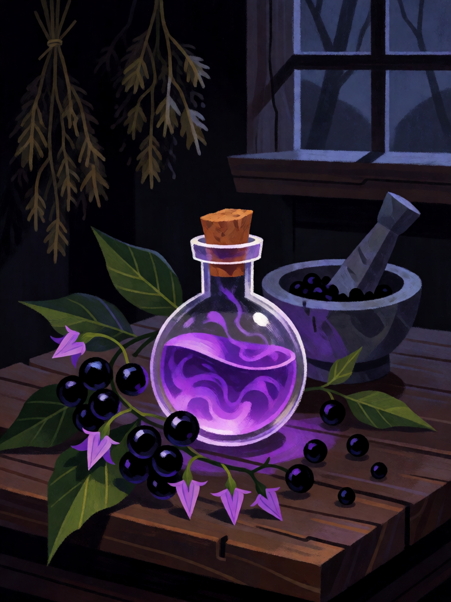

# Poção de Beladona

[← Bruxaria](../bruxaria.md) · [Wiki KodeX](../README.md) · [◀ Boneco de Cera](bru_boneco_de_cera.md) · [Pacto na Encruzilhada ▶](bru_pacto_na_encruzilhada.md)

| Carta | Arte |
|---|---|
|  |  |

| | |
|---|---|
| **Tradição** | Bruxaria |
| **Tipo** | Rito |
| **Custo de Fé** | 1 |
| **Palavras-chave** | — |
| **Lendária** | não |
| **Cópias no deck** | 2 |
| **Id** | `bru_pocao_de_beladona` |

## Texto da carta

> Uma Entidade aliada à escolha cura 2 de Vida e ganha +1 ATK e +1 Vida permanentemente.

**EN — Belladonna Potion:** *An allied Entity of your choice heals 2 Health and gains +1 ATK and +1 Health permanently.*

## Contexto mitológico

*Atropa belladonna*: o gênero leva o nome de Átropos, a Moira que corta o fio da vida, e a espécie o das damas venezianas que pingavam seu suco nos olhos para dilatar as pupilas e parecer mais belas. Toda a planta é carregada de atropina, hiosciamina e escopolamina (hioscina) — os alcaloides tropânicos que, em dose pequena, aceleram o coração, secam a boca e provocam visões; em dose maior, matam. É a erva da bruxa por definição: remédio e veneno na mesma raiz.

A beladona é ingrediente constante das receitas de **unguento de voo** que os eruditos do séc. XVI copiaram uns dos outros: Giambattista della Porta (*Magia Naturalis*, 1558, II.26) lista gordura de criança, acônito, solano (a família da beladona), pentafilo, sangue de morcego e fuligem; Girolamo Cardano (*De subtilitate*, 1550) acrescenta meimendro e papoula; Johann Weyer (*De praestigiis daemonum*, 1563) e Reginald Scot (*Discoverie of Witchcraft*, 1584, X.8) repetem as receitas, para argumentar que as bruxas não voavam — sonhavam que voavam, drogadas. A farmacologia moderna concorda: o unguento aplicado nas mucosas produz sensação de voo, de metamorfose em animal, de encontro com outros. Ginzburg (*História Noturna*, parte III) toma isso como um dos canais do êxtase que os benandanti e os cortejos de Diana descrevem.

Na carta a poção é usada como as curandeiras de aldeia a usavam (Owen Davies, *Popular Magic*, 2003): em dose medida, para fechar a ferida e dar força ao corpo.

## Papel no jogo

A poção barata e repetível do deck: por 1 Fé, cura um familiar ferido e o deixa permanentemente maior. Transforma um Sapo 0/1 em 1/2, uma Strix em 2/2, e faz a Morrigan ou Hécate sobreviverem a mais um turno de troca. Duas cópias para que o deck tenha sempre um "esbat" na mão. A cura vale pouco em Entidades intactas — aí vale só o +1/+1 (ainda dentro do custo). As duas ações devem resolver na **mesma** Entidade escolhida (uma escolha só).

## Atributos visuais

frasco de vidro pequeno com líquido roxo brilhante · rolha de cortiça · ramo de beladona com bagas pretas brilhantes e flores roxas em sino · almofariz com bagas amassadas

Balanço (conta de custo)

Orçamento P = 2·1+1 = 3 pts. Gasto: curar 2 de Vida (1) + +1 ATK / +1 Vida permanentes (1+1 = 2) = 3. Dentro.

Ficha completa: `cartas/bruxaria/17_pocao_de_beladona.md` · cartas base da versão Alpha
