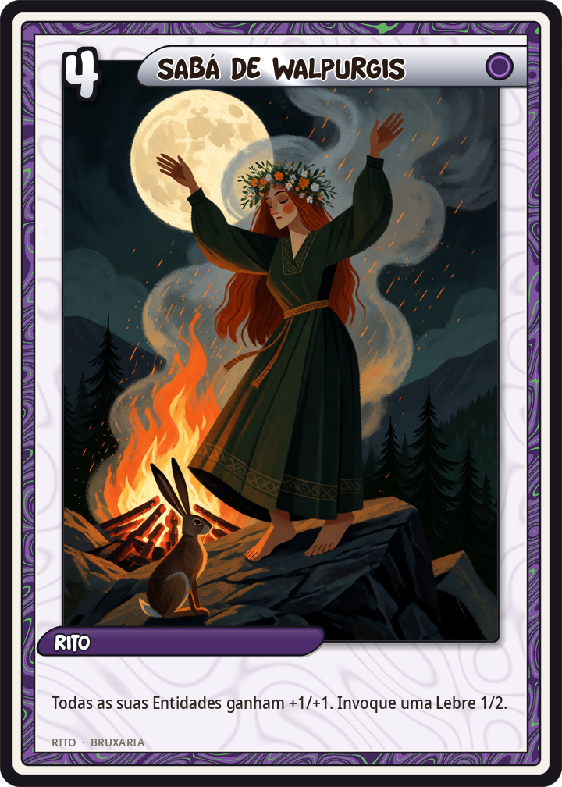
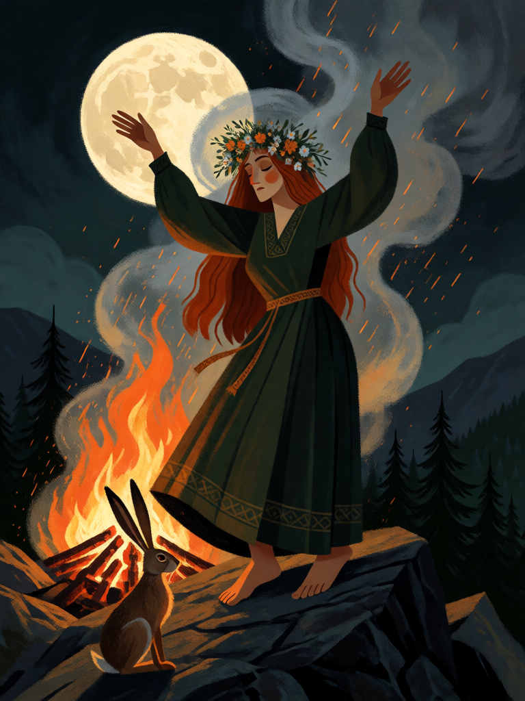

# Sabá de Walpurgis

[← Bruxaria](../bruxaria.md) · [Wiki KodeX](../README.md) · [◀ Malefício](bru_maleficio.md) · [Vassoura ▶](bru_vassoura.md)

| Carta | Arte |
|---|---|
|  |  |

| | |
|---|---|
| **Tradição** | Bruxaria |
| **Tipo** | Rito |
| **Custo de Fé** | 4 |
| **Palavras-chave** | — |
| **Lendária** | não |
| **Cópias no deck** | 1 |
| **Id** | `bru_saba_de_walpurgis` |

## Texto da carta

> Todas as Entidades aliadas ganham +1 ATK e +1 Vida permanentemente. Invoque uma Lebre 1/2.

**EN — Walpurgis Sabbath:** *All allied Entities gain +1 ATK and +1 Health permanently. Summon a 1/2 Hare.*

## Contexto mitológico

O **sabá** — a assembleia noturna em que as bruxas chegam voando, dançam de costas, banqueteiam-se, beijam o bode e recebem ordens do Diabo — é, como Carlo Ginzburg demonstra em *História Noturna* (1989), uma construção dos juízes e inquisidores dos Alpes ocidentais a partir de 1430 (*Formicarius* de Johannes Nider, *Errores Gazariorum*), que fundiu a velha acusação de reunião secreta feita a judeus, leprosos e hereges com um material folclórico real: os cortejos noturnos da "senhora do jogo" (Diana, Holda, Perchta, Richella, Oriente), as batalhas em espírito dos benandanti, as viagens em êxtase das *völur*. Por baixo da caricatura havia experiência — e é a experiência, não a caricatura, que a bruxaria moderna reivindica.

A **Noite de Walpurgis** (30 de abril para 1º de maio) é a data alemã do sabá: as bruxas se reúnem no Brocken, pico do Harz, segundo Johannes Praetorius (*Blockes-Berges Verrichtung*, 1668), e Goethe a levou para o *Fausto*. Coincide com o Beltane céltico e com a véspera de Santa Walburga, cujo nome a noite roubou. Na Roda do Ano da Wicca (Gardner e Ross Nichols, c. 1958) é um dos oito sabás, festa do fogo e da fertilidade; o **Rei Cornífero** (Cernunnos, por via de Margaret Murray) é o deus que o coven invoca junto à Deusa.

A **Lebre** que surge no fim é a bruxa escocesa Isobel Gowdie (1662), que confessou a fórmula para virar lebre e correr com o coven: "I shall go into a hare…". No sabá da carta todo o enxame da bruxa cresce — e mais uma chega correndo.

## Papel no jogo

O único buff coletivo do deck e seu fecho natural: com três ou quatro familiares em campo (Gato, Strix, Corvos da Morrigan, Sapo), +1/+1 em cada um transforma um enxame de 1/1 em uma força real, e a Lebre é mais um corpo. Jogar depois de Hécate (inimigos −2/−2) e antes do ataque geral costuma decidir a partida. Com o campo vazio é só uma Lebre 1/2 por 4 Fé — paciência e timing. Com Strega no turno 3 (2/3 + Strix), o Sabá do turno 4 deixa 3/4 + 2/2 + Lebre 1/2: o combo de curva do deck.

## Atributos visuais

grande fogueira no cume do Brocken · bruxa dançando de braços erguidos · lebre marrom de orelhas em pé no primeiro plano · faíscas e fumaça · lua cheia

Balanço (conta de custo)

Orçamento P = 2·4+1 = 9 pts. Gasto: +1/+1 permanente a todas as aliadas (2 × 3 = 6, tabela §10) + token Lebre 1/2 (3) = 9. Dentro. (A custo 3 somava 8 > 7 pela tabela oficial — subiu para 4.)
Rodada 2 de balanceamento (pacote CB3 do Analista): Lebre 1/1 → 1/2 (+0,3 pp medido); o Rito sobe para P.

Ficha completa: `cartas/bruxaria/22_saba_de_walpurgis.md` · cartas base da versão Alpha
