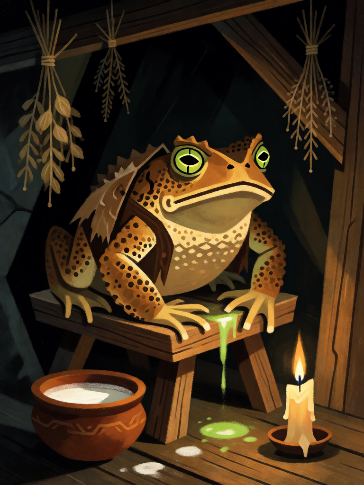

# Sapo Familiar

[← Bruxaria](../bruxaria.md) · [Wiki KodeX](../README.md) · [Gato Preto ▶](bru_gato_preto.md)

| Carta | Arte |
|---|---|
|  |  |

| | |
|---|---|
| **Tradição** | Bruxaria |
| **Tipo** | Entidade |
| **Custo de Fé** | 1 |
| **ATK / DEF** | 0 / 1 |
| **Palavras-chave** | — |
| **Lendária** | não |
| **Cópias no deck** | 1 |
| **Id** | `bru_sapo_familiar` |

## Texto da carta

> Último Sopro: uma Entidade inimiga à escolha perde 1 ATK e 1 Vida permanentemente.

**EN — Toad Familiar:** *Last Breath: An enemy Entity of your choice loses 1 ATK and 1 Health permanently.*

## Contexto mitológico

Nos processos de Zugarramurdi (Navarra, 1609–1610) os acusados descreviam sapos vestidos com roupinhas de pano, guardados em casa e alimentados pelas bruxas, que os levavam ao *akelarre* e deles extraíam venenos. A imagem é tão recorrente nas confissões que o inquisidor Alonso de Salazar y Frías, ao reexaminar os casos, usou a falta de qualquer sapo apreendido como um dos argumentos de que tudo era fabricado sob pressão (Henningsen, *The Witches' Advocate*, 1980).

Na Inglaterra o sapo também é familiar: nos julgamentos de Essex e Lancashire aparece ao lado do gato e da doninha, e o *Malleus Maleficarum* (parte II, questão 1) o conta entre os ingredientes dos venenos e unguentos que atribui às bruxas. Há um fundo real: a pele de muitos sapos e rãs produz bufotoxinas, e o animal era mesmo usado em preparos de veneno e de "remédio".

Na carta, o Sapo é a menor peça do deck — não ataca, só existe para ser gasto. Quando morre (ou é sacrificado para o pacto), seu veneno respinga numa Entidade inimiga: o familiar barato que paga o custo de Baba Yaga e Hécate e ainda deixa uma maldição ao partir.

## Papel no jogo

É a moeda de Sacrifício ideal: custa 1, enche um slot cedo (impedindo dano direto à Cornucópia) e, ao ser sacrificado para Baba Yaga ou Hécate, dispara o Último Sopro, encolhendo o inimigo em −1/−1 permanente — que mata um token 1/1 ou enfraquece um atacante. Também é bom alvo da Vassoura (vira 1/2 com Ímpeto) ou da Poção de Beladona quando se precisa de corpo. Ruim contra decks que ignoram Entidades pequenas e removem em área.

## Atributos visuais

sapo grande marrom verrugoso · coletinho de pano esfarrapado · olhos verdes brilhantes · veneno verde pingando · banquinho de madeira

Balanço (conta de custo)

Orçamento P = 2·1+1 = 3 pts. Gasto: ATK 0 + Vida 1 + Último Sopro −1/−1 permanente a inimigo escolhido (1+1 = 2 pts; `on_death` dispara uma vez, valor cheio) = 3. Dentro.

Ficha completa: `cartas/bruxaria/01_sapo_familiar.md` · cartas base da versão Alpha
